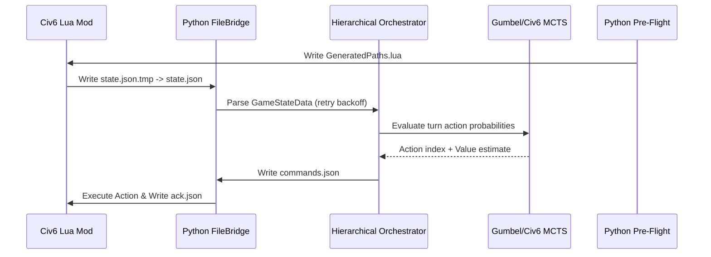

# Subagent Architecture & Agent Harness Specification

## Overview

The `Civ6-AlphaZero` framework implements a hierarchical multi-agent architecture to orchestrate gameplay and training between Civilization VI and deep reinforcement learning networks.

---

## Hierarchical Subagent Architecture

The agent orchestrator (`alpha_zero.orchestrator`) divides strategic decision making into three distinct temporal layers:

1. **Strategic Subagent (Long-Term Planning)**:
   - **Scope**: Re-evaluates macro victory conditions, empire wide tech/civic trees, and long-term expansion goals every $N$ turns (default 50).
   - **Outputs**: Strategic alignment vectors and high-level goal targets.

2. **Tactical Subagent (Mid-Term Operations)**:
   - **Scope**: Evaluates city production, army composition, regional defense, and economic optimization every $M$ turns (default 10).
   - **Outputs**: Tactical target priorities and resource allocation directives.

3. **Operational Subagent (Immediate Action Execution)**:
   - **Scope**: Executes micro-level unit movement, combat engagements, and tile interactions turn-by-turn.
   - **Outputs**: Concrete game action indices submitted to `FileBridge` IPC.

---

## Agent Harness & IPC Bridge

- **Pre-Flight Path Generation**: Before bridge startup, `BridgeConfig.generate_lua_path_config()` writes `GeneratedPaths.lua` to the Civ6 Mod directory.
- **Atomic File Swapping**: Lua `AlphaZeroFileIO.Write()` writes payload to `<path>.tmp` before executing atomic `os.rename` to prevent JSON partial reads.
- **Retry Backoff**: Python `poll_state()` handles transient `JSONDecodeError` with short backoff retries.

---

## Workflows & Pre-PR Harness

Available agent workflows:
- `/prepr` (`.agent/workflows/prepr.md`): Pre-PR validation checklist including git status, diff review, ruff linting, pytest unit/security execution, and conventional commit packaging.
- `/gcp` (`.agent/workflows/gcp.md`): GCP Cloud deployment, Vertex AI job management, and log diagnosis.
