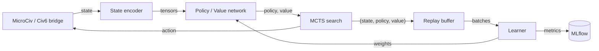

# Civ6 AlphaZero

[](https://github.com/Mango-Metrics-NLM/Civ6-AlphaZero/actions/workflows/ci.yml)
[](https://www.python.org/)
[](LICENSE)


An AlphaZero / MuZero-style reinforcement-learning system for **Civilization VI**.
It learns through self-play, using Monte Carlo Tree Search guided by deep neural
networks, and scales from a simplified training environment (MicroCiv) to the
live game through a headless FireTuner socket bridge.

> **Governance:** scope, non-goals, and invariants live in
> [`PROJECT_CHARTER.md`](PROJECT_CHARTER.md); the roadmap is in
> [`ROADMAP.md`](ROADMAP.md); release history is in [`CHANGELOG.md`](CHANGELOG.md).

## Table of contents

- [Overview](#overview)
- [Key features](#key-features)
- [Architecture](#architecture)
- [Installation](#installation)
- [Usage](#usage)
- [Configuration](#configuration)
- [Testing & quality gates](#testing--quality-gates)
- [Documentation](#documentation)
- [Contributing](#contributing)
- [License](#license)

## Overview

Civilization VI is a 4X strategy game with an astronomical state space
(~10^200 states, ~10^6 actions per turn). This project applies the AlphaZero
recipe — self-play, MCTS, and a policy/value network — to that domain:

- **MicroCiv** is a simplified, fast 4X environment used for Phase 1 training.
- The **neural network** (ResNet / transformer backbone) outputs a policy
  distribution and a value estimate that guide **MCTS** (Gumbel, DUCT, and MuZero
  variants).
- Training data (state, policy, value) accumulates in replay buffers; a learner
  samples batches for gradient updates.
- A **bridge** connects the trained agent to real Civilization VI over a socket,
  so the same policy that trains on MicroCiv can drive the full game.

The project is organized into 27 submodules under `alpha_zero/`; the authoritative
inventory is [`docs/MODULE_REFERENCE.md`](docs/MODULE_REFERENCE.md).

## Key features

- **Self-play training** with a unified orchestrator and configurable presets.
- **MCTS variants**: Gumbel MCTS (default), DUCT for simultaneous actions, and
  MuZero-style learned-model search.
- **N-player support** (2–8 players): Max-N, Paranoid, and Best-Reply search with
  per-player value vectors.
- **MLflow experiment tracking** (`alpha_zero/monitoring/`) — the sole tracker.
- **Optuna hyperparameter search** via `run_sweep.py` and `configs/sweep_muzero.yaml`.
- **Cloud training** on Google Cloud Vertex AI (self-play / trainer / evaluator
  workers, GCS-backed replay buffer, Spot-VM preemption handling).
- **LLM eval gate** for the strategy advisor (`make eval-llm`, `configs/eval/`).
- **Live Civ6 gameplay** over a headless FireTuner socket bridge.

## Architecture



For the full C4 model and component diagrams, see
[`docs/architecture/C4_ARCHITECTURE.md`](docs/architecture/C4_ARCHITECTURE.md).

## Installation

Requires **Python 3.11+**.

```bash
git clone https://github.com/Mango-Metrics-NLM/Civ6-AlphaZero.git
cd Civ6-AlphaZero
python -m venv venv && source venv/bin/activate   # Windows: venv\Scripts\activate
pip install -e '.[dev]'
```

Optional extras (installable individually or together with `.[all]`):

| Extra | Purpose |
|-------|---------|
| `dev` | Test / lint / type tooling (pytest, ruff, mypy) |
| `gcp` | Google Cloud / Vertex AI client libraries |
| `distributed` | Multi-process / multi-node training deps |
| `llm` | LLM provider clients for the strategy advisor |
| `web` | FastAPI + uvicorn for the web interface and serving |
| `monitoring` | MLflow experiment tracking |
| `spacetimedb` | SpacetimeDB integration |
| `tuning` | Optuna hyperparameter search |
| `jax` | JAX backend (optional) |
| `chess` | Chess benchmarking harness |
| `eval` | LLM eval harness (`make eval-llm`) |
| `all` | Everything above |

There are **no** installed console scripts — run everything via `python -m`.

## Usage

### Training orchestrator

```bash
python -m alpha_zero.orchestrator --preset fast --dry_run   # validate config
python -m alpha_zero.orchestrator --preset balanced         # run training
```

Presets (defined in `alpha_zero/orchestrator/config.py`):

| Preset | Iterations | Games/iter | MCTS sims | Batch | Use for |
|--------|-----------:|-----------:|----------:|------:|---------|
| `fast` | 10 | 5 | 10 | 32 | Smoke tests / CI |
| `balanced` | 500 | 50 | 50 | 128 | Standard training |
| `production` | 500000 | 200 | 200 | 512 | Long production runs |

### Other entry points

```bash
python -m alpha_zero.web --preset dev          # Human-vs-AI web interface
python -m alpha_zero.cloud.gcp --help          # Vertex AI job launcher
python -m alpha_zero.training_civ6 --dry_run   # MicroCiv training smoke test
```

### Top-level runners

| Script | Purpose |
|--------|---------|
| `run_sweep.py` | Optuna hyperparameter sweep |
| `run_muzero_training.py` | MuZero training (Gumbel MCTS, learned dynamics) |
| `run_enhanced_training.py` | Training with tuned rewards |
| `run_debug_selfplay.py` | Short self-play session with debug output |
| `run_civ6_ai.py` | Launcher wrapper |
| `inspect_db.py` | Inspect the tournament database |

### Live Civilization VI

```bash
python -m alpha_zero.civ6_local --mode civ6 --dry-run       # validate bridge config
python -m alpha_zero.civ6_local --mode civ6 --mcts          # drive Civ6 with MCTS
python scripts/install_civ6_mod.py                          # install the AlphaZeroAI mod
```

## Configuration

- YAML configs live in `configs/` (orchestrator presets, cloud / Vertex profiles,
  tournament, PBT, sweeps, and the LLM eval gate under `configs/eval/`).
- Environment variables use the `CIV6AZ_` prefix; copy `.env.template` to `.env`
  and fill in provider keys. MLflow is configured via `MLFLOW_*` /
  `CIV6AZ_MLFLOW_*` variables (the legacy tracker fallback is documented in
  `.env.template`).

```bash
mlflow ui --backend-store-uri ./mlruns --port 5000   # inspect training runs
```

## Testing & quality gates

```bash
make test            # unit tests
make test-all        # full suite with coverage
make lint            # ruff
make typecheck       # mypy (advisory)
make validate        # governance validators (openspec, kb, skills)
make eval-llm        # LLM eval gate (offline)
make hooks-install   # install the git pre-commit / pre-push hooks
```

CI enforces a **coverage gate of 85%** on `alpha_zero/` (`--cov-fail-under=85`,
matching `pyproject.toml` `fail_under`). Tests live under `tests/` (`unit/`,
`integration/`, `e2e/`, `cloud/`, `governance/`, and more). Check the current CI
status via the badge above rather than a hardcoded count.

Governance validators keep the docs and harness honest — `check_doc_sync.py`
fails the build on version drift, stale module counts, retired-tooling references,
unknown extras, or broken links.

## Documentation

- [`docs/README.md`](docs/README.md) — documentation index (every doc, with status).
- [`docs/MODULE_REFERENCE.md`](docs/MODULE_REFERENCE.md) — authoritative module inventory.
- [`docs/architecture/C4_ARCHITECTURE.md`](docs/architecture/C4_ARCHITECTURE.md) — architecture.
- [`CLAUDE.md`](CLAUDE.md) — agent constraint spec and command reference.

## Contributing

See `CONTRIBUTING.md` for the development loop, quality gates, and the OpenSpec
change workflow. In short: work on a feature branch (never the default branch),
install the hooks with `make hooks-install`, keep `make validate` and the tests
green, and open a draft PR. Substantive changes are proposed under
`openspec/changes/` first — see [`openspec/AGENTS.md`](openspec/AGENTS.md).

## License

Released under the [MIT License](LICENSE).
