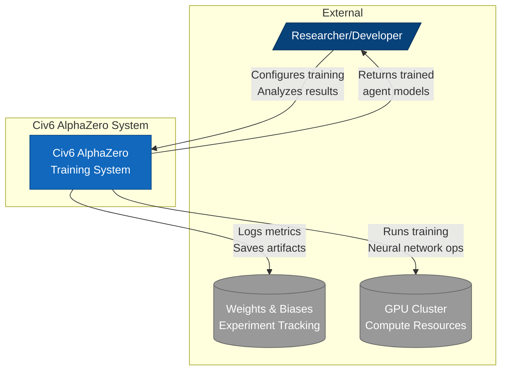
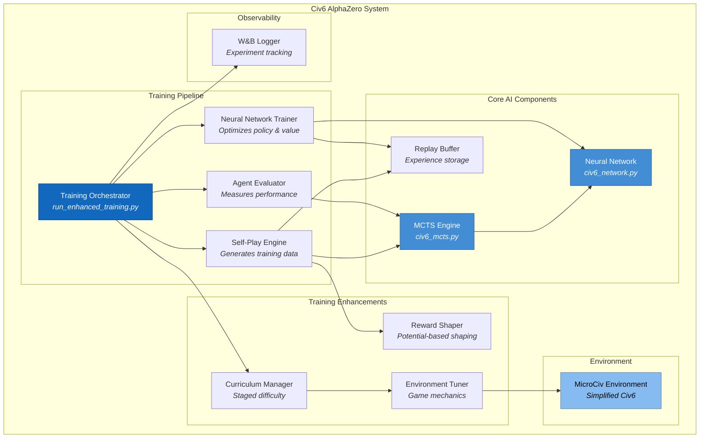
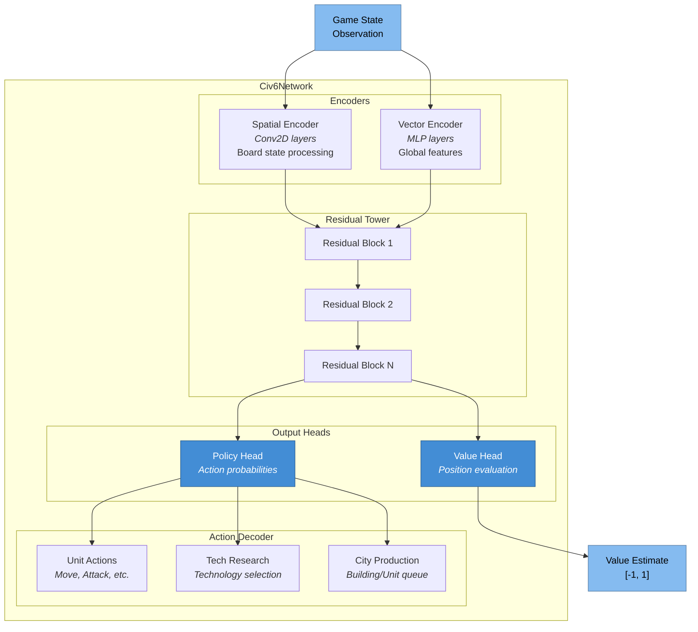
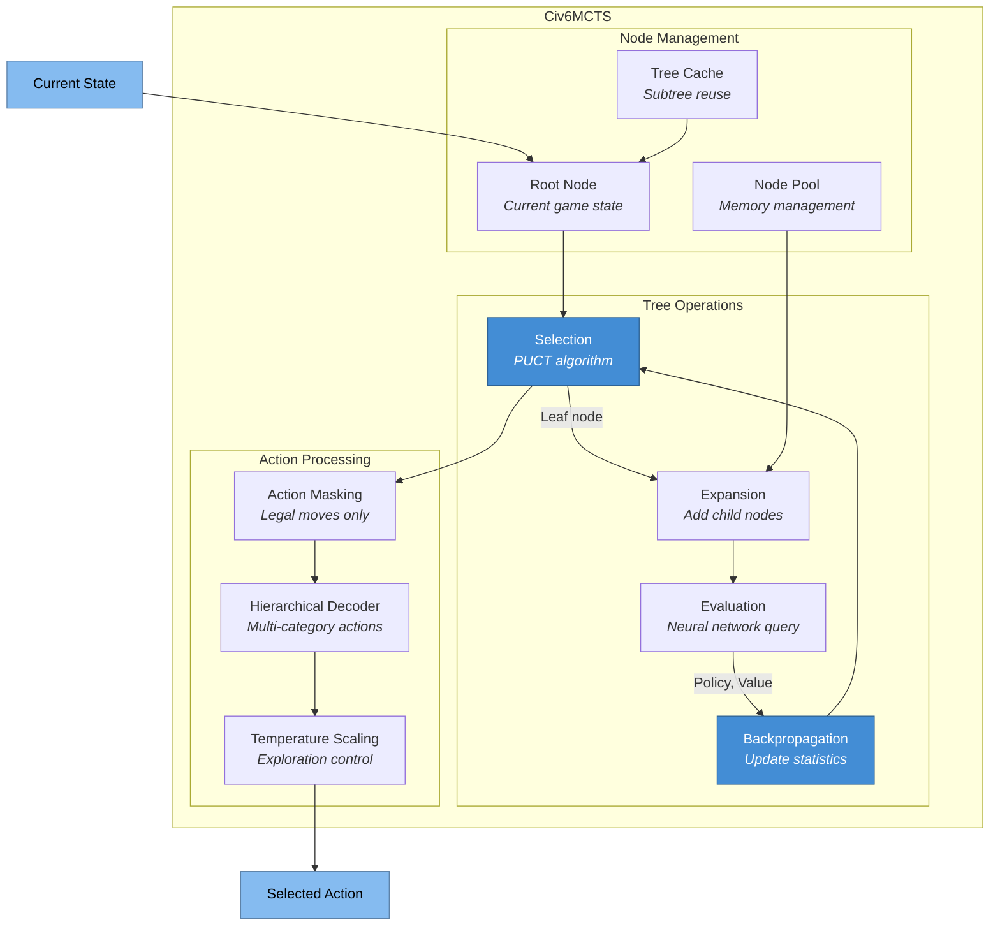
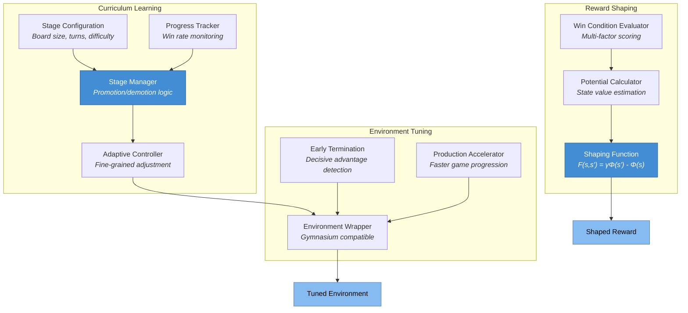
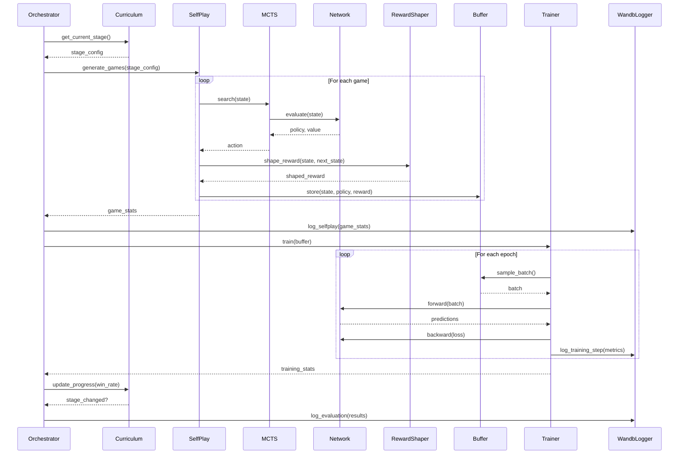

# Civ6 AlphaZero

A high-performance implementation of the AlphaZero algorithm tailored for a simplified Civilization VI environment (MicroCiv). This project leverages Monte Carlo Tree Search (MCTS) combined with deep residual neural networks to master complex strategic decision-making.

[](https://www.python.org/downloads/)
[](https://pytorch.org/)
[](https://opensource.org/licenses/MIT)

## Key Features

- **AlphaZero Core**: Full implementation of the AlphaZero self-play reinforcement learning loop
- **Hierarchical MCTS**: Advanced tree search supporting complex, multi-category action spaces
- **Residual Network**: Dual-headed (Policy & Value) architecture for joint estimation
- **Curriculum Learning**: Multi-stage difficulty progression for accelerated training
- **Reward Shaping**: Potential-based shaping that preserves optimal policy
- **Environment Tuning**: Configurable game mechanics for faster iteration
- **W&B Integration**: Full experiment tracking with Weights & Biases
- **MicroCiv Environment**: Gymnasium-compliant simulation of Civ6 core mechanics
- **RAG Integration**: Retrieval-Augmented Generation for knowledge-enhanced decision making

## Architecture (C4 Model)

### Level 1: System Context Diagram

Shows how external actors interact with the Civ6 AlphaZero system.



### Level 2: Container Diagram

High-level software containers that compose the system.



### Level 3: Component Diagram - Neural Network

Internal structure of the neural network component.



### Level 3: Component Diagram - MCTS Engine

Internal structure of the Monte Carlo Tree Search component.



### Level 3: Component Diagram - Training Enhancements

Internal structure of the Phase 3 training improvements.



### Level 4: Code Diagram - Training Flow

Sequence of operations during a training iteration.



## Installation

### Prerequisites

- Python 3.11 or higher
- CUDA-capable GPU (recommended) or Apple Silicon (MPS)
- 8GB+ RAM

### Quick Start

```bash
# Clone the repository
git clone https://github.com/Mango-Metrics-NLM/Civ6-AlphaZero.git
cd Civ6-AlphaZero

# Create virtual environment (recommended)
python -m venv venv
source venv/bin/activate  # Linux/macOS
# or
.\venv\Scripts\activate  # Windows

# Install dependencies
pip install -r requirements.txt

# Optional: Install W&B for experiment tracking
pip install wandb
wandb login
```

### Development Setup

```bash
# Install with development dependencies
pip install -r requirements.txt
pip install -r requirements-dev.txt  # If available

# Run tests to verify installation
pytest tests/unit -v
```

## Usage

### Unified Training Orchestrator (Recommended)

The new `TrainingOrchestrator` provides a single entry point for all training:

```bash
# Quick training run (development/testing)
python -m alpha_zero.orchestrator --preset fast

# Balanced training (recommended for initial experiments)
python -m alpha_zero.orchestrator --preset balanced

# Production training
python -m alpha_zero.orchestrator --preset production

# Dry run (validate configuration without training)
python -m alpha_zero.orchestrator --preset fast --dry_run

# Resume from checkpoint
python -m alpha_zero.orchestrator --preset balanced --resume

# Custom YAML configuration
python -m alpha_zero.orchestrator --config configs/orchestrator.yaml
```

### Orchestrator Presets

| Preset | Iterations | Games/Iter | Board | Simulations | Use Case |
| ------ | ---------- | ---------- | ----- | ----------- | -------- |
| `fast` | 10 | 5 | 6x6 | 10 | Quick testing |
| `balanced` | 100 | 20 | 8x8 | 50 | Experiments |
| `production` | 1000 | 100 | 16x16 | 200 | Full training |

### Legacy Training Scripts

The previous training entry points are still available:

```bash
# Enhanced training script
python run_enhanced_training.py --preset balanced --device cuda

# With W&B tracking
python run_enhanced_training.py --preset balanced --wandb --wandb-project "civ6-alphazero"
```

### Programmatic Usage

```python
from alpha_zero.orchestrator import TrainingOrchestrator, OrchestratorConfig

# Load configuration from YAML
config = OrchestratorConfig.from_yaml("configs/orchestrator.yaml")

# Or use a preset
config = OrchestratorConfig.from_preset("balanced")

# Create and run orchestrator
orchestrator = TrainingOrchestrator(config)
orchestrator.run()

# Access training state
print(f"Total games: {orchestrator.state.total_games}")
print(f"Best win rate: {orchestrator.state.best_win_rate:.2%}")
```

## Configuration

### Training Presets

| Preset | Iterations | Games/Iter | Board Size | Use Case |
|--------|-----------|------------|------------|----------|
| `fast` | 2 | 2 | 6x6 | Development, debugging |
| `balanced` | 10 | 20 | 8x8 | Initial experiments |
| `full` | 50 | 100 | 10x10 | Production training |

### Curriculum Stages

| Stage | Board Size | Max Turns | Win Rate to Advance |
|-------|-----------|-----------|---------------------|
| Beginner | 6x6 | 30 | 60% |
| Intermediate | 8x8 | 50 | 65% |
| Advanced | 10x10 | 100 | 70% |

### Environment Variables

Create a `.env` file based on `.env.template`:

```bash
# Weights & Biases
WANDB_API_KEY=your_api_key_here
WANDB_PROJECT=civ6-alphazero
WANDB_ENTITY=your_team_name

# Training
CUDA_VISIBLE_DEVICES=0
```

## RAG Integration

The RAG (Retrieval-Augmented Generation) system enables knowledge-enhanced agent decision making by retrieving relevant context from a vector database.

### Installation

```bash
# Install RAG dependencies
pip install -e ".[rag]"

# Or install all dependencies including RAG
pip install -e ".[all]"
```

### Quick Start

```python
import asyncio
from alpha_zero.rag import RAGPipeline, RAGConfig

async def main():
    # Create pipeline with default configuration
    pipeline = await RAGPipeline.create()

    # Ingest strategy documents
    await pipeline.ingest_text(
        "Early game strategy: Focus on expanding territory and building settlers.",
        source="strategy_guide.txt",
        metadata={"category": "early_game"}
    )

    # Query for relevant context
    result = await pipeline.query(
        "How should I play the early game?",
        top_k=5
    )

    print(f"Context: {result.context}")
    print(f"Retrieved {len(result.documents)} documents")

    await pipeline.close()

asyncio.run(main())
```

### Configuration

RAG can be configured via environment variables or YAML:

```bash
# Environment variables
export RAG_VECTOR_STORE_TYPE=chroma
export RAG_EMBEDDING_MODEL_TYPE=openai
export OPENAI_API_KEY=your_key_here
```

```python
from alpha_zero.rag import RAGConfig, VectorStoreType, EmbeddingModelType

config = RAGConfig()
config.vector_store.store_type = VectorStoreType.CHROMA
config.embedding.model_type = EmbeddingModelType.OPENAI

pipeline = await RAGPipeline.create(config)
```

### Agent Workflow Integration

```python
from alpha_zero.rag.agents import RAGAgentWorkflow
from alpha_zero.rag.stores import MemoryVectorStore
from alpha_zero.rag.processors import LocalEmbeddings

# Create workflow
workflow = RAGAgentWorkflow(
    vector_store=MemoryVectorStore(dimension=384),
    embedding_generator=LocalEmbeddings(dimension=384),
)
await workflow.initialize()

# Register hooks for custom processing
async def pre_retrieve_hook(context):
    print(f"Searching for: {context.query}")

workflow.register_hook("pre_retrieve", pre_retrieve_hook)

# Execute workflow
result = await workflow.execute("What is the best opening strategy?")
print(result.context)
```

## Testing

The project maintains comprehensive test coverage:

```bash
# Run all tests
pytest

# Unit tests only
pytest tests/unit -v

# Integration tests only
pytest tests/integration -v

# With coverage report
pytest --cov=alpha_zero --cov-report=html

# Specific test file
pytest tests/unit/test_curriculum_learning.py -v

# Run tests matching pattern
pytest -k "curriculum" -v
```

### Test Categories

- **Unit Tests** (`tests/unit/`): Test individual components in isolation
- **Integration Tests** (`tests/integration/`): Test component interactions
- **Performance Tests**: Benchmark critical paths

## Project Structure

```
Civ6-AlphaZero/
├── alpha_zero/
│   ├── orchestrator/         # Unified training orchestrator (Phase 4)
│   │   ├── __init__.py       # Module exports
│   │   ├── __main__.py       # CLI entry point
│   │   ├── config.py         # OrchestratorConfig
│   │   ├── orchestrator.py   # TrainingOrchestrator
│   │   ├── scheduler.py      # HyperparameterScheduler
│   │   └── checkpointer.py   # CheckpointManager
│   ├── core/                 # Core AlphaZero components
│   │   ├── civ6_network.py   # Neural network architecture
│   │   ├── civ6_mcts.py      # MCTS implementation
│   │   └── civ6_actions.py   # Action space handling
│   ├── distributed/          # Distributed training
│   │   ├── actor.py          # Self-play actors
│   │   ├── learner.py        # Training workers
│   │   └── coordinator.py    # Orchestration
│   ├── envs/                 # Game environments
│   │   ├── microciv.py       # MicroCiv environment
│   │   └── civ6_encoder.py   # State encoding
│   ├── rag/                  # RAG Integration
│   │   ├── config/           # Configuration management
│   │   │   └── settings.py   # RAG configuration classes
│   │   ├── stores/           # Vector store implementations
│   │   │   ├── base.py       # Abstract interfaces
│   │   │   ├── memory_store.py
│   │   │   ├── chroma_store.py
│   │   │   └── faiss_store.py
│   │   ├── processors/       # Document processing
│   │   │   ├── text_processor.py
│   │   │   └── embeddings.py
│   │   ├── agents/           # Agent workflow
│   │   │   ├── workflow.py   # RAG workflow orchestration
│   │   │   ├── context_builder.py
│   │   │   └── query_enhancer.py
│   │   ├── utils/            # RAG utilities
│   │   │   ├── logging.py    # Structured logging
│   │   │   ├── metrics.py    # Performance metrics
│   │   │   └── cache.py      # Caching implementations
│   │   └── pipeline.py       # Main RAG pipeline
│   └── utils/                # Utilities & enhancements
│       ├── factories.py      # Component factory functions
│       ├── curriculum_learning.py
│       ├── enhanced_rewards.py
│       ├── environment_tuning.py
│       ├── training_config_enhanced.py
│       └── wandb_logger.py
├── configs/                  # Configuration files
│   ├── orchestrator.yaml     # Master configuration
│   ├── orchestrator_fast.yaml
│   └── orchestrator_production.yaml
├── tests/
│   ├── unit/                 # Unit tests
│   │   └── test_rag/         # RAG unit tests
│   └── integration/          # Integration tests
│       └── test_rag/         # RAG integration tests
├── scripts/                  # Utility scripts
├── run_enhanced_training.py  # Legacy training entry point
├── requirements.txt          # Dependencies
└── README.md                 # This file
```

## Technologies

| Category | Technologies |
|----------|-------------|
| Core | Python 3.11+ |
| Deep Learning | PyTorch 2.0+ |
| Environment | Gymnasium |
| Experiment Tracking | Weights & Biases |
| RAG / Vector DB | ChromaDB, FAISS, Pinecone |
| Embeddings | OpenAI, Sentence Transformers |
| Testing | Pytest, pytest-asyncio |
| Visualization | Mermaid.js, Matplotlib |
| Code Quality | MyPy, Ruff, Black |

## Contributing

1. Fork the repository
2. Create a feature branch (`git checkout -b feature/amazing-feature`)
3. Make your changes
4. Run tests (`pytest`)
5. Commit your changes (`git commit -m 'Add amazing feature'`)
6. Push to the branch (`git push origin feature/amazing-feature`)
7. Open a Pull Request

## License

This project is licensed under the MIT License - see the [LICENSE](LICENSE) file for details.

## Acknowledgments

- DeepMind's AlphaZero paper for the foundational algorithm
- The PyTorch team for the deep learning framework
- Firaxis Games for the inspiration from Civilization VI
