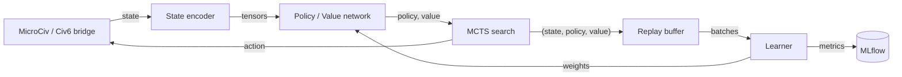

# Civ6 AlphaZero

[](https://github.com/Mango-Metrics-NLM/Civ6-AlphaZero/actions/workflows/ci.yml)
[](https://www.python.org/)
[](LICENSE)


[](https://www.python.org/downloads/)
[](https://pytorch.org/)
[](https://opensource.org/licenses/MIT)
[](https://huggingface.co/Mango-Metrics-NLM/civ6-hexcrystal-encoder)
[](https://huggingface.co/Mango-Metrics-NLM/civ6-alphazero-transformer)
[](https://huggingface.co/Mango-Metrics-NLM/civ6-muzero)
[](https://huggingface.co/spaces/Mango-Metrics-NLM/microciv-explorer)
[](https://huggingface.co/spaces/Mango-Metrics-NLM/elo-dashboard)
[](https://huggingface.co/datasets/Mango-Metrics-NLM/civ6-elo-tournament)

An AlphaZero / MuZero-style reinforcement-learning system for **Civilization VI**.
It learns through self-play, using Monte Carlo Tree Search guided by deep neural
networks, and scales from a simplified training environment (MicroCiv) to the
live game through a headless FireTuner socket bridge.

> **Governance:** scope, non-goals, and invariants live in
> [`PROJECT_CHARTER.md`](PROJECT_CHARTER.md); the roadmap is in
> [`ROADMAP.md`](ROADMAP.md); release history is in [`CHANGELOG.md`](CHANGELOG.md).

## Table of contents

- [Overview](#overview)
- [Key features](#key-features)
- [Hugging Face Hub](#-hugging-face-hub)
- [Architecture](#architecture)
- [Installation](#installation)
- [Usage](#usage)
- [Configuration](#configuration)
- [Testing & quality gates](#testing--quality-gates)
- [Documentation](#documentation)
- [Contributing](#contributing)
- [License](#license)

## Overview

Civilization VI is a 4X strategy game with an astronomical state space
(~10^200 states, ~10^6 actions per turn). This project applies the AlphaZero
recipe — self-play, MCTS, and a policy/value network — to that domain:

- **MicroCiv** is a simplified, fast 4X environment used for Phase 1 training.
- The **neural network** (ResNet / transformer backbone) outputs a policy
  distribution and a value estimate that guide **MCTS** (Gumbel, DUCT, and MuZero
  variants). Every variant backs values up through one shared, sign-correct
  implementation (`alpha_zero/core/mcts/backup.py`): MicroCiv lets a player act
  many times before yielding, so the perspective flips only on edges where the
  acting player changes, not on every ply.
- Training data (state, policy, value) accumulates in replay buffers; a learner
  samples batches for gradient updates.
- A **bridge** connects the trained agent to real Civilization VI over a socket,
  so the same policy that trains on MicroCiv can drive the full game.

The project is organized into 29 submodules under `alpha_zero/`; the authoritative
inventory is [`docs/MODULE_REFERENCE.md`](docs/MODULE_REFERENCE.md).

## Key features

- **Self-play training** with a unified orchestrator and configurable presets.
- **MCTS variants**: Gumbel MCTS (default), PUCT, random-rollout Simple, DUCT for
  simultaneous actions, and MuZero-style learned-model search — one module each
  under `alpha_zero/core/mcts/`, sharing one value backup. Gumbel's policy target
  is the completed-Q distribution of Danihelka et al.; `policy_target` and
  `greedy_threshold` on `GumbelMCTSConfig` / `BatchMCTSConfig` select the
  alternatives (`visit_counts`, `one_hot`).
- **Reproducible runs**: `--seed` reaches every RNG stream, each derived by name
  from `alpha_zero/utils/seeding.py`. Self-play varies with the training
  iteration; evaluation is a fixed held-out set, so scores stay comparable
  across iterations.
- **N-player support** (2–8 players): Max-N, Paranoid, and Best-Reply search with
  per-player value vectors.
- **MLflow experiment tracking** (`alpha_zero/monitoring/`) — the sole tracker.
- **Optuna hyperparameter search** via `run_sweep.py` and `configs/sweep_muzero.yaml`.
- **Cloud training** on Google Cloud Vertex AI — one image
  (`dockerfiles/Dockerfile.vertex`) entrypointed by `alpha_zero.cloud.gcp.entrypoint`,
  which routes `--mode` to the `selfplay`, `training`, `evaluation` and `tournament`
  workers in `alpha_zero/cloud/gcp/`. The orchestrator runs locally and dispatches
  those jobs. GCS-backed replay buffer, Spot-VM preemption handling.
- **LLM eval gate** for the strategy advisor (`make eval-llm`, `configs/eval/`).
- **Live Civ6 gameplay** over a headless FireTuner socket bridge.

## 🤗 Hugging Face Hub

> **Status**: Hub integration complete — Spaces scaffold deployed.
> Model repos activate once training checkpoints are published.

| Resource | Type | Link |
| --- | --- | --- |
| Hex-Crystalline Encoder | Model | [Mango-Metrics-NLM/civ6-hexcrystal-encoder](https://huggingface.co/Mango-Metrics-NLM/civ6-hexcrystal-encoder) |
| Transformer Policy/Value | Model | [Mango-Metrics-NLM/civ6-alphazero-transformer](https://huggingface.co/Mango-Metrics-NLM/civ6-alphazero-transformer) |
| MuZero World Model | Model | [Mango-Metrics-NLM/civ6-muzero](https://huggingface.co/Mango-Metrics-NLM/civ6-muzero) |
| MicroCiv Explorer | Space | [Mango-Metrics-NLM/microciv-explorer](https://huggingface.co/spaces/Mango-Metrics-NLM/microciv-explorer) |
| ELO Dashboard | Space | [Mango-Metrics-NLM/elo-dashboard](https://huggingface.co/spaces/Mango-Metrics-NLM/elo-dashboard) |
| ELO Tournament Dataset | Dataset | [Mango-Metrics-NLM/civ6-elo-tournament](https://huggingface.co/datasets/Mango-Metrics-NLM/civ6-elo-tournament) |

### Publishing

```bash
# Dry-run (default) — stage and review before publishing
python scripts/upload_to_hub.py --model-type encoder

# Publish encoder checkpoint
HF_TOKEN=... python scripts/upload_to_hub.py \
    --model-type encoder \
    --checkpoint-path checkpoints/hex_crystalline.pt \
    --publish

# Export ELO dataset
python scripts/export_dataset.py --type elo --source-path ./results
```

See [`docs/HF_PUBLISHING.md`](docs/HF_PUBLISHING.md) for the full publishing guide.

## Architecture



For the full C4 model and component diagrams, see
[`docs/architecture/C4_ARCHITECTURE.md`](docs/architecture/C4_ARCHITECTURE.md).

## Installation

Requires **Python 3.11+**.

```bash
git clone https://github.com/Mango-Metrics-NLM/Civ6-AlphaZero.git
cd Civ6-AlphaZero
python -m venv venv && source venv/bin/activate   # Windows: venv\Scripts\activate
pip install -e '.[dev]'
```

Optional extras (installable individually or together with `.[all]`):

| Extra | Purpose |
|-------|---------|
| `dev` | Test / lint / type tooling (pytest, ruff, mypy) |
| `gcp` | Google Cloud / Vertex AI client libraries |
| `distributed` | Multi-process / multi-node training deps |
| `llm` | LLM provider clients for the strategy advisor |
| `web` | FastAPI + uvicorn for the web interface and serving |
| `monitoring` | MLflow experiment tracking |
| `spacetimedb` | SpacetimeDB integration |
| `hub` | Hugging Face Hub integration (for encoder publishing) |
| `tuning` | Optuna hyperparameter search |
| `jax` | JAX backend (optional) |
| `chess` | Chess benchmarking harness |
| `eval` | LLM eval harness (`make eval-llm`) |
| `all` | Everything above |

`dev` deliberately does **not** pull `chess`: its sdist fails to build on current
Debian/Ubuntu setuptools, and because a failing extra aborts the whole install,
`pip install -e '.[dev]'` used to install nothing. The chess-benchmark test
modules `pytest.importorskip("chess")`, so the suite collects without it; install
`.[chess]` to run them.

There are **no** installed console scripts — run everything via `python -m`.

## Usage

### Training orchestrator

```bash
python -m alpha_zero.orchestrator --preset fast --dry_run   # validate config
python -m alpha_zero.orchestrator --preset balanced         # run training
```

Presets (defined in `alpha_zero/orchestrator/config.py`):

| Preset | Iterations | Games/iter | MCTS sims | Batch | Use for |
|--------|-----------:|-----------:|----------:|------:|---------|
| `fast` | 10 | 5 | 10 | 32 | Smoke tests / CI |
| `balanced` | 500 | 50 | 50 | 128 | Standard training |
| `production` | 500000 | 200 | 200 | 512 | Long production runs |

### Train a model and play against it

The full loop on CPU. Keep `board_size` identical across all three steps — the
web UI rejects a checkpoint trained at a different board size rather than
failing mid-game.

```bash
pip install -e '.[dev,web]'          # the web extra is required for the UI

python -m alpha_zero.training_civ6 \
    --board_size 8 --max_turns 20 --num_simulations 10 \
    --num_iterations 6 --num_games 10 \
    --num_res_blocks 2 --num_filters 16 \
    --save_interval 1 --device cpu

CIV6AZ_WEB_BOARD_SIZE=8 \
CIV6AZ_WEB_CHECKPOINT=checkpoints/civ6/latest.pt \
    python -m alpha_zero.web
```

Then open the UI, start a game against **Neural Network (Hard)**, and play.

**What to expect, measured on this configuration (CPU, 2-core container).** These
figures were taken **before** the 2026-09-04 search fixes (sign-correct value
backup, completed-Q policy target, per-iteration self-play seeds), so treat them
as a wall-clock guide and re-run rather than quoting the win rates:

| | Observed |
|---|---|
| Total wall clock | 683 s (~11 min) |
| Iteration 1 | ~6 min — it uses random-rollout `SimpleMCTS`, so it dominates the total |
| Iterations 2–6 | ~1 min each |
| Win rate vs random, by iteration | 10% → 5% → 5% → 5% → 0% → 5% |

**A run this short does not produce a model that beats random**, and the numbers
above are not cherry-picked — they are what it does. The point of the quickstart
is to exercise the whole loop end to end, not to produce a strong agent. Treat
it as a smoke test with a real artifact at the end; scale
`--num_iterations`/`--num_games` up substantially before drawing any conclusion
about strength, and compare against a random-initialised control rather than
against the random agent alone (a random network under MCTS also beats a random
agent, so "beats random" on its own proves nothing).

`--max_turns` matters: MicroCiv only advances its turn counter when the player
index wraps, so at the default 200 a single game needs 400+ end-turn actions
plus every unit ply. `--save_interval` matters too — at its default of 10, a
6-iteration run never reaches the evaluation block and reports no win rate.

### Other entry points

```bash
python -m alpha_zero.web --preset dev                        # Human-vs-AI web interface
python -m alpha_zero.cloud.gcp.vertex_orchestrator --help    # Vertex AI job launcher
python -m alpha_zero.training_civ6 --dry_run                 # MicroCiv training smoke test
make local-smoke                                             # deployed self-play worker, dry run
```

`make local-smoke` is the deployed worker's own dry run — the worker requires
`--worker_id`, `--model_version` and `--iteration`, so `--dry_run` on its own
exits with an argparse error:

```bash
CIV6_STORAGE_BACKEND=local CIV6_STORAGE_BASE_PATH=./test_storage \
    python -m alpha_zero.cloud.gcp.selfplay_worker \
    --worker_id 0 --model_version 0 --iteration 0 --games 1 --dry_run
```

Inside the container, `alpha_zero.cloud.gcp.entrypoint` routes `--mode` to one of
`selfplay`, `training`, `evaluation` or `tournament`; `--mode=orchestrator` is
deliberately refused there, because the orchestrator runs locally and dispatches
those jobs.

### Top-level runners

| Script | Purpose |
|--------|---------|
| `run_sweep.py` | Optuna hyperparameter sweep |
| `run_muzero_training.py` | MuZero training (Gumbel MCTS, learned dynamics) |
| `run_enhanced_training.py` | Training with tuned rewards |
| `run_civ6_ai.py` | Launcher wrapper |
| `scripts/inspect_db.py` | Inspect the tournament database |
| `scripts/run_encoder_ab.py` | Local, device-agnostic A/B comparison of spatial encoders |
| `scripts/upload_encoder_to_hub.py` | Publish the hex-crystalline encoder to Hugging Face Hub |

### Live Civilization VI

```bash
python -m alpha_zero.civ6_local --mode civ6 --dry-run       # validate bridge config
python -m alpha_zero.civ6_local --mode civ6 --mcts          # drive Civ6 with MCTS
python scripts/install_civ6_mod.py                          # install the AlphaZeroAI mod
```

## Configuration

- YAML configs live in `configs/` (orchestrator presets, cloud / Vertex profiles,
  tournament, PBT, sweeps, and the LLM eval gate under `configs/eval/`).
- Environment variables use the `CIV6AZ_` prefix; copy `.env.template` to `.env`
  and fill in provider keys. MLflow is configured via `MLFLOW_*` /
  `CIV6AZ_MLFLOW_*` variables (the legacy tracker fallback is documented in
  `.env.template`).

```bash
mlflow ui --backend-store-uri ./mlruns --port 5000   # inspect training runs
```

## Testing & quality gates

```bash
make verify              # every CI gate in one pass — run before opening a PR
make test                # the suites CI runs
make test-all            # coverage, mirroring CI's coverage job (gate: 85%)
make test-cloud-coverage # the deployed path, against coverage-floors.json
make lint                # ruff
make typecheck           # mypy, exactly as CI runs it
make validate            # governance validators (openspec, kb, skills, agents, doc-sync)
make security-secrets    # gitleaks over the committable tree + this branch's history
make eval-llm            # LLM eval gate (offline)
make hooks-install       # install pre-commit + the git pre-commit / pre-push hooks
```

The Makefile exports `OMP_NUM_THREADS ?= 2` for every target. Without that cap
two tests wedge in `torch.conv2d` on the OpenMP spin-wait and hit the pytest
timeout; raise it on a bigger machine with `OMP_NUM_THREADS=8 make test`. Use the
same variable when running `pytest` directly.

CI enforces a **coverage gate of 85%** on `alpha_zero/` (`--cov-fail-under=85`,
matching `pyproject.toml` `fail_under`). `alpha_zero/cloud/` — the deployed path —
is omitted from that gate and measured separately against a per-package floor in
[`coverage-floors.json`](coverage-floors.json), using `.coveragerc-cloud`. A floor
may only ever be raised, and `tests/regression/test_coverage_floors_ratchet.py`
enforces that against the merge base (it also refuses a dropped package). Tests
live under `tests/` (`unit/`, `integration/`,
`e2e/`, `cloud/`, `governance/`, `regression/`, `security/`, and more). Check the
current CI status via the badge above rather than a hardcoded count.

Governance validators keep the docs and harness honest — `check_doc_sync.py`
fails the build on version drift, stale module counts, retired-tooling references,
unknown extras, or broken links.

### Debt and coverage tooling

| Script | Purpose |
|--------|---------|
| `scripts/audit_import_graph.py` | AST import graph — lists `alpha_zero/` modules nothing outside `tests/` imports (`--json`, `--package`). Skips `build/`, `dist/`, `.tox/`, `.eggs/`: a build copy of the package is credited as an external importer and hides the dead modules |
| `scripts/measure_debt.py` | Emits the tracked debt metrics as JSON; `--compare` exits 1 on any regression |
| `scripts/check_coverage_floors.py` | Enforces the per-package floors in `coverage-floors.json` against a `coverage json` report |

The baseline these compare against is
`docs/evidence/tech_debt_baseline/baseline.json`, held by
`tests/regression/test_debt_ratchet.py`: a metric may fall (and the baseline falls
with it in the same PR); it may never rise.

## Documentation

- [`docs/README.md`](docs/README.md) — documentation index (every doc, with status).
- [`docs/MODULE_REFERENCE.md`](docs/MODULE_REFERENCE.md) — authoritative module inventory.
- [`docs/architecture/C4_ARCHITECTURE.md`](docs/architecture/C4_ARCHITECTURE.md) — architecture.
- [`CLAUDE.md`](CLAUDE.md) — agent constraint spec and command reference.

## Contributing

See `CONTRIBUTING.md` for the development loop, quality gates, and the OpenSpec
change workflow. In short: work on a feature branch (never the default branch),
install the hooks with `make hooks-install`, keep `make validate` and the tests
green, and open a draft PR. Substantive changes are proposed under
`openspec/changes/` first — see [`openspec/AGENTS.md`](openspec/AGENTS.md).

## License

Released under the [MIT License](LICENSE).
