# Civ6 AlphaZero

A high-performance implementation of the AlphaZero algorithm tailored for a simplified Civilization VI environment (MicroCiv). This project leverages Monte Carlo Tree Search (MCTS) combined with deep residual neural networks to master complex strategic decision-making.

[](https://www.python.org/downloads/)
[](https://pytorch.org/)
[](https://opensource.org/licenses/MIT)

## Project Status

| Phase | Description | Status |
|-------|-------------|--------|
| Phase 1 | Core AlphaZero (MCTS + Neural Network) | ✅ Complete |
| Phase 2 | Hierarchical Reinforcement Learning | ✅ Complete |
| Phase 3 | Training Improvements (Curriculum, Rewards) | ✅ Complete |
| Phase 4 | Unified Training Orchestrator | ✅ Complete |
| Phase 5 | Cost Optimization & Monitoring | ✅ Complete |
| Phase 6 | ~~Agentic Framework~~ (removed in Phase 11) | ✅ Removed |
| Phase 7 | GCP Vertex AI Cloud Training Pipeline | ✅ Complete |
| Phase 7+ | Production PBT Scaling & Validation | ✅ Complete |
| Phase 8 | Training Safeguards & Automated Intervention | ✅ Complete |
| Phase 9 | MuZero Integration Bridge | ✅ Complete |
| Phase 10 | Tournament & Matchmaking System | ✅ Complete |
| Phase 11 | Code Quality & Tech Debt Reduction | ✅ Complete |
| Phase 12-Prep | Docker v0.9.0, Container Smoke Tests, Vertex AI Smoke Test | ✅ Complete |
| Phase 13 | Multi-Iteration Training & Post-Run Evaluation | ✅ Complete |
| Phase 14 | Learning Signal Validation (20-iteration run) | ✅ Complete |
| Phase 15 | Scaled Training & Value Head Stabilization | ✅ Complete |
| Phase 15+ | Standalone Tournament Worker & Lua Integration | ✅ Complete |
| Phase 16 | Batch Inference & Vectorized Self-Play | ✅ Complete |
| Phase 17 | Training Readiness — action_mask, W&B groups, gumbel default | ✅ Complete |
| Phase 17a | Hex Crystalline Encoder & A/B Comparison | ✅ Complete |
| Phase 17b | Training Readiness & Windows Compatibility | ✅ Complete |
| Phase 18 | Training Bug Fix — load base model for fine-tuning | ✅ Complete |
| Phase 19 | MLflow Monitoring Layer (PR #78 + PR #79 combined) | ✅ Complete |
| Phase 20 | v1.5.0 — Convergence validation + MLflow + batch self-play | ✅ Complete |
| Phase 21 | v1.6.0 — Cloud-deploy prep: Vertex launcher, runbook, GCP OAuth/VM fixes | ✅ Complete |
| Phase 22 | v1.7.0 — Full-Civ6 local gameplay (`BridgeAgentLoop`) | ✅ Complete |
| Phase 23 | LLM eval harness (`langfuse-eval-harness`) for `StrategyAdvisor` (`make eval-llm`) | ✅ Complete |
| Sprint 3 | Convergence, Batch Self-Play, N-Player Foundation | ✅ Complete |
| Sprint 4 | Type Safety Expansion (envs + evaluation) | ✅ Complete |
| Sprint 5 | Type Safety — Breadth-First Mypy Stabilization | ✅ Complete |

**Codebase Statistics:**

- ~63,000 lines of core implementation
- 5,200+ tests, all passing (canonical Windows deselect list)
- Docker v1.2.0 on Artifact Registry (`us-central1-docker.pkg.dev/hrmtrain/civ6az/civ6az-training:v1.2.0`)
- 269 model versions in GCS (v0-v268), production run v1.2.0 completed
- GumbelMCTS default: 13× faster than Civ6MCTS — 50-iter production run active (4 workers × 50 games/iter)
- Batch self-play validated: `BatchGumbelMCTS` + `VectorizedMicroCivEnv` (5-10× throughput)
- N-player MicroCiv: 2-6 players, backwards-compatible
- Mypy strict mode: `envs/`, `evaluation/`, `web/`, `hierarchical/`, `pbt/` packages (0 errors)
- **Sprint 5 type safety**: 251→~98 mypy errors (61% reduction, 58 files, 7 commits)
- Action-masked cross-entropy training, W&B group coordination, eval retry with backoff
- Civ6 Lua mod fully integrated with Python bridge (245 bridge tests, 50 integration tests)
- 8 remaining xfail tests (7 DDP multinode + 1 hierarchical — deferred)

## Key Features

- **AlphaZero Core**: Full implementation of the AlphaZero self-play reinforcement learning loop
- **Hierarchical MCTS**: Advanced tree search supporting complex, multi-category action spaces
- **Hierarchical RL**: Multi-level decision hierarchy (Strategic → Tactical → Operational) with goal-based learning
- **Residual Network**: Dual-headed (Policy & Value) architecture with optional Transformer support
- **Curriculum Learning**: Multi-stage difficulty progression for accelerated training
- **Reward Shaping**: Potential-based shaping that preserves optimal policy
- **Environment Tuning**: Configurable game mechanics for faster iteration
- **Comprehensive Game Mechanics**: 11 modules covering diplomacy, trade, espionage, religion, and more
- **W&B Integration**: Full experiment tracking with Weights & Biases
- **MicroCiv Environment**: Gymnasium-compliant simulation of Civ6 core mechanics (N-player: 2-6)
- **Real Civ6 Bridge**: File-based IPC bridge for playing actual Civilization VI
- **Lua Mod Integration**: Complete Civ6 mod for game state export and action execution
- **RAG Integration**: Retrieval-Augmented Generation for knowledge-enhanced decision making
- **GCP Vertex AI Pipeline**: Distributed cloud training with selfplay, training, and evaluation phases
- **GumbelMCTS**: 5-50x faster MCTS variant via Gumbel sampling (no Dirichlet noise needed)
- **Batch Self-Play**: `BatchGumbelMCTS` + `VectorizedMicroCivEnv` for 5-10× GPU utilization
- **MCTS Factory**: Pluggable MCTS instantiation (`create_mcts("civ6"|"gumbel"|"muzero", ...)`)
- **Model Evaluation Arena**: Automated new-vs-old model comparison with win rate gating
- **Population-Based Training**: Production PBT with W&B dashboards, ELO evaluation, 6 mutation strategies
- **Baseline Benchmarking**: Absolute performance tracking against random/heuristic agents
- **GCS Checkpoint Rotation**: Manifest-based checkpoint pruning with configurable retention
- **GPU Quota Guard**: Automatic quota checking with exponential backoff polling
- **Training Safeguards**: NaN detection, loss explosion monitoring, gradient health, automated interventions
- **MuZero Integration**: Learned dynamics model bridge with MuZeroNetwork, MuZeroTrainer, MuZeroMCTS
- **Tournament System**: Bracket generation (round-robin, single-elimination, Swiss), ELO standings, W&B dashboards
- **Tournament Analysis**: Head-to-head matrix, player trends, meta-analysis, cross-generation comparison
- **Post-Run Tournament**: Automated round-robin ELO tournament across all model versions after training
- **NetworkArchitectureConfig**: Centralized architecture defaults (board_size=8, action_space_size=376, embed_dim=64)
- **Arena Module**: Shared arena logic for evaluation and tournament play
- **Orchestrator W&B Logging**: Iteration metrics, cost tracking, phase timing, and final summaries
- **Docker Container Pipeline**: PyTorch 2.5 + CUDA 12.4 container with healthcheck, deployed to GCR
- **Training Diagnostics**: Real-time gradient norms, loss decomposition, value correlation, policy entropy, stall detection
- **Per-Head Learning Rates**: Separate LR multipliers for encoder, policy head, and value head to stabilize training
- **LR Schedule Types**: Warmup-cosine, constant, and step-decay schedules with per-head ratio preservation
- **Standalone Tournament Worker**: CLI-based ELO round-robin tournament across GCS model versions with stride support
- **Mixed-Architecture Tournaments**: Automatic head dimension inference from state_dict for cross-architecture model comparison
- **Lua Mod Hardening**: Shell injection prevention, content-hash change detection, hex-grid neighbors, log rotation, graceful shutdown
- **Hex Crystalline Encoder**: Hex-topology-aware spatial encoder with crystalline attention and hex convolutions
- **Encoder Registry**: Factory pattern for pluggable spatial encoders (`patch_embed`, `hex_crystalline`)
- **A/B Comparison Pipeline**: Cloud-based encoder comparison with W&B metrics and automated analysis
- **Gameplay Systems**: Terrain types, fog of war, tech tree, and terrain-aware combat for MicroCiv
- **Inference Service**: Production-ready machine learning inference service with FastAPI, multi-model caching, and Cloud Run support
- **Windows Compatibility**: Full support for distributed training on Windows via custom pickling handlers

## Architecture (C4 Model)

### Level 1: System Context Diagram

Shows how external actors interact with the Civ6 AlphaZero system.

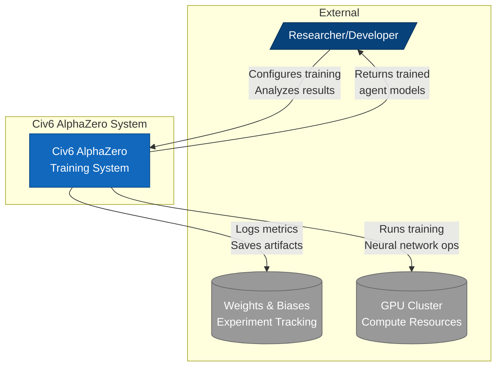

### Level 2: Container Diagram

High-level software containers that compose the system.

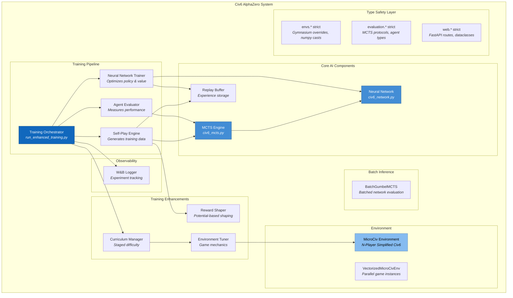

### Level 2: Container Diagram - Cloud Training Pipeline (Vertex AI)

Shows the production cloud training loop on GCP Vertex AI.

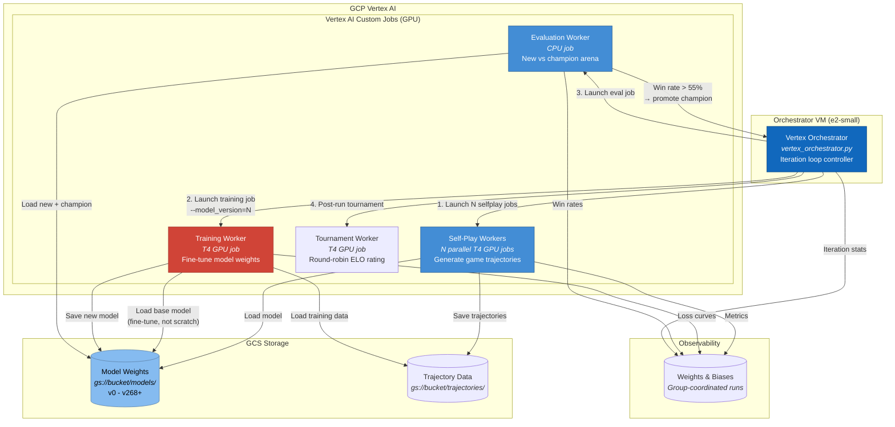

### Level 3: Component Diagram - Neural Network

Internal structure of the neural network component.

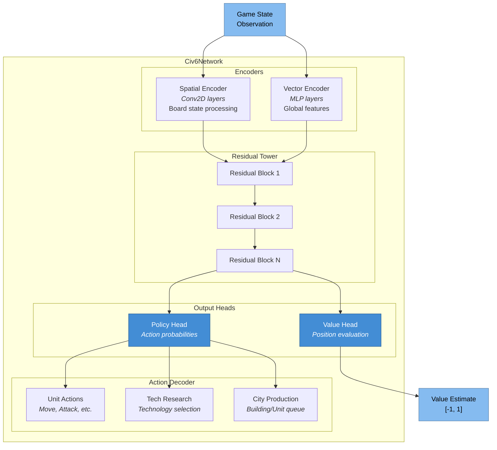

### Level 3: Component Diagram - MCTS Engine

Internal structure of the Monte Carlo Tree Search component.

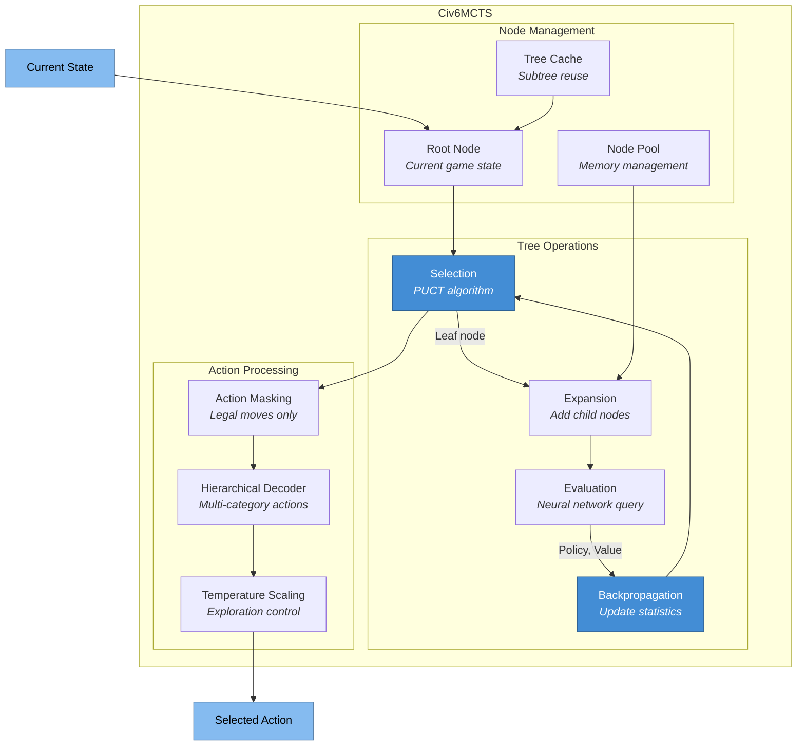

### Level 3: Component Diagram - Training Enhancements

Internal structure of the Phase 3 training improvements.

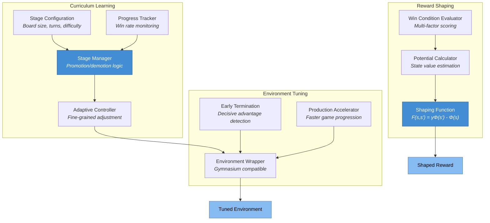

### Level 3: Component Diagram - Population-Based Training

Internal structure of the PBT hyperparameter optimization system.

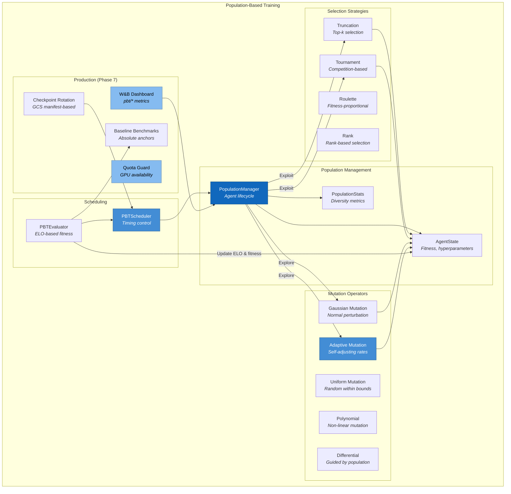

### Level 3: Component Diagram - Training Safeguards & MuZero (Phases 8-9)

Internal structure of the training safeguard and MuZero integration systems.

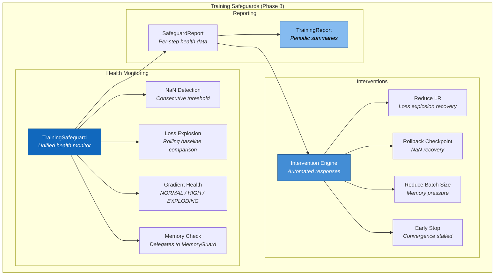

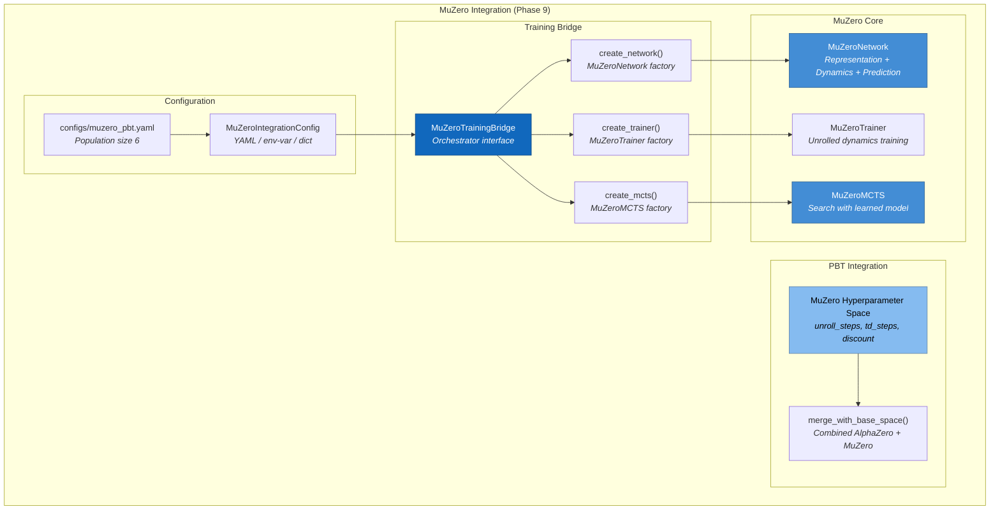

### Level 3: Component Diagram - Tournament System (Phase 10)

Internal structure of the tournament orchestration and analysis system.

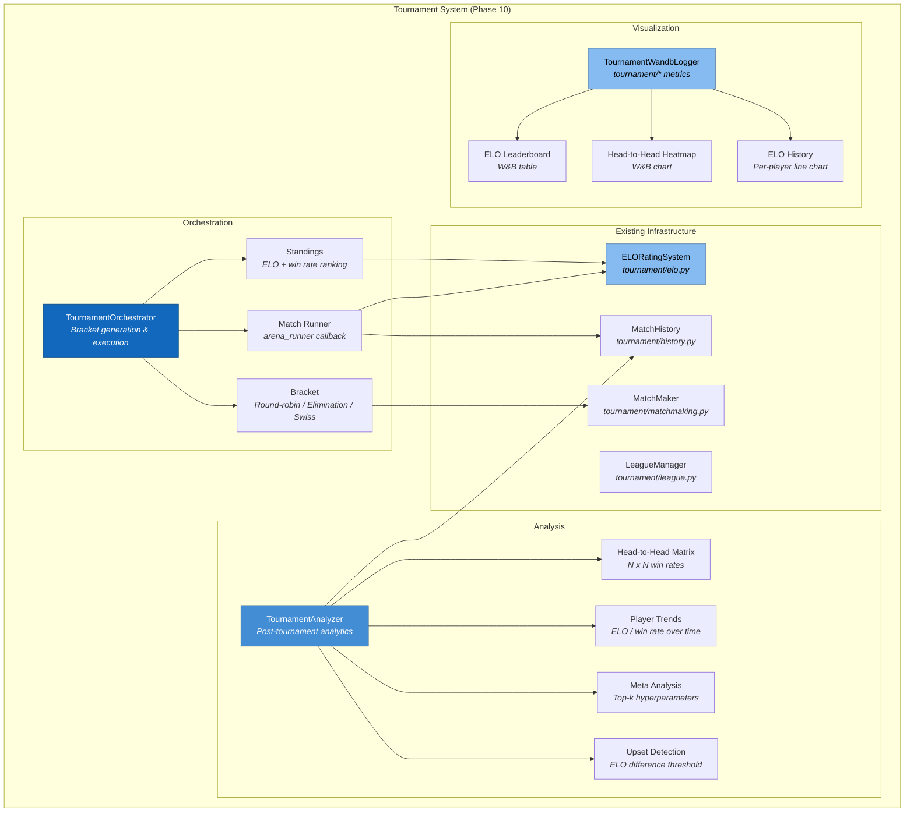

### Level 3: Component Diagram - Code Quality Infrastructure (Phase 11)

Internal structure of the production hardening and code quality systems.

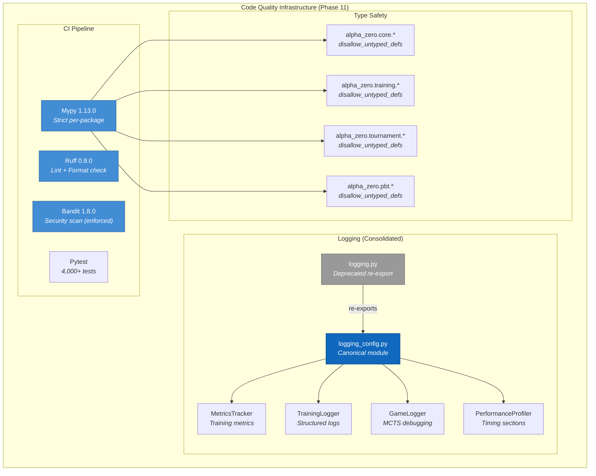

### Level 3: Component Diagram - GCP Cloud Training Pipeline

Internal structure of the Vertex AI training pipeline with standalone tournament worker.

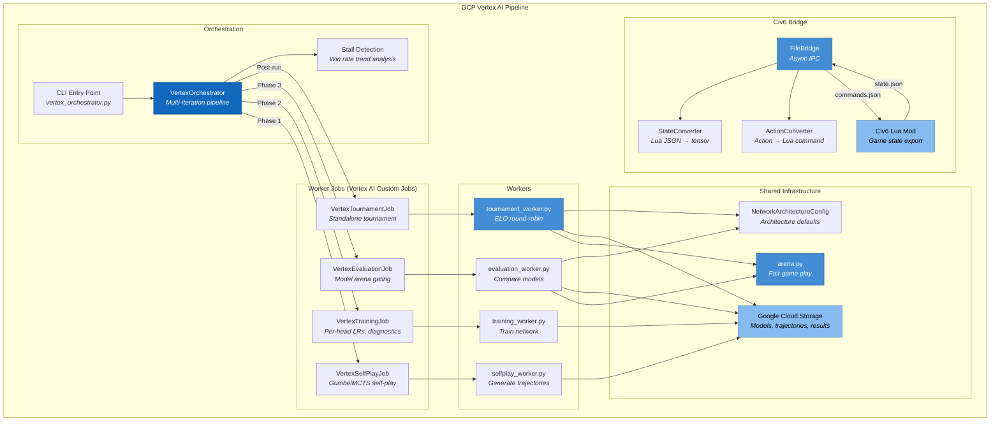

### Level 3: Component Diagram - Hierarchical RL

Internal structure of the multi-level decision hierarchy.

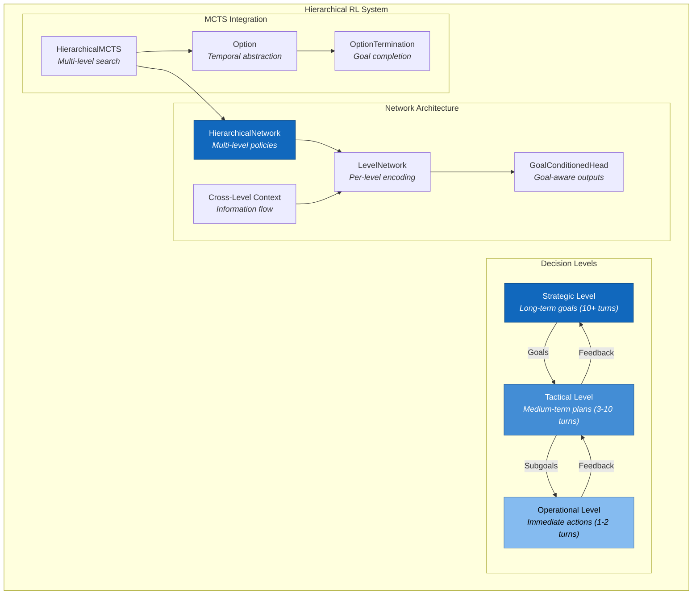

### Level 3: Component Diagram - Climate System

Internal structure of the climate and disaster mechanics.

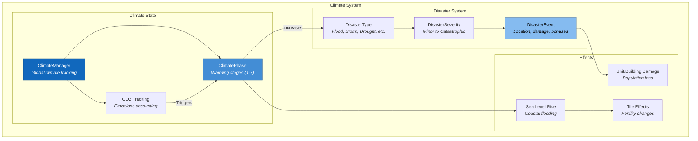

### Level 4: Code Diagram - Training Flow

Sequence of operations during a training iteration.

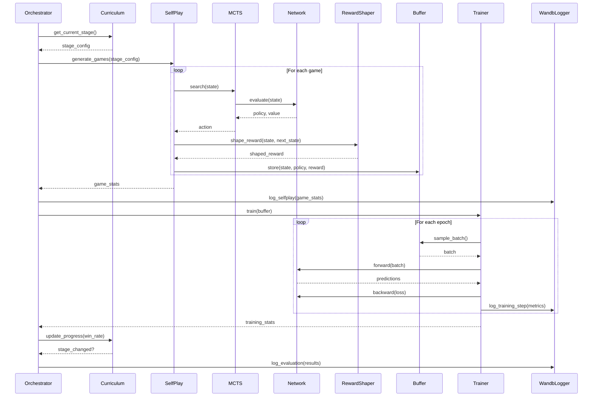

## Installation

### Prerequisites

- Python 3.11 or higher
- CUDA-capable GPU (recommended) or Apple Silicon (MPS)
- 8GB+ RAM

### Quick Start

```bash
# Clone the repository
git clone https://github.com/Mango-Metrics-NLM/Civ6-AlphaZero.git
cd Civ6-AlphaZero

# Create virtual environment (recommended)
python -m venv venv
source venv/bin/activate  # Linux/macOS
# or
.\venv\Scripts\activate  # Windows

# Install dependencies
pip install -r requirements.txt

# Optional: Install W&B for experiment tracking
pip install wandb
wandb login
```

### Development Setup

```bash
# Install with development dependencies
pip install -r requirements.txt
pip install -r requirements-dev.txt  # If available

# Run tests to verify installation
pytest tests/unit -v
```

## Usage

### Unified Training Orchestrator (Recommended)

The new `TrainingOrchestrator` provides a single entry point for all training:

```bash
# Quick training run (development/testing)
python -m alpha_zero.orchestrator --preset fast

# Balanced training (recommended for initial experiments)
python -m alpha_zero.orchestrator --preset balanced

# Production training
python -m alpha_zero.orchestrator --preset production

# Dry run (validate configuration without training)
python -m alpha_zero.orchestrator --preset fast --dry_run

# Resume from checkpoint
python -m alpha_zero.orchestrator --preset balanced --resume

# Custom YAML configuration
python -m alpha_zero.orchestrator --config configs/orchestrator.yaml
```

### Orchestrator Presets

| Preset | Iterations | Games/Iter | Board | Simulations | Use Case |
| ------ | ---------- | ---------- | ----- | ----------- | -------- |
| `fast` | 10 | 5 | 6x6 | 10 | Quick testing |
| `balanced` | 100 | 20 | 8x8 | 50 | Experiments |
| `production` | 1000 | 100 | 16x16 | 200 | Full training |

### Cloud Training on Vertex AI

Run distributed training on GCP with the 3-phase pipeline (selfplay → training → evaluation):

```bash
# Prerequisites: set GCP env vars (see .env.template)
export CIV6AZ_VERTEX_PROJECT=your-project
export CIV6AZ_VERTEX_REGION=us-central1
export CIV6AZ_GCS_BUCKET=your-bucket
export CIV6AZ_CONTAINER_IMAGE_URI=gcr.io/your-project/civ6az-training:latest

# Build and push container
./scripts/build_container.sh

# Quick cloud test (GumbelMCTS, 2 workers, 10 games each)
python -m alpha_zero.cloud.gcp.vertex_orchestrator \
    --iterations=1 --workers=2 --games_per_worker=10 \
    --mcts_type=gumbel --mcts_simulations=16 \
    --evaluation_games=10 --evaluation_win_threshold=0.50

# Production run with evaluation and curriculum
python -m alpha_zero.cloud.gcp.vertex_orchestrator \
    --iterations=20 --workers=4 --games_per_worker=50 \
    --mcts_type=gumbel --mcts_simulations=32 \
    --evaluation_games=20 --evaluation_win_threshold=0.55 \
    --curriculum --reward_shaping

# Dry run (validate args without launching cloud jobs)
python -m alpha_zero.cloud.gcp.vertex_orchestrator --dry_run --iterations=1

# Multi-iteration training with post-run tournament
python -m alpha_zero.cloud.gcp.vertex_orchestrator \
    --iterations=3 --workers=1 --games_per_worker=10 \
    --mcts_type=gumbel --mcts_simulations=8 --board_size=8 \
    --epochs=3 --max_turns=15 --evaluation_games=4 \
    --post_run_tournament --tournament_games=4 --tournament_mcts_sims=8

# 50-iteration scaled run with value head stabilization (Phase 15)
python -m alpha_zero.cloud.gcp.vertex_orchestrator \
    --iterations=50 --workers=2 --games_per_worker=50 \
    --mcts_type=gumbel --mcts_simulations=16 --board_size=8 \
    --epochs=10 --max_turns=20 --evaluation_games=25 \
    --trajectory_window=5 \
    --lr_schedule_type=warmup_cosine --lr_initial=0.001 --lr_final=0.0001 \
    --value_lr_multiplier=0.1 \
    --post_run_tournament --tournament_games=10 --tournament_mcts_sims=16
```

| MCTS Variant | Speed | Simulations | Best For |
| ------------ | ----------- | ----------- | -------------------------- |
| `civ6` | Baseline | 200 | Accuracy-focused training |
| `gumbel` | ~13x faster | 16 | Fast iteration, cloud scale |

### Legacy Training Scripts

The previous training entry points are still available:

```bash
# Enhanced training script
python run_enhanced_training.py --preset balanced --device cuda

# With W&B tracking
python run_enhanced_training.py --preset balanced --wandb --wandb-project "civ6-alphazero"
```

### Programmatic Usage

```python
from alpha_zero.orchestrator import TrainingOrchestrator, OrchestratorConfig

# Load configuration from YAML
config = OrchestratorConfig.from_yaml("configs/orchestrator.yaml")

# Or use a preset
config = OrchestratorConfig.from_preset("balanced")

# Create and run orchestrator
orchestrator = TrainingOrchestrator(config)
orchestrator.run()

# Access training state
print(f"Total games: {orchestrator.state.total_games}")
print(f"Best win rate: {orchestrator.state.best_win_rate:.2%}")
```

## Configuration

### Training Presets

| Preset | Iterations | Games/Iter | Board Size | Use Case |
|--------|-----------|------------|------------|----------|
| `fast` | 2 | 2 | 6x6 | Development, debugging |
| `balanced` | 10 | 20 | 8x8 | Initial experiments |
| `full` | 50 | 100 | 10x10 | Production training |

### Curriculum Stages

| Stage | Board Size | Max Turns | Win Rate to Advance |
|-------|-----------|-----------|---------------------|
| Beginner | 6x6 | 30 | 60% |
| Intermediate | 8x8 | 50 | 65% |
| Advanced | 10x10 | 100 | 70% |

### Environment Variables

Create a `.env` file based on `.env.template`:

```bash
# Weights & Biases
WANDB_API_KEY=your_api_key_here
WANDB_PROJECT=civ6-alphazero
WANDB_ENTITY=your_team_name

# Training
CUDA_VISIBLE_DEVICES=0
```

## RAG Integration

The RAG (Retrieval-Augmented Generation) system enables knowledge-enhanced agent decision making by retrieving relevant context from a vector database.

### Installation

```bash
# Install RAG dependencies
pip install -e ".[rag]"

# Or install all dependencies including RAG
pip install -e ".[all]"
```

### Quick Start

```python
import asyncio
from alpha_zero.rag import RAGPipeline, RAGConfig

async def main():
    # Create pipeline with default configuration
    pipeline = await RAGPipeline.create()

    # Ingest strategy documents
    await pipeline.ingest_text(
        "Early game strategy: Focus on expanding territory and building settlers.",
        source="strategy_guide.txt",
        metadata={"category": "early_game"}
    )

    # Query for relevant context
    result = await pipeline.query(
        "How should I play the early game?",
        top_k=5
    )

    print(f"Context: {result.context}")
    print(f"Retrieved {len(result.documents)} documents")

    await pipeline.close()

asyncio.run(main())
```

### Configuration

RAG can be configured via environment variables or YAML:

```bash
# Environment variables
export RAG_VECTOR_STORE_TYPE=chroma
export RAG_EMBEDDING_MODEL_TYPE=openai
export OPENAI_API_KEY=your_key_here
```

```python
from alpha_zero.rag import RAGConfig, VectorStoreType, EmbeddingModelType

config = RAGConfig()
config.vector_store.store_type = VectorStoreType.CHROMA
config.embedding.model_type = EmbeddingModelType.OPENAI

pipeline = await RAGPipeline.create(config)
```

### Agent Workflow Integration

```python
from alpha_zero.rag.agents import RAGAgentWorkflow
from alpha_zero.rag.stores import MemoryVectorStore
from alpha_zero.rag.processors import LocalEmbeddings

# Create workflow
workflow = RAGAgentWorkflow(
    vector_store=MemoryVectorStore(dimension=384),
    embedding_generator=LocalEmbeddings(dimension=384),
)
await workflow.initialize()

# Register hooks for custom processing
async def pre_retrieve_hook(context):
    print(f"Searching for: {context.query}")

workflow.register_hook("pre_retrieve", pre_retrieve_hook)

# Execute workflow
result = await workflow.execute("What is the best opening strategy?")
print(result.context)
```

## Testing

The project maintains comprehensive test coverage:

```bash
# Run all tests
pytest

# Unit tests only
pytest tests/unit -v

# Integration tests only
pytest tests/integration -v

# With coverage report
pytest --cov=alpha_zero --cov-report=html

# Specific test file
pytest tests/unit/test_curriculum_learning.py -v

# Run tests matching pattern
pytest -k "curriculum" -v
```

### Test Categories

- **Unit Tests** (`tests/unit/`): Test individual components in isolation
- **Integration Tests** (`tests/integration/`): Test component interactions (PBT lifecycle, distributed coordination, preemption recovery)
- **E2E Tests** (`tests/e2e/`): End-to-end pipeline validation (local training smoke, GCS live, Vertex AI submission)
- **Security Tests** (`tests/security/`): Secret scanning, `.gitignore`/`.dockerignore` validation
- **Sanity Tests** (`tests/sanity/`): Import verification for all submodules
- **Cloud Tests** (`tests/cloud/`): Cloud worker unit tests
- **Performance Tests**: Benchmark critical paths

## Project Structure

> For the authoritative, up-to-date list of all **27 `alpha_zero/` submodules** with file
> counts and one-line responsibilities, see [`docs/MODULE_REFERENCE.md`](docs/MODULE_REFERENCE.md).
> The tree below is an illustrative (non-exhaustive) view of the most-used packages.

```
Civ6-AlphaZero/
├── alpha_zero/               # Core AI system (27 submodules — see docs/MODULE_REFERENCE.md)
│   ├── orchestrator/         # Unified training orchestrator (Phase 4)
│   │   ├── __init__.py       # Module exports
│   │   ├── __main__.py       # CLI entry point
│   │   ├── config.py         # OrchestratorConfig
│   │   ├── orchestrator.py   # TrainingOrchestrator
│   │   ├── scheduler.py      # HyperparameterScheduler
│   │   ├── checkpointer.py   # CheckpointManager
│   │   ├── rag_integration.py # RAG-LLM integration
│   │   └── strategy_advisor.py # LLM-based strategy guidance
│   ├── core/                 # Core AlphaZero components
│   │   ├── civ6_network.py   # Neural network architecture
│   │   ├── civ6_mcts.py      # MCTS (Civ6MCTS, GumbelMCTS, MuZeroMCTS)
│   │   ├── mcts_factory.py   # MCTS factory: create_mcts("civ6"|"gumbel"|"batch_gumbel"|"muzero")
│   │   ├── batch_mcts.py     # BatchGumbelMCTS (Phase 16)
│   │   ├── civ6_actions.py   # Action space handling
│   │   ├── transformer_network.py # Transformer/ViT architecture
│   │   └── action_pruning.py # Strategic action pruning
│   ├── hierarchical/         # Hierarchical RL (Phase 2)
│   │   ├── goals/            # Goal definitions and management
│   │   ├── encoders/         # Level-specific state encoders
│   │   ├── network/          # Hierarchical policy networks
│   │   ├── mcts/             # Hierarchical MCTS
│   │   ├── controllers/      # Level controllers
│   │   ├── controller.py     # Main HierarchicalController
│   │   └── training_integration.py # Training pipeline integration
│   ├── mechanics/            # Civ6 game mechanics (11 modules)
│   │   ├── diplomacy.py      # Diplomatic relations & actions
│   │   ├── trade.py          # Trade routes & commerce
│   │   ├── espionage.py      # Spy operations
│   │   ├── religion.py       # Faith & religious systems
│   │   ├── government.py     # Government & policies
│   │   ├── great_people.py   # Great person generation
│   │   ├── promotions.py     # Unit experience & upgrades
│   │   ├── eras.py           # Era progression & ages
│   │   ├── climate.py        # Climate & disasters
│   │   ├── congress.py       # World Congress
│   │   └── culture.py        # Culture & tourism
│   ├── distributed/          # Distributed training
│   │   ├── actor.py          # Self-play actors
│   │   ├── learner.py        # Training workers
│   │   ├── coordinator.py    # Orchestration
│   │   └── shared_storage.py # Weight/buffer synchronization
│   ├── bridge/               # Real Civ6 bridge system
│   │   ├── config.py         # Bridge configuration
│   │   ├── protocol.py       # Message types & schemas
│   │   ├── file_bridge.py    # File-based IPC
│   │   ├── state_converter.py # Civ6 JSON → tensor
│   │   └── action_converter.py # Action → Lua command
│   ├── envs/                 # Game environments
│   │   ├── microciv.py       # MicroCiv environment
│   │   ├── vectorized_env.py # VectorizedMicroCivEnv (Phase 16)
│   │   ├── civ6_encoder.py   # State encoding
│   │   └── real_civ6_env.py  # Real Civ6 Gymnasium env
│   ├── interfaces/           # Game interfaces
│   │   ├── base_interface.py # BaseGameInterface contract
│   │   ├── civ6_interface.py # Real Civ6 interface
│   │   └── unciv_interface.py # Unciv JSON interface
│   ├── cloud/                # GCP Vertex AI cloud training
│   │   └── gcp/
│   │       ├── config.py             # GCPConfig + NetworkArchitectureConfig
│   │       ├── storage.py            # GCS storage backends
│   │       ├── vertex_jobs.py        # Vertex AI job wrappers
│   │       ├── vertex_orchestrator.py # Multi-iteration pipeline + W&B + tournament
│   │       ├── selfplay_worker.py    # Self-play container worker
│   │       ├── training_worker.py    # Training worker (per-head LRs, diagnostics)
│   │       ├── evaluation_worker.py  # Model arena (Civ6TransformerNetwork)
│   │       ├── tournament_worker.py  # Standalone ELO tournament (Phase 15+)
│   │       ├── arena.py              # Shared arena logic (Phase 13)
│   │       ├── entrypoint.py         # Container mode router (incl. orchestrator mode)
│   │       ├── container_healthcheck.py # Container import validation
│   │       ├── pbt_orchestrator.py    # Production PBT loop
│   │       ├── cost_monitor.py       # Budget enforcement
│   │       ├── cost_optimization.py  # Unified cost optimization
│   │       ├── gpu_scheduler.py      # Dynamic GPU selection
│   │       └── preemption_handler.py # Spot VM preemption recovery
│   ├── pbt/                 # Population-Based Training
│   │   ├── config.py        # PBTConfig (incl. Phase 7+ fields)
│   │   ├── evaluator.py     # PBTEvaluator (ELO + baselines)
│   │   ├── population.py    # PopulationManager
│   │   ├── mutations.py     # 6 mutation strategies
│   │   ├── scheduler.py     # PBTScheduler
│   │   ├── coordinator.py   # PBT coordination
│   │   └── muzero_hyperparams.py # MuZero PBT hyperparameter space (Phase 9)
│   ├── tournament/           # Tournament System (Phase 10)
│   │   ├── config.py         # TournamentConfig, MatchResult, PlayerStats
│   │   ├── elo.py            # ELORatingSystem, RatingLeaderboard
│   │   ├── matchmaking.py    # MatchMaker, OpponentSelector
│   │   ├── history.py        # MatchHistory, PlayerStatistics
│   │   ├── league.py         # LeagueManager, SeasonInfo
│   │   ├── orchestrator.py   # TournamentOrchestrator, Bracket
│   │   ├── analysis.py       # TournamentAnalyzer, head-to-head
│   │   └── wandb_dashboards.py # TournamentWandbLogger
│   ├── training/             # Training Infrastructure
│   │   ├── muzero_trainer.py       # MuZeroTrainer, MuZeroTrainingConfig
│   │   ├── muzero_integration.py   # MuZeroTrainingBridge (Phase 9)
│   │   ├── training_safeguards.py  # TrainingSafeguard (Phase 8)
│   │   ├── training_report.py      # TrainingReport (Phase 8)
│   │   ├── diagnostics.py          # TrainingDiagnostics (Phase 14)
│   │   ├── convergence_monitor.py  # ConvergenceMonitor
│   │   ├── training_profiler.py    # TrainingProfiler
│   │   └── elo_plateau_detector.py # EloPlateauDetector
│   ├── integration/          # External integrations
│   │   └── game_connector.py # AI-to-game bridge
│   ├── rag/                  # RAG Integration (Phase 5)
│   │   ├── config/           # Configuration management
│   │   ├── stores/           # Vector stores (Memory, Chroma, FAISS)
│   │   ├── processors/       # Document processing & embeddings
│   │   ├── agents/           # Agent workflow
│   │   ├── utils/            # Logging, metrics, caching
│   │   └── pipeline.py       # Main RAG pipeline
│   └── utils/                # Utilities & enhancements
│       ├── curriculum_learning.py  # Multi-stage difficulty
│       ├── enhanced_rewards.py     # Intermediate rewards
│       ├── environment_tuning.py   # Game mechanics tuning
│       ├── reward_shaping.py       # Potential-based shaping
│       ├── training_diagnostics.py # Learning metrics
│       ├── llm_client.py           # LLM API integration
│       ├── factories.py            # Component factories
│       └── wandb_logger.py         # W&B integration
├── configs/                  # Configuration files
│   ├── orchestrator.yaml     # Master configuration
│   ├── orchestrator_fast.yaml
│   ├── orchestrator_production.yaml
│   ├── pbt_prod.yaml         # Production PBT config (Phase 7+)
│   ├── muzero_pbt.yaml       # MuZero PBT config (Phase 9)
│   ├── tournament.yaml       # Tournament config (Phase 10)
│   └── civ6_config.yaml      # Game-specific configuration
├── data/
│   └── knowledge/            # RAG knowledge base
├── scripts/
│   └── build_container.sh    # Docker build & push to GCR
├── Dockerfile                # Container image (PyTorch 2.5 + CUDA 12.4)
├── .dockerignore             # Container build exclusions
├── requirements-container.txt # Slim deps for container
├── docs/
│   ├── architecture.md       # C4 architecture diagrams
│   └── C4_ARCHITECTURE.md    # Detailed architecture documentation
├── mod/                      # Civ6 Lua mod
│   └── AlphaZeroAI/          # Mod package
│       ├── AlphaZeroAI.modinfo # Mod definition
│       └── Scripts/          # Lua scripts
│           ├── Main.lua      # Entry point & events (re-entrance guard, graceful shutdown)
│           ├── StateExporter.lua # Game state serialization (hex-grid, civics, enemy units)
│           ├── ActionExecutor.lua # Command execution (RequestOperation API, 10+ handlers)
│           ├── FileIO.lua    # File operations (shell escape, content-hash change detection)
│           ├── Config.lua    # Configuration (cross-platform, path traversal prevention)
│           ├── Logger.lua    # Logging (log rotation at 5MB)
│           └── JsonEncoder.lua # Pure Lua JSON
├── tests/                    # Test suite (4,893+ tests)
│   ├── unit/                 # Unit tests
│   ├── integration/          # Integration tests (PBT, distributed, preemption)
│   ├── e2e/                  # End-to-end tests (training smoke, GCS, Vertex)
│   ├── security/             # Security sanity tests
│   ├── sanity/               # Import verification tests
│   ├── cloud/                # Cloud worker unit tests
│   └── fixtures/             # Test data
│       └── game_states/      # Sample Civ6 states
├── CLAUDE.md                 # Agent instructions & constraints
├── requirements.txt          # Dependencies
└── README.md                 # This file
```

## Technologies

| Category | Technologies |
|----------|-------------|
| Core | Python 3.11+ |
| Deep Learning | PyTorch 2.0+ |
| Environment | Gymnasium 0.29+ |
| Cloud Training | GCP Vertex AI, Google Cloud Storage |
| Containers | Docker, Google Container Registry |
| Experiment Tracking | Weights & Biases, TensorBoard |
| RAG / Vector DB | ChromaDB, FAISS, Pinecone |
| Embeddings | OpenAI, Sentence Transformers |
| LLM Integration | OpenAI, Anthropic |
| Configuration | PyYAML, Pydantic |
| Testing | Pytest 7.0+, pytest-asyncio, pytest-cov |
| Visualization | Mermaid.js, Matplotlib |
| Code Quality | MyPy, Ruff, Bandit |
| Numerical | NumPy 1.23+ |

## Roadmap

### Completed

- ✅ **GCP Vertex AI Pipeline** — Cloud training with GumbelMCTS, 3-phase pipeline (selfplay → training → evaluation)
- ✅ **Population-Based Training** — Full PBT with cross-agent ELO evaluation, 6 mutation strategies, W&B dashboards
- ✅ **Production PBT Scaling** — Checkpoint rotation, GPU quota guard, baseline benchmarking, dynamic strategy switch
- ✅ **CI/CD & Test Infrastructure** — Release automation, 6-tier test coverage (unit, integration, e2e, security, sanity, cloud)
- ✅ **Training Safeguards** — NaN detection, loss explosion monitoring, gradient health, automated interventions
- ✅ **MuZero Integration** — MuZeroTrainingBridge connecting network/trainer/MCTS to orchestrators and PBT
- ✅ **Tournament System** — Bracket orchestration (round-robin, elimination, Swiss), analysis, W&B dashboards
- ✅ **Code Quality & Tech Debt** (Phase 11) — Removed 14,600 LOC dead code, fixed 16 xfailed tests, consolidated logging, CI hardening, mypy strictness, 16 new edge case tests
- ✅ **Learning Signal Validation** (Phase 14) — 20-iteration training run ($2.44), 2 model promotions (v6→v19→v26), policy loss 1.21→0.63, training diagnostics, warmup-cosine LR, stall detection
- ✅ **Value Head Stabilization** (Phase 15) — Separate per-head LR multipliers (value=0.1x), optimizer param groups, base_lr_ratio preservation through scheduler, per-head W&B logging
- ✅ **Standalone Tournament Worker** (Phase 15+) — CLI-based ELO tournament across GCS model versions, model stride, VertexTournamentJob, head dimension inference for mixed-architecture tournaments
- ✅ **Civ6 Lua Integration** (Phase 15+) — Fixed Lua mod API calls (RequestOperation), hex-grid neighbors, injection prevention, log rotation, civics support; Python bridge coordinate fixes, to_dict/create_single protocol methods

### Training Results

#### Phase 15: golden-dream-542 (50-iteration scaled run)

| Metric | Result |
|--------|--------|
| Iterations | 50/50 |
| Cost | ~$4.63 |
| Model Versions | 80 (v0-v79) |
| Architecture | v0-v29: embed=256/layers=8; v30-v79: embed=64/layers=6 |
| LR Schedule | warmup_cosine (value_lr=0.1x encoder) |
| Standalone Tournament | 17 models (stride=5), 136 matchups, 1,360 games (in progress) |

#### Phase 14: sunny-fog-469 (20-iteration validation)

| Metric | Result |
|--------|--------|
| Iterations | 20/20 |
| Duration | 377.5 min |
| Cost | $2.44 |
| Promotions | v6→v19 (70% WR), v19→v26 (60% WR) |
| Policy Loss | 1.21 → 0.63 (steady decrease) |
| Value Correlation | 0.07–0.91 (unstable, addressed in Phase 15) |
| Tournament | 23 models, 253 matchups, ELO spread 66 points |

### Training Results — Phase 17: dashing-firebrand-1393 (50-iteration production run, ACTIVE)

| Parameter | Value |
|-----------|-------|
| Container | `civ6az-prod-v120` on `civ6az-orchestrator` VM |
| Config | 50 iters, 4 workers × 50 games, GumbelMCTS 16 sims, max_turns=30 |
| LR | warmup_cosine 0.001→0.0001, value_lr_multiplier=0.1 |
| Start model | v218 (auto-detected from GCS) |
| W&B | [dashing-firebrand-1393](https://wandb.ai/ianshank-none/civ6-alphazero/runs/ukxjr0uz) |

### Next Steps

| Priority | Feature | Description |
|----------|---------|-------------|
| P0 | Monitor 50-iter production run | Track win rates, value correlation, ELO spread via W&B |
| P1 | Analyse 50-iter results | Policy loss trend, value head stability, post-run tournament ELO spread |
| P2 | Batch self-play cloud integration | Enable `--num_parallel_games` in cloud for 5-10x throughput |
| P3 | MuZero Training Run | Run MuZero PBT with `configs/muzero_pbt.yaml` to validate learned dynamics |
| P4 | Real Civ6 Game Testing | Test Python bridge ↔ Lua mod end-to-end with actual Civilization VI |
| P5 | PBT on Vertex AI | Population-based training with auto hyperparameter tuning |

### Current Priorities

1. **Production run monitoring** — `docker logs -f civ6az-prod-v120` on orchestrator VM; W&B at [dashing-firebrand-1393](https://wandb.ai/ianshank-none/civ6-alphazero/runs/ukxjr0uz)
2. **Value head stability** — target `value_correlation > 0.5` for 10+ consecutive iterations (was 0.07-0.91 in Phase 14)
3. **Model promotion** — target 3+ promotions over 50 iterations; 30-game eval with `win_threshold=0.55`
4. **Post-run tournament** — automated round-robin of all 50 models, 25 MCTS sims, ELO spread target >100 pts
5. **Batch self-play** — after run completes, enable `--num_parallel_games` for 3-5x throughput

## Contributing

1. Fork the repository
2. Create a feature branch (`git checkout -b feature/amazing-feature`)
3. Make your changes
4. Run tests (`pytest`)
5. Commit your changes (`git commit -m 'Add amazing feature'`)
6. Push to the branch (`git push origin feature/amazing-feature`)
7. Open a Pull Request

## Development By

Ian Cruickshank

## License

This project is licensed under the MIT License - see the [LICENSE](LICENSE) file for details.

## Acknowledgments

- DeepMind's AlphaZero paper for the foundational algorithm
- The PyTorch team for the deep learning framework
- Firaxis Games for the inspiration from Civilization VI
