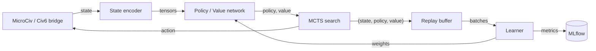

# Civ6-AlphaZero

[](https://github.com/Mango-Metrics-NLM/Civ6-AlphaZero/actions/workflows/ci.yml)
[](pyproject.toml)
[](LICENSE)
[](docs/EVALUATION.md)
[](https://huggingface.co/ianshank/civ6-hexcrystal-encoder)

An AlphaZero/MuZero-style self-play system for a simplified Civilization-like
game (MicroCiv), engineered so that every claim about it can be checked,
including the ones that turned out to be wrong.

- **What this is:** a CPU-reproducible, seeded MCTS + policy/value training stack
  with negative-controlled quality gates, a measured evaluation methodology, and a
  demo-grade bridge that sends commands into a live Civilization VI.
- **What this isn't (yet):** a strong agent. No run on the corrected search has
  shown learning; see [Project status](#project-status) and
  [`docs/EVALUATION.md`](docs/EVALUATION.md).
- **Not affiliated with** Firaxis Games, 2K, Take-Two Interactive or Google
  DeepMind. *Civilization VI* is a trademark of Take-Two Interactive Software, Inc.

## Project status

"Proven" below means a committed, seeded artifact under
[`docs/evidence/`](docs/evidence/README.md) generated on code that includes the
2026-09-04 search fixes. Nothing is in that column yet; the table says so rather
than rounding up.

| Area | State | Evidence |
|---|---|---|
| MicroCiv environment, encoders, five MCTS variants | Built. One shared, sign-correct value backup since 2026-09-04; forced-win oracle gates it | `tests/unit/test_mcts_backup_correctness.py` |
| Local training loop (CPU) | Runs end to end. **No committed run demonstrates learning**; the only run predates the search fixes and ends below parity against random | [`docs/evidence/validation_iteration_zero/`](docs/evidence/validation_iteration_zero/validation_iteration_zero_report.md) (pre-fix) |
| Evaluation and promotion | Score-rate statistics with ternary intervals are the single source of truth; the deployed promotion default still cannot promote at the measured 73.5% draw rate | [`docs/EVALUATION.md`](docs/EVALUATION.md), [`docs/runbooks/promotion-gate.md`](docs/runbooks/promotion-gate.md) |
| Reproducibility | A seed determines the whole local run; every search owns its RNG | [`docs/evidence/seeded_probe_reproducibility/`](docs/evidence/seeded_probe_reproducibility/README.md) |
| Cloud pipeline (Vertex AI) | Built and exercised; outputs predate the fixes; self-play worker not yet seeded; costs money | [`docs/GCP_INFRA.md`](docs/GCP_INFRA.md) |
| Live Civilization VI bridge | Demo-grade: command delivery verified headless (four end-turn commands on random weights, 2026-07-12); turn-cycle stall open | [`docs/LIVE_CIV6.md`](docs/LIVE_CIV6.md) |
| MuZero, N-player, PBT, fog of war, hierarchical planning | Built; unvalidated by any committed artifact | [`docs/MODULE_REFERENCE.md`](docs/MODULE_REFERENCE.md) |
| Hex-crystalline encoder | Published on the Hub; its head-to-head result is superseded (pre-fix, seed overlap) | [`docs/model_cards/hexcrystal_encoder.md`](docs/model_cards/hexcrystal_encoder.md) |
| Hugging Face Spaces, transformer/MuZero Hub repos, Elo dataset | Scaffold / planned, not published | `spaces/`, [`docs/HF_PUBLISHING.md`](docs/HF_PUBLISHING.md) |
| LLM strategy advisor | Experimental, default-off; its gate checks output shape, not advice quality | [`docs/EVALUATION.md`](docs/EVALUATION.md) §8 |

## How it works



- **MicroCiv** is a small 4X environment (configurable board, 2–8 players,
  warriors/settlers/archers, cities) with a 13-channel state encoding.
- The **network** (ResNet or transformer backbone, optional hex-crystalline
  encoder) outputs a policy over a hierarchical action space and a value.
- **Search** variants live one per module under `alpha_zero/core/mcts/`: Gumbel
  (default, completed-Q policy target), PUCT, random-rollout Simple, DUCT for
  simultaneous moves, and MuZero over a learned model. They share one value
  backup that flips perspective only where the acting player changes, because
  MicroCiv lets a player act many times before yielding.
- **Training** samples (state, policy, value) from a replay buffer; MLflow is the
  experiment tracker. The full C4 model is in
  [`docs/architecture/C4_ARCHITECTURE.md`](docs/architecture/C4_ARCHITECTURE.md).

## Install

Requires **Python 3.11+**. Everything runs on CPU; a GPU is an accelerator, never a
dependency. The one exception is by choice, not need: the registered learning runs
(A1, A1-R) are pinned to two named GPUs and a named CUDA build of torch, and refuse to
start on anything else ([`docs/EVALUATION.md`](docs/EVALUATION.md) section 7.1, "Devices").

```bash
git clone https://github.com/Mango-Metrics-NLM/Civ6-AlphaZero.git
cd Civ6-AlphaZero
python -m venv .venv && source .venv/bin/activate   # Windows: .venv\Scripts\activate
pip install -e '.[dev]'
```

Optional extras (individually, or together with `.[all]`):

| Extra | Purpose |
|-------|---------|
| `dev` | Test / lint / type tooling (pytest, ruff, mypy) |
| `gcp` | Google Cloud / Vertex AI client libraries |
| `distributed` | Multi-process / multi-node training deps |
| `llm` | LLM provider clients for the strategy advisor |
| `web` | FastAPI + uvicorn for the web interface and serving |
| `monitoring` | MLflow experiment tracking |
| `spacetimedb` | SpacetimeDB integration |
| `hub` | Hugging Face Hub integration (encoder publishing) |
| `datasets` | Dataset export helpers |
| `spaces` | Gradio apps under `spaces/` |
| `tuning` | Optuna hyperparameter search |
| `jax` | JAX backend (optional) |
| `chess` | Chess benchmarking harness (its sdist does not build on current Debian setuptools, so it is kept out of `dev`) |
| `eval` | Advisor output-contract harness, installed from a git URL; not part of `all` |
| `all` | Every extra above except `eval` |

There are no console scripts; run everything with `python -m`.

## Quickstart

```bash
python -m alpha_zero.training_civ6 --dry_run                # smoke test, ~15 s on CPU
python -m alpha_zero.orchestrator --preset fast --dry_run   # validate an orchestrator config
```

Train a small model and play against it in the browser (keep `board_size`
identical across the steps; the UI refuses a checkpoint trained at another size):

```bash
pip install -e '.[dev,web]'

python -m alpha_zero.training_civ6 --seed 42 \
    --board_size 8 --max_turns 20 --num_simulations 10 \
    --num_iterations 6 --num_games 10 \
    --num_res_blocks 2 --num_filters 16 \
    --save_interval 1 --device cpu

CIV6AZ_WEB_BOARD_SIZE=8 \
CIV6AZ_WEB_CHECKPOINT=checkpoints/civ6/latest.pt \
    python -m alpha_zero.web
```

What to expect from that configuration, measured on a two-core CPU container
**before** the 2026-09-04 search fixes (treat it as a wall-clock guide, not a
strength measurement):

| | Observed |
|---|---|
| Total wall clock | 683 s (~11 min) |
| Iteration 1 | ~6 min (random-rollout search bootstraps the first iteration) |
| Iterations 2–6 | ~1 min each |
| Score vs random, by iteration | did not beat random at this budget |

A run this short does not produce a model that beats random, and that is what it
reports. Scale `--num_iterations` and `--num_games` up before drawing any
conclusion about strength, and compare against a random-initialised network under
the same search, not against the random agent alone: a random network under MCTS
also beats a random agent, so "beats random" alone proves nothing.

## Evaluate

```bash
python scripts/benchmark_suite.py --help     # the benchmark protocol over the promotion judge's own arena
python scripts/run_baseline_eval.py --help   # score a model from storage against random / heuristic
```

[`docs/EVALUATION.md`](docs/EVALUATION.md) defines the vocabulary (`score_rate`
with a ternary interval is the statistic for claims; `win_rate` is legacy and
draw-blind), the power table that sizes a run, the promotion-gate arithmetic, and
the pre-registered protocol for the first post-fix learning run.
[`docs/evidence/README.md`](docs/evidence/README.md) indexes every committed
measurement with the one fact a reader needs first: whether it predates the
search fixes.

## Reproducibility

`--seed` on `training_civ6.py`, `run_baseline_eval.py` and
`post_run_evaluation.py` determines environments, every search, the random
opponent, replay sampling, batch order and network initialisation. Streams are
derived by name from one seed (`alpha_zero/utils/seeding.py`), so self-play varies
with the iteration while evaluation stays on a fixed held-out set. Two runs at one
seed are identical (`tests/regression/test_training_determinism_regression.py`).
The deployed cloud workers are not yet seeded; that change touches distributed
coordination and is tracked separately.

On a GPU, seeding is not enough: CUDA kernels are non-deterministic by default. A seeded
run on a CUDA device therefore enforces deterministic algorithms, and an operation with no
deterministic implementation raises. That buys repeatability on one machine, one torch build
and one GPU, not across GPU models. CI has no GPU, so this is checked on the machine that
runs the registered cards (`scripts/check_determinism.py`, run by the T0b card), and it has
**not been run yet**.

## Cloud training

One image (`dockerfiles/Dockerfile.vertex`) entrypointed by
`alpha_zero.cloud.gcp.entrypoint` runs the `selfplay`, `training`, `evaluation`
and `tournament` workers on Vertex AI; `python -m alpha_zero.cloud.gcp.vertex_orchestrator --help`
dispatches them from a local machine. Cloud runs cost money and need explicit
confirmation (charter non-goal NG-7). Setup and troubleshooting:
[`docs/GCP_INFRA.md`](docs/GCP_INFRA.md), [`docs/GCP_TROUBLESHOOTING.md`](docs/GCP_TROUBLESHOOTING.md).

## Live Civilization VI

The bridge drives a running Civilization VI over the FireTuner socket through
the `AlphaZeroAI` mod. It is demo-grade: command delivery is verified, sustained
skilled play is not. Prerequisites, installation and known limitations:
[`docs/LIVE_CIV6.md`](docs/LIVE_CIV6.md).

```bash
python -m alpha_zero.civ6_local --mode civ6 --dry-run    # validate bridge config, no game needed
python scripts/install_civ6_mod.py                       # install the mod
python -m alpha_zero.civ6_local --mode civ6 --mcts       # drive the game with Gumbel MCTS
```

## Development and quality gates

```bash
make verify-fast         # lint, types, regression and governance gates — the inner loop
make verify              # every CI gate in one pass — run before opening a PR
make test-all            # coverage, mirroring CI's coverage job (gate: 85%)
make test-cloud-coverage # the deployed path, against coverage-floors.json
```

The Makefile exports `OMP_NUM_THREADS ?= 2`; without the cap two tests wedge in
`torch.conv2d` on the OpenMP spin-wait. CI enforces a coverage gate of 85% on
`alpha_zero/`; `alpha_zero/cloud/` is measured separately against a per-package
floor in [`coverage-floors.json`](coverage-floors.json) that may only rise. Debt
metrics ratchet the same way (`docs/evidence/tech_debt_baseline/`). Governance
validators keep the docs honest: version drift, module counts, dead links,
unsupported claims and missing index rows all fail the build.
[`CONTRIBUTING.md`](CONTRIBUTING.md) has the development loop and the OpenSpec
change workflow; [`GOVERNANCE.md`](GOVERNANCE.md) says who decides what.

## Documentation

- [`docs/README.md`](docs/README.md) — the index: start here, how-to, reference,
  explanation, records.
- [`docs/EVALUATION.md`](docs/EVALUATION.md) — what is and is not proven, and how to measure it.
- [`docs/architecture/C4_ARCHITECTURE.md`](docs/architecture/C4_ARCHITECTURE.md) — architecture.
- [`ROADMAP.md`](ROADMAP.md) — milestones with a validation column, and Now / Next / Later.
- [`PROJECT_CHARTER.md`](PROJECT_CHARTER.md) — scope, non-goals, invariants.
- [`CHANGELOG.md`](CHANGELOG.md) — release history.

## Citation

If this work is useful to you, cite it with the metadata in
[`CITATION.cff`](CITATION.cff) (GitHub renders it under "Cite this repository").
The methods it builds on: Silver et al. 2018 (AlphaZero), Schrittwieser et al.
2020 (MuZero), Danihelka et al. 2022 (planning with Gumbel), Karnin et al. 2013
(sequential halving).

## Contributing, security, conduct, licence

Contributions follow [`CONTRIBUTING.md`](CONTRIBUTING.md). Report vulnerabilities
privately as described in [`SECURITY.md`](SECURITY.md). Participation is governed
by the [`CODE_OF_CONDUCT.md`](CODE_OF_CONDUCT.md). Released under the
[MIT License](LICENSE).
