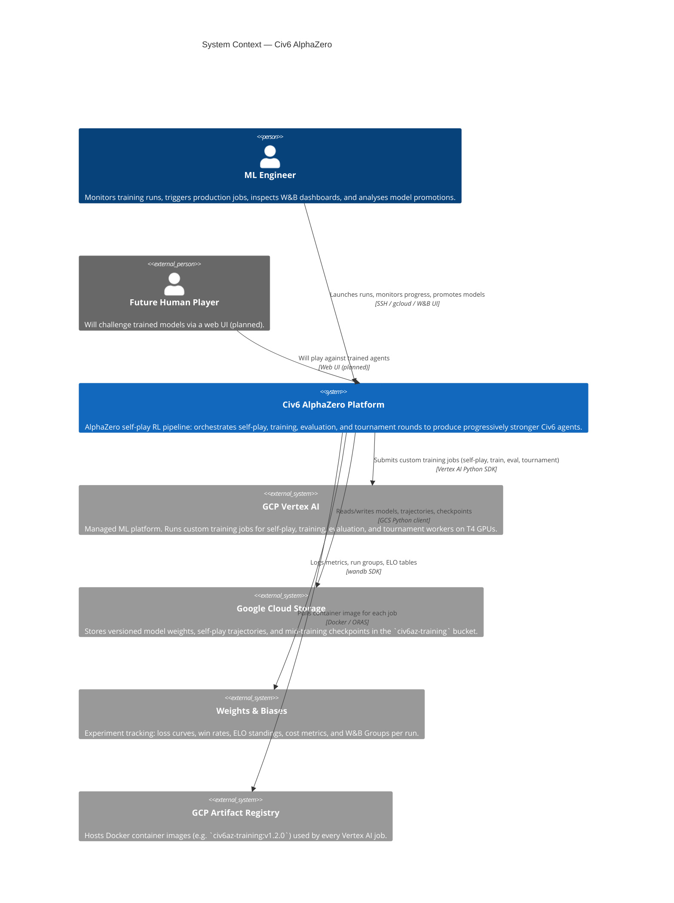
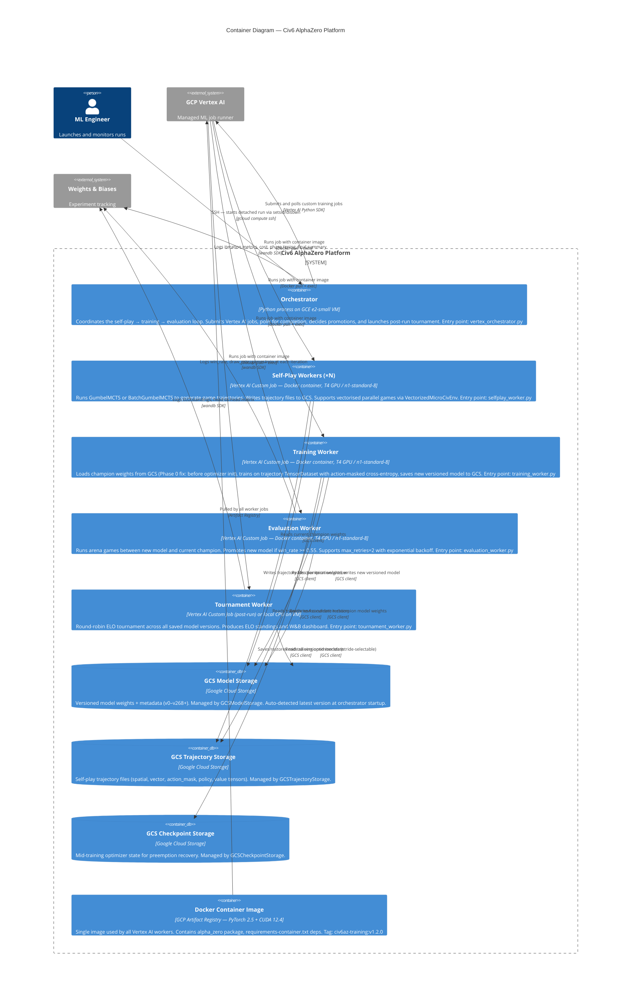
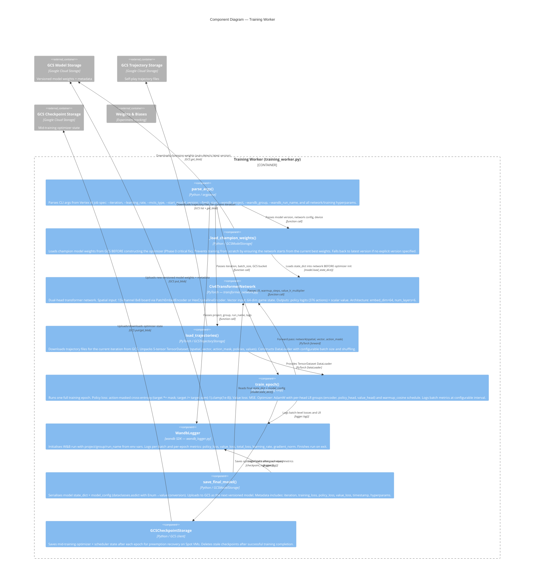

# C4 Architecture — Civ6 AlphaZero

Architecture documentation using the C4 model (Levels 1–3) with Mermaid diagrams.
This document reflects the production GCP cloud pipeline as of Phase 17 / Phase 0 bug fix.

---

## Level 1: System Context

Shows how external actors and systems interact with the Civ6 AlphaZero training platform.

**Key points:**

- The ML Engineer is the primary operator: they start production runs via SSH on the orchestrator VM (`civ6az-orchestrator`) and monitor results in W&B.
- All compute-intensive work runs on Vertex AI custom jobs, not on the orchestrator VM itself.
- GCS is the single source of truth for model state. The orchestrator auto-detects the latest version at startup.
- W&B Groups tie all phases of a single production run together under one dashboard.

---

## Level 2: Container Diagram

Shows the major deployable units (containers) that compose the platform and how they communicate.

**Key data flows:**

1. **Self-play phase**: Orchestrator submits N parallel Vertex AI self-play jobs. Each loads the current champion model, generates games with GumbelMCTS, and writes trajectory files to GCS.
2. **Training phase**: A single training job reads all new trajectories, loads champion weights before optimizer init (Phase 0 fix), trains for one epoch, and writes a new versioned model to GCS.
3. **Evaluation phase**: An evaluation job loads both the new model and the champion, plays arena games, and promotes the new model if it exceeds the win threshold. Failed evaluations are retried up to 2 times with backoff.
4. **Post-run tournament**: After all iterations, a tournament job loads every model version, runs a round-robin, and publishes ELO standings to W&B.

---

## Level 3: Component Diagram — Training Worker

Shows the internal components of `training_worker.py` and how they interact with each other and with external storage/monitoring.

**Component responsibilities:**

| Component | File | Key responsibility |
|-----------|------|--------------------|
| `parse_args()` | `training_worker.py` | CLI arg parsing; new fields use `getattr(args, field, default)` for backwards compat |
| `_load_champion_weights()` | `training_worker.py` | Phase 0 fix: load weights **before** `torch.optim.AdamW(...)` so optimizer starts from champion state |
| `Civ6TransformerNetwork` | `transformer_network.py` | 3-input forward: `(spatial, vector, action_mask)` → `(policy_logits, value)` |
| `load_trajectories()` | `training_worker.py` | 5-tensor TensorDataset; action_mask included since Phase 17 |
| `train_epoch()` | `training_worker.py` | Masked cross-entropy policy loss; per-head AdamW param groups; warmup_cosine LR |
| `WandbLogger` | `utils/wandb_logger.py` | W&B init/log/finish; reads `WANDB_GROUP`/`WANDB_RUN_NAME` env vars set by orchestrator |
| `save_final_model()` | `training_worker.py` | Enum→value conversion required before `dataclasses.asdict()` for JSON serialisation |
| `GCSCheckpointStorage` | `storage.py` | Uses `backend.upload_blob`/`download_blob`/`delete_blob` (not higher-level wrappers) |

---

## Architecture Decision Record

| Decision | Rationale |
|----------|-----------|
| Single Docker image for all workers | Simplifies versioning; avoids image drift between self-play and training |
| Orchestrator runs on e2-small VM (not Vertex AI) | Orchestrator is blocked in container mode (`entrypoint.py --mode=orchestrator` exits 1); VM avoids Vertex AI idle costs |
| `_load_champion_weights()` called before optimizer init (Phase 0) | AdamW initialises momentum buffers from current param values; loading weights after init means optimizer state diverges from the loaded weights, causing effective training from scratch |
| action_mask in trajectory + training | Prevents policy from assigning probability to illegal actions; ensures masked cross-entropy target sums to 1 over legal actions only |
| GumbelMCTS as default MCTS type | 13× faster than Civ6MCTS (no Dirichlet noise required); enables 200 games/iteration within Vertex AI job time limits |
| W&B Groups set by orchestrator env var | Ties all self-play/training/eval phases in one production run under a single W&B group for easy comparison |
| Auto-detect latest model from GCS | No `--start_model_version` needed at orchestrator startup; prevents off-by-one errors when resuming interrupted runs |
| Per-head LR multipliers (value_lr_multiplier=0.1) | Value head receives 10× lower LR to stabilise value correlation, which was highly variable (0.07–0.91) in early runs |
