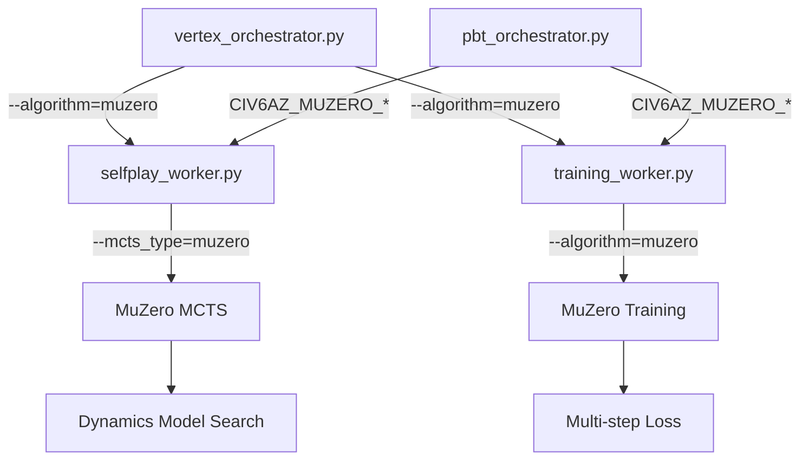

# MuZero Cloud Integration Guide

Reference for running MuZero training on Vertex AI alongside the existing AlphaZero pipeline.

## Overview

MuZero integration adds a parallel training path to the existing cloud infrastructure. All changes are backwards-compatible — the default behavior remains AlphaZero unless explicitly overridden.

## Architecture



## CLI Flags

### vertex_orchestrator.py

| Flag | Values | Default | Description |
|------|--------|---------|-------------|
| `--algorithm` | `alphazero`, `muzero` | `alphazero` | Selects the training algorithm |

When `--algorithm=muzero`:

- Self-play workers receive `--mcts_type=muzero`
- Training workers receive `--algorithm=muzero`

### selfplay_worker.py

| Flag | Values | Default | Description |
|------|--------|---------|-------------|
| `--mcts_type` | `civ6`, `gumbel`, `batch_gumbel`, `muzero` | `gumbel` | MCTS variant to use |

Values and default come from `VALID_MCTS_TYPES` / `DEFAULT_MCTS_TYPE` in
`alpha_zero/cloud/gcp/config.py` — a single source shared by `selfplay_worker`,
`evaluation_worker` and `vertex_orchestrator`.

When `--mcts_type=muzero`:

- Loads a `MuZeroNetwork` instead of `Civ6TransformerNetwork`
- Uses dynamics model for tree search (no env cloning)
- Trajectories include `reward_targets` and `value_targets`

### training_worker.py

| Flag | Values | Default | Description |
|------|--------|---------|-------------|
| `--algorithm` | `alphazero`, `muzero` | `alphazero` | Training algorithm |

When `--algorithm=muzero`:

- Creates `MuZeroNetwork` with representation, dynamics, and prediction heads
- Uses multi-step unrolled training loss
- Saves `"algorithm": "muzero"` in model metadata

## PBT Orchestrator

The PBT orchestrator passes MuZero flags via environment variables:

| Variable | Description |
|----------|-------------|
| `CIV6AZ_MUZERO_ENABLED` | Set to `"1"` to enable MuZero |
| `CIV6AZ_MUZERO_NUM_UNROLL_STEPS` | Number of unroll steps for training |
| `CIV6AZ_MUZERO_TD_STEPS` | TD-lambda steps |

When active, the PBT orchestrator appends `--mcts_type=muzero` and `--algorithm=muzero` to worker CLI args.

## Benchmark Framework

`alpha_zero/evaluation/muzero_vs_alphazero_benchmark.py` provides head-to-head comparison:

```python
from alpha_zero.evaluation.muzero_vs_alphazero_benchmark import (
    AlphaZeroVsMuZeroBenchmark,
    BenchmarkConfig,
)

config = BenchmarkConfig(
    num_games=100,
    mcts_simulations=400,
    board_size=8,
    action_space_size=376,
)

benchmark = AlphaZeroVsMuZeroBenchmark(config)
report = benchmark.run_comparison()
benchmark.generate_report(report, output_dir="benchmark_results")
```

### Tracked Metrics

- Win rate per algorithm
- Search efficiency (env clones vs dynamics calls)
- Game length distribution
- Network evaluations per move
- Training speed (games/minute)

## Search Efficiency Report

Generate standalone search efficiency comparison reports:

```bash
# From benchmark output files
python scripts/search_efficiency_report.py \
    --benchmark_results benchmark_results/benchmark_report.json \
    --output_dir reports/search_efficiency

# From W&B runs
python scripts/search_efficiency_report.py \
    --wandb_run <run_id> \
    --output_dir reports/search_efficiency
```

## Quick Start

```bash
# Run MuZero training via Vertex AI
python -m alpha_zero.cloud.gcp.vertex_orchestrator \
    --algorithm=muzero \
    --iterations=50 \
    --mcts_simulations=400

# Run benchmark comparison
python -m alpha_zero.evaluation.muzero_vs_alphazero_benchmark \
    --num_games=100 \
    --mcts_simulations=400
```

## Test Coverage

| Test File | Tests | Covers |
|-----------|-------|--------|
| `test_selfplay_worker_muzero.py` | 12 | MuZero self-play model loading and selfplay |
| `test_training_worker_muzero.py` | 8 | MuZero training model creation and training |
| `test_vertex_orchestrator_muzero.py` | 10 | Algorithm flag propagation |
| `test_benchmark_framework.py` | 14 | Benchmark config, results, reports |
| `test_orchestrator_algorithm_routing.py` | 15 | Routing regression guards |
| `test_selfplay_muzero_dispatch.py` | 5 | main() dispatch to MuZero/AZ functions |
| `test_training_muzero_dispatch.py` | 5 | main() dispatch to MuZero/AZ model creation |
| `test_search_efficiency_report.py` | 10 | Search efficiency report generation |
