# C4 Architecture Documentation - Civ6 AlphaZero AI

> Complete architectural visualization using C4 model and Mermaid diagrams.
> Reflects all 6 implementation phases including GCP cloud infrastructure.

> **Last reconciled: 2026-06-20 (v1.7.0).** For the authoritative, up-to-date list of
> `alpha_zero/` submodules and their responsibilities, see
> [`MODULE_REFERENCE.md`](MODULE_REFERENCE.md). The phase table and diagrams below are a
> historical/architectural narrative and may lag the latest module additions.

## Project Status

| Phase | Description | Status |
|-------|-------------|--------|
| Phase 1 | Core AlphaZero (MCTS + Neural Network) | ✅ Complete |
| Phase 2 | Hierarchical Reinforcement Learning | ✅ Complete |
| Phase 3 | Training Improvements (Curriculum, Rewards) | ✅ Complete |
| Phase 4 | Unified Training Orchestrator | ✅ Complete |
| Phase 5a | RAG-LLM Integration | ✅ Complete |
| Phase 5b | GCP/Vertex AI Cloud Infrastructure | ✅ Complete |
| Phase 5c | Cost Optimization & Resource Management | ✅ Complete |
| Phase 6 | ~~Agentic Framework~~ (removed in Phase 11) | ❌ Removed |
| Phase 7 | Production PBT Scaling & Validation | ✅ Complete |
| Phase 8 | Training Safeguards & Automated Intervention | ✅ Complete |
| Phase 9 | MuZero Integration Bridge | ✅ Complete |
| Phase 10 | Tournament & Matchmaking System | ✅ Complete |
| Phase 11 | Code Quality & Tech Debt Reduction | ✅ Complete |
| Phase 12-Prep | Docker & Vertex AI Smoke Test | ✅ Complete |
| Phase 13 | Multi-Iteration Training & Post-Run Evaluation | ✅ Complete |
| Phase 14 | Learning Signal Validation (20-iteration run) | ✅ Complete |
| Phase 15 | Scaled Training & Value Head Stabilization | ✅ Complete |

**Codebase Statistics:** ~55,000 LOC core, 3,678+ tests, Docker v0.12.0

---

## Level 1: System Context Diagram

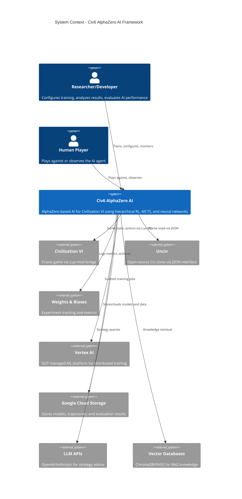

---

## Level 2: Container Diagram

```mermaid
C4Container
    title Container Diagram - Civ6 AlphaZero System

    Person(user, "User/Researcher")

    System_Boundary(c1, "Civ6 AlphaZero System") {
        Container(orchestrator, "Training Orchestrator", "Python", "Unified training coordination, hyperparameter scheduling")
        Container(selfplay, "Self-Play Engine", "Python/multiprocessing", "Generates training data via MCTS games")
        Container(learner, "Neural Network Trainer", "PyTorch", "Optimizes policy and value networks")
        Container(evaluator, "Agent Evaluator", "Python", "Tournament-based performance measurement")
        
        Container(mcts, "MCTS Engine", "Python/NumPy", "Monte Carlo Tree Search with Gumbel/PUCT")
        Container(network, "Neural Networks", "PyTorch", "ResNet, Transformer, Hierarchical architectures")
        Container(factory, "MCTS Factory", "Python", "Creates MCTS variants by name")
        Container(buffer, "Replay Buffer", "Python", "Prioritized experience storage")
        
        Container(hierarchical, "Hierarchical RL", "Python", "3-level decision hierarchy with goal conditioning")
        Container(mechanics, "Game Mechanics", "Python", "11 Civ6 subsystems simulation")
        Container(rag, "RAG Pipeline", "Python/async", "Knowledge retrieval and LLM integration")
        
        Container(microciv, "MicroCiv Environment", "Python/Gymnasium", "Simplified Civ6 for fast training")
        Container(bridge, "Civ6 Bridge", "Python/Lua", "Real game file-based IPC")
        
        Container(cloud, "GCP Cloud Layer", "Python/GCS/Vertex", "Distributed training infrastructure")
        Container(pbt, "Population-Based Training", "Python", "Hyperparameter evolution")
        Container(agentic, "Agentic Framework", "Python", "Claude Code development workflows")
    }

    System_Ext(wandb, "W&B Cloud")
    System_Ext(vertex, "Vertex AI", "GCP managed ML platform")
    System_Ext(gcs, "Google Cloud Storage", "Cloud object storage")

    Rel(user, orchestrator, "Configures, monitors")
    Rel(orchestrator, selfplay, "Triggers games")
    Rel(orchestrator, learner, "Triggers training")
    Rel(orchestrator, evaluator, "Triggers evaluation")
    Rel(orchestrator, pbt, "Hyperparameter optimization")
    
    Rel(selfplay, mcts, "Tree search")
    Rel(selfplay, buffer, "Stores experience")
    Rel(mcts, network, "Policy/value queries")
    Rel(mcts, hierarchical, "Multi-level search")
    
    Rel(learner, network, "Updates weights")
    Rel(learner, buffer, "Samples batches")
    
    Rel(selfplay, microciv, "Training games")
    Rel(selfplay, bridge, "Real Civ6 games")
    Rel(microciv, mechanics, "Game rules")
    
    Rel(selfplay, factory, "Creates MCTS instances")
    Rel(evaluator, factory, "Creates MCTS instances")
    
    Rel(orchestrator, rag, "Strategy context")
    Rel(orchestrator, cloud, "Distributed execution")
    Rel(cloud, vertex, "Submits jobs")
    Rel(cloud, gcs, "Storage operations")
    Rel(orchestrator, wandb, "Metrics logging")
```

## Cloud Training Pipeline

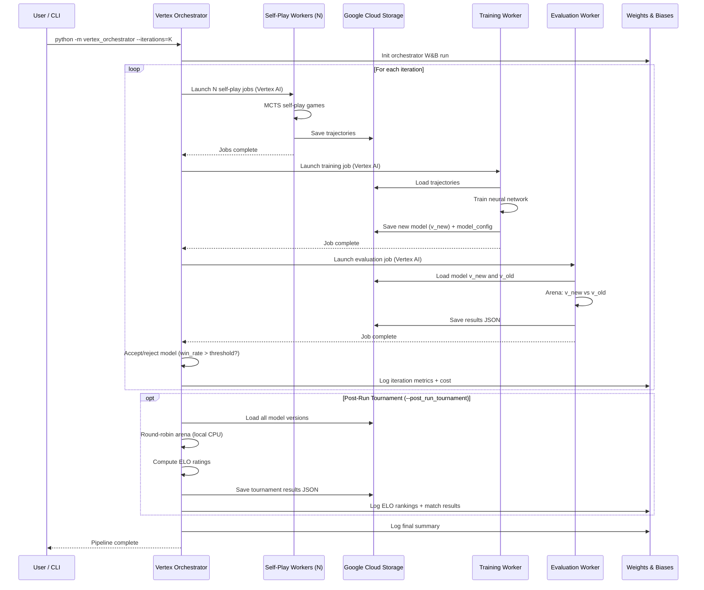

---

## Level 3: Component Diagram - Core AI Layer

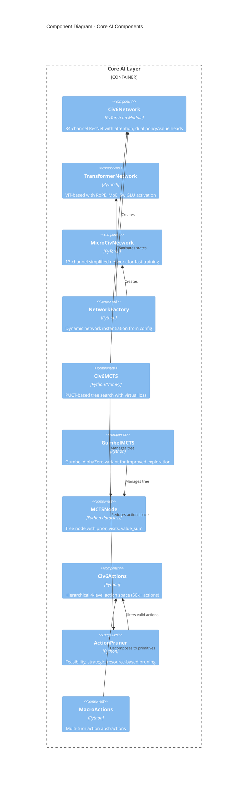

---

## Level 3: Component Diagram - Hierarchical RL Layer

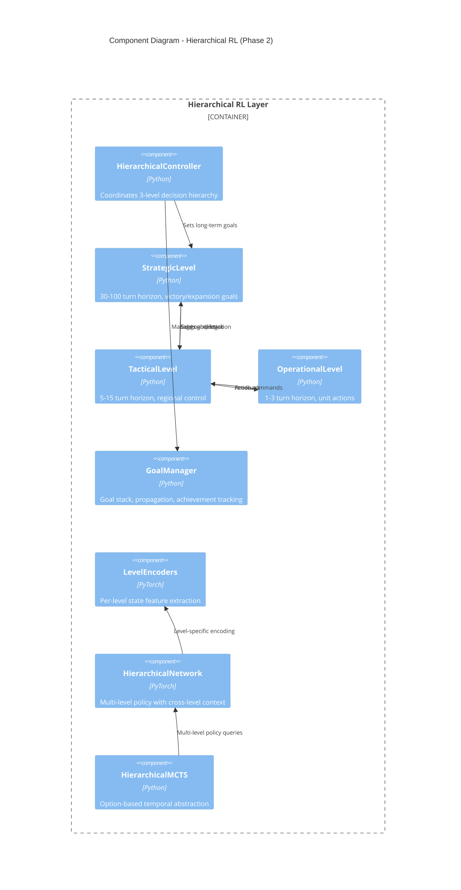

---

## Level 3: Component Diagram - GCP Cloud Infrastructure

```mermaid
C4Component
    title Component Diagram - GCP Cloud Infrastructure (Phase 5b/5c)

    Container_Boundary(cloud, "GCP Cloud Layer") {
        Component(gcpconfig, "GCPConfig", "Python dataclass", "Environment-based configuration")
        Component(vertexclient, "VertexAIClient", "Python/aiplatform", "Job submission abstraction")
        Component(vertexjobs, "VertexJobs", "Python", "SelfPlay and Training job wrappers")

        Component(gcsstorage, "GCSStorage", "Python/GCS", "Model, trajectory, checkpoint backends")
        Component(modelstorage, "GCSModelStorage", "Python", "Versioned model weights with latest.json")
        Component(trajstorage, "GCSTrajectoryStorage", "Python", "Sharded, LZMA-compressed trajectories")

        Component(selfplayworker, "SelfPlayWorker", "Python", "Stateless parallel game generation")
        Component(trainingworker, "TrainingWorker", "Python", "Centralized learner with checkpointing")
        Component(evalworker, "EvaluationWorker", "Python", "Model arena with Civ6TransformerNetwork")

        Component(arena, "Arena", "Python", "Shared arena logic for eval + tournament")
        Component(netconfig, "NetworkArchitectureConfig", "Python dataclass", "Single source of truth for architecture")
        Component(orchestrator, "VertexOrchestrator", "Python", "Multi-iteration pipeline + W&B + post-run tournament")

        Component(costmonitor, "CostMonitor", "Python", "Budget tracking via Billing API")
        Component(gpuscheduler, "GPUScheduler", "Python", "Dynamic T4/L4/A100 selection")
        Component(idlemanager, "IdleManager", "Python", "Inactive worker termination")
        Component(quotamanager, "QuotaManager", "Python", "Pre-submission quota validation")
        Component(preemption, "PreemptionHandler", "Python", "Spot VM recovery with manifests")
    }

    System_Ext(vertexai, "Vertex AI")
    System_Ext(gcs, "Cloud Storage")
    System_Ext(billing, "Cloud Billing")

    Rel(vertexclient, vertexai, "CustomJob submission")
    Rel(gcsstorage, gcs, "Blob operations")
    Rel(costmonitor, billing, "Budget queries")

    Rel(orchestrator, vertexjobs, "Launches worker jobs")
    Rel(orchestrator, arena, "Post-run tournament")
    Rel(vertexjobs, selfplayworker, "Launches")
    Rel(vertexjobs, trainingworker, "Launches")
    Rel(evalworker, arena, "Arena games")
    Rel(selfplayworker, trajstorage, "Pushes shards")
    Rel(trainingworker, modelstorage, "Promotes versions")
    Rel(netconfig, selfplayworker, "Architecture defaults")
    Rel(netconfig, trainingworker, "Architecture defaults")
    Rel(netconfig, evalworker, "Architecture defaults")

    Rel(gpuscheduler, vertexjobs, "GPU tier selection")
    Rel(idlemanager, vertexjobs, "Terminates idle")
    Rel(preemption, gcsstorage, "Recovery from manifests")
```

---

## Level 3: Component Diagram - Game Mechanics Layer

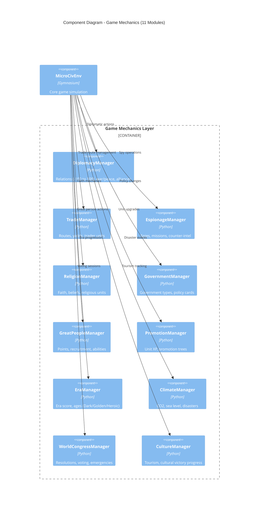

---

## Level 3: Component Diagram - RAG & LLM Integration

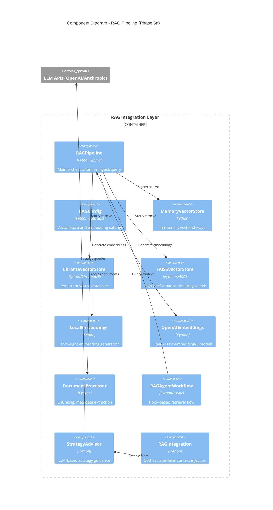

---

## Level 3: Component Diagram - Training Orchestrator

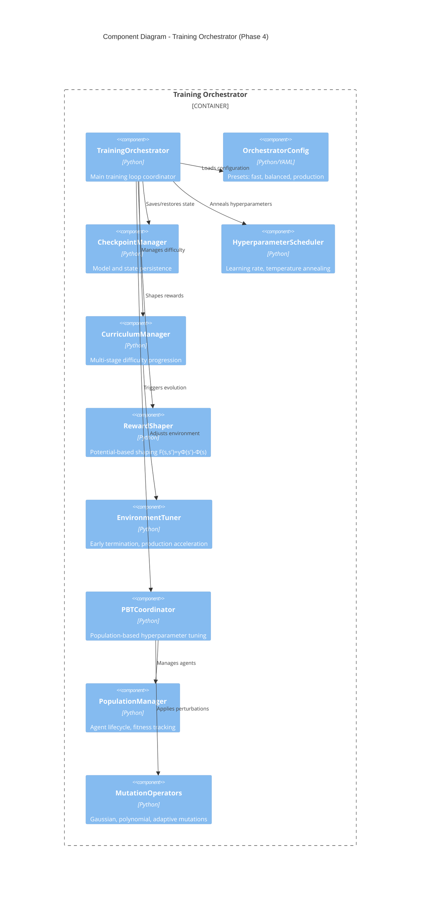

---

## Level 3: Component Diagram - Agentic Framework (Removed)

> The agentic framework (~14,600 LOC) was removed in Phase 11 as dead code. See CHANGELOG.md for details.

---

## Level 3: Component Diagram - Training Diagnostics & Value Head Stabilization (Phases 14-15)

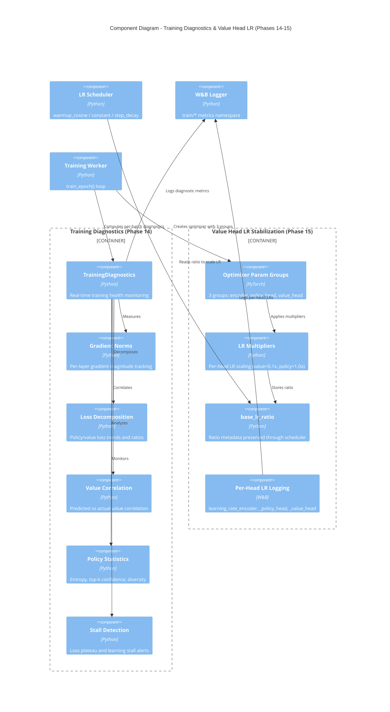

---

## Deployment Diagram

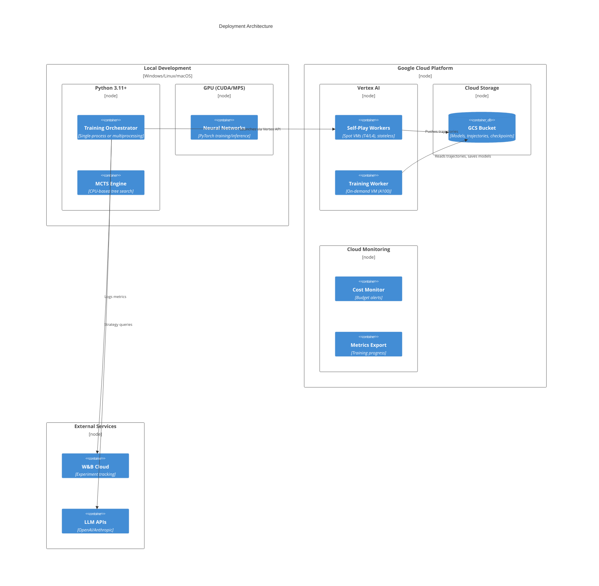

---

## Data Flow Diagram

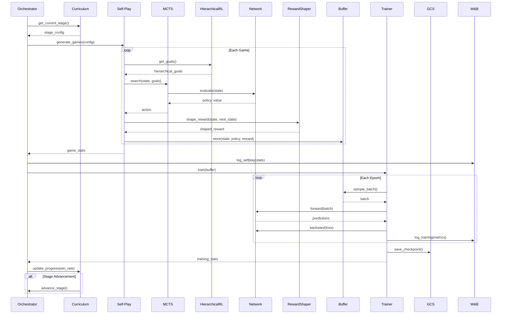

---

## Technology Stack

| Layer | Component | Technology | Purpose |
|-------|-----------|------------|---------|
| **Core AI** | Neural Network | PyTorch 2.0+ | Model training/inference |
| **Core AI** | MCTS | NumPy | Tree search algorithms |
| **Core AI** | Transformer | PyTorch | ViT with RoPE, MoE |
| **Environment** | MicroCiv | Gymnasium | Training simulation |
| **Environment** | Civ6 Bridge | Lua/Python IPC | Real game integration |
| **Training** | Orchestrator | Python | Training coordination |
| **Training** | Distributed | multiprocessing | Parallel self-play |
| **Training** | PBT | Python | Hyperparameter evolution |
| **Cloud** | Compute | Vertex AI | Distributed training |
| **Cloud** | Storage | GCS | Artifacts, checkpoints |
| **Cloud** | Container | Docker + GCR | Containerized workers (v0.12.0) |
| **Cloud** | Optimization | Python | Cost/quota management |
| **Knowledge** | RAG | ChromaDB/FAISS | Vector search |
| **Knowledge** | LLM | OpenAI/Anthropic | Strategy advisor |
| **Logging** | Metrics | W&B, TensorBoard | Experiment tracking |
| **Testing** | Framework | pytest | 3,678+ tests, >80% coverage |
| **Linting** | Quality | ruff, mypy | Static analysis |

---

## Key Architectural Decisions

| Decision | Rationale | Trade-offs |
|----------|-----------|------------|
| **Hierarchical action space** | Reduces branching from 10^6 to 10^3 | Encoding complexity |
| **3-level decision hierarchy** | Temporal abstraction matches game scales | Coordination overhead |
| **Curriculum learning** | Faster convergence, better generalization | Requires environment abstraction |
| **GCP Spot VMs** | 60-91% cost reduction for self-play | Preemption handling complexity |
| **Protocol-driven cloud** | Backend-agnostic design for testability | Abstraction layers |
| **LZMA trajectory compression** | Minimizes GCS egress costs | CPU overhead |
| **RAG integration** | Knowledge-enhanced decisions | Query latency |
| **NetworkArchitectureConfig** | Single source of truth for model dimensions | Must stay in sync with TransformerConfig |
| **Post-run tournament local** | Avoids extra Vertex AI job cost for evaluation | Limited by local CPU speed |
| **model_config persistence** | Enables legacy model loading with correct architecture | Enum→string conversion needed |
| **Per-head LR multipliers** | Value head trains at lower LR to reduce instability | Requires optimizer param groups |
| **base_lr_ratio in param groups** | LR scheduler preserves per-head ratios automatically | Extra metadata in optimizer state |
| **Training diagnostics** | Real-time gradient health, loss trends, value correlation | Minimal overhead per batch |
