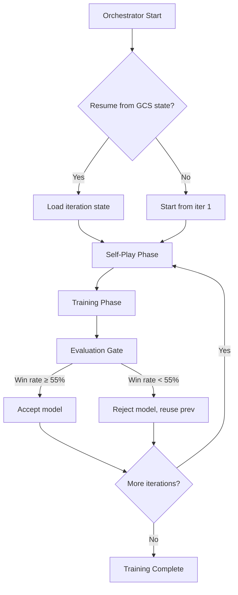
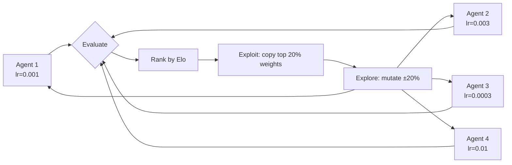
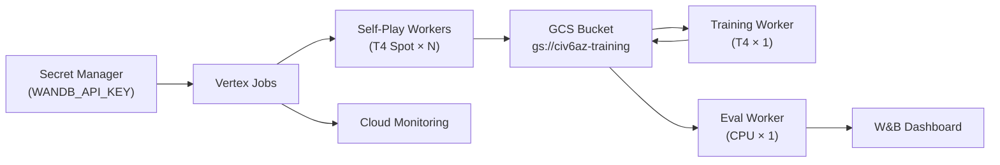

# ADR: Scaling & Optimization Architecture

**Date**: 2026-03-04
**Status**: Proposed
**Author**: AI Agent

## Context

Training validation completed: 49 iterations, 219 model versions on T4 GPUs. Sprint 2 scales to 100+ iterations with PBT hyperparameter optimization and production monitoring.

## Decision

### Multi-Iteration Orchestrator

Use `vertex_orchestrator.py` as the coordinator:

### PBT Architecture

### Data Flow

## Technology Choices

| Component | Choice | Rationale |
|-----------|--------|-----------|
| Orchestration | Vertex AI Custom Jobs | Already in use, mature, no new deps |
| State recovery | GCS JSON markers | Preemption-safe, no DB needed |
| PBT | Custom module | Lightweight, AlphaZero-specific |
| Secrets | GCP Secret Manager | No plain-text keys in job specs |
| Monitoring | Cloud Monitoring + W&B | Dual: infra alerts + ML metrics |

## Risks

| Risk | Severity | Mitigation |
|------|----------|------------|
| Spot VM preemption during PBT | Medium | GCS checkpoint + auto-restart |
| GPU quota exhaustion | High | Budget tier T4 default, fallback A100 |
| W&B rate limiting | Low | Batch logging, offline mode fallback |
| Cost overrun | Medium | Daily spend ceiling via billing alerts |

## Non-Functional Requirements

- **Latency**: Orchestrator loop < 5s overhead per iteration
- **Scalability**: Support 1-20 parallel self-play workers
- **Security**: All secrets via Secret Manager, least-privilege SA
- **Cost**: Max $50/day budget alert
