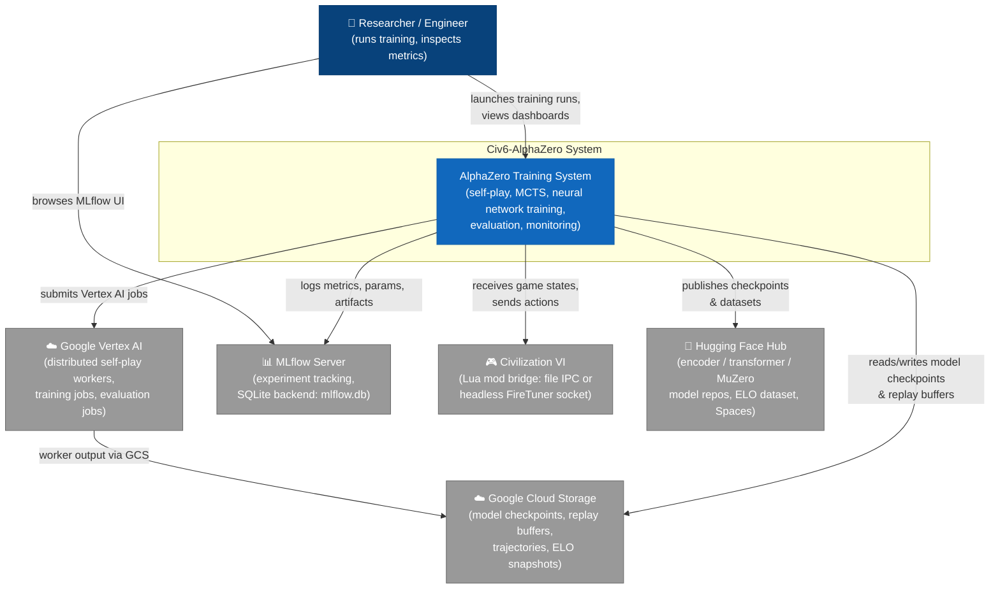
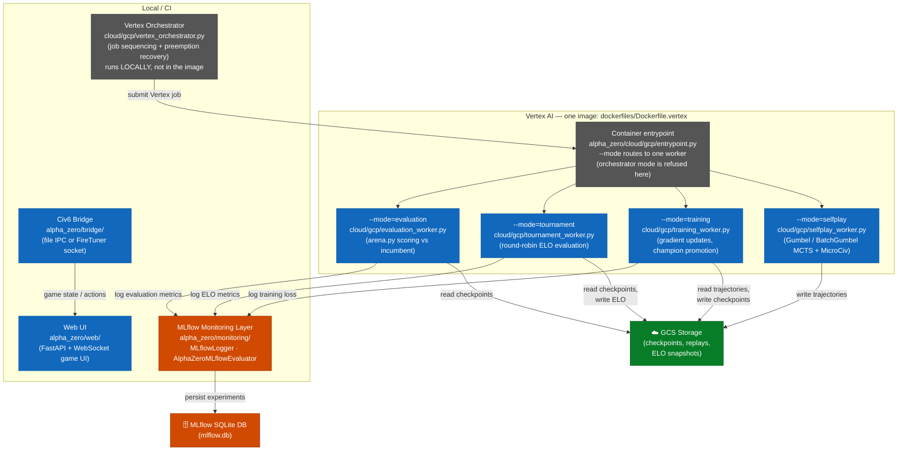
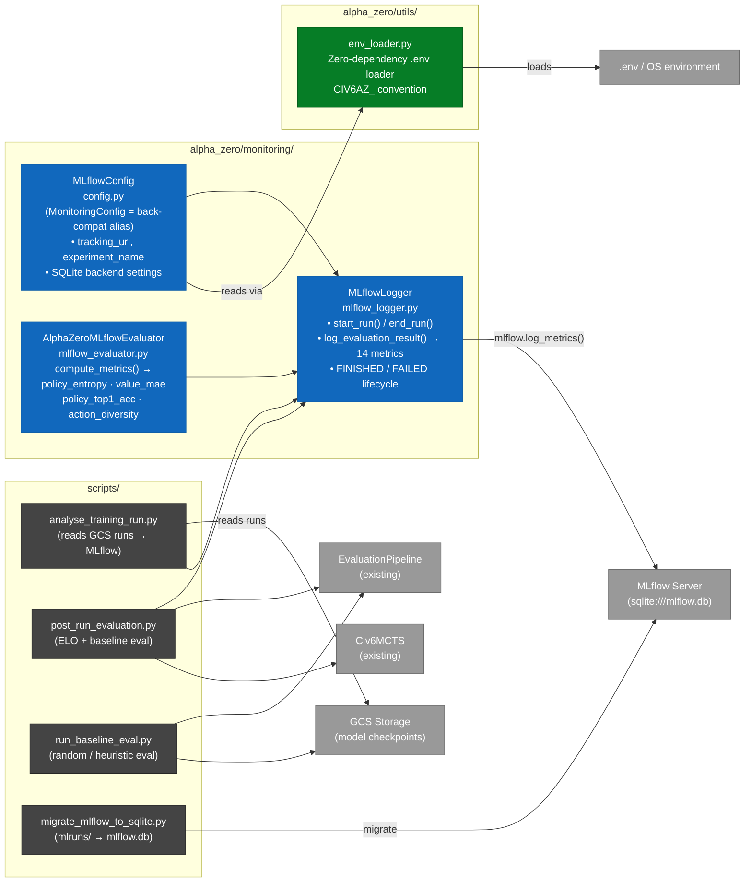
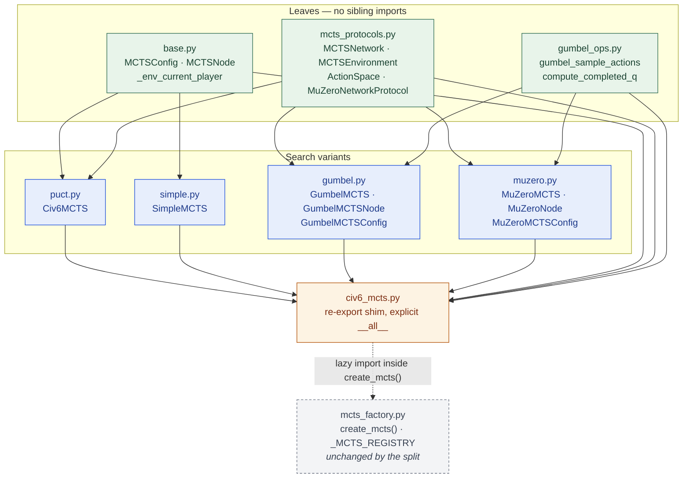
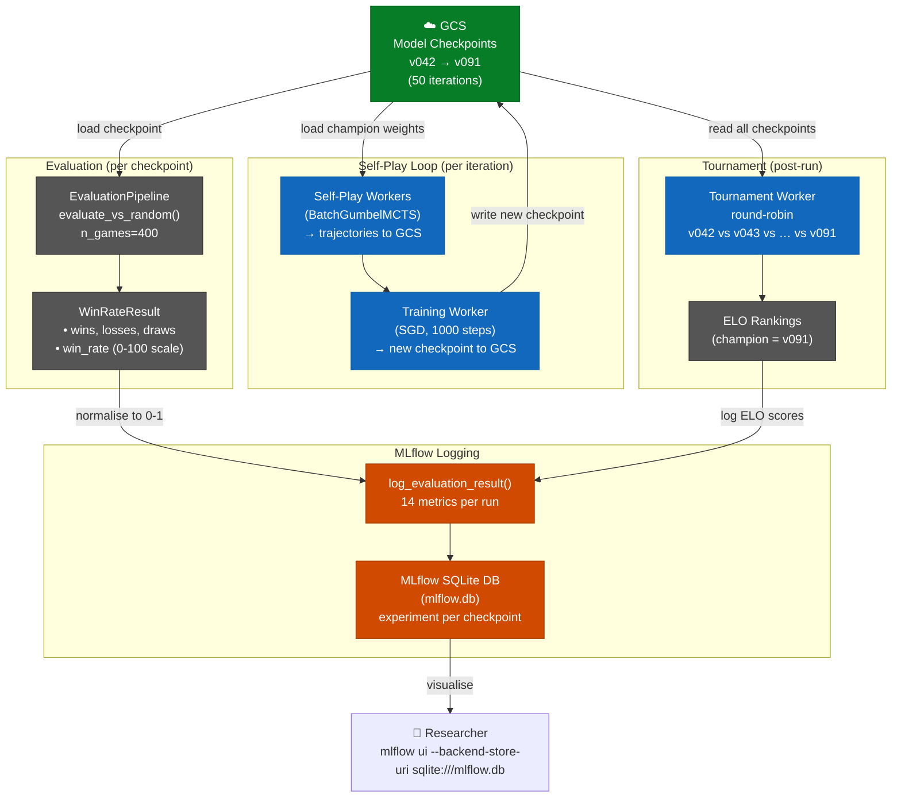
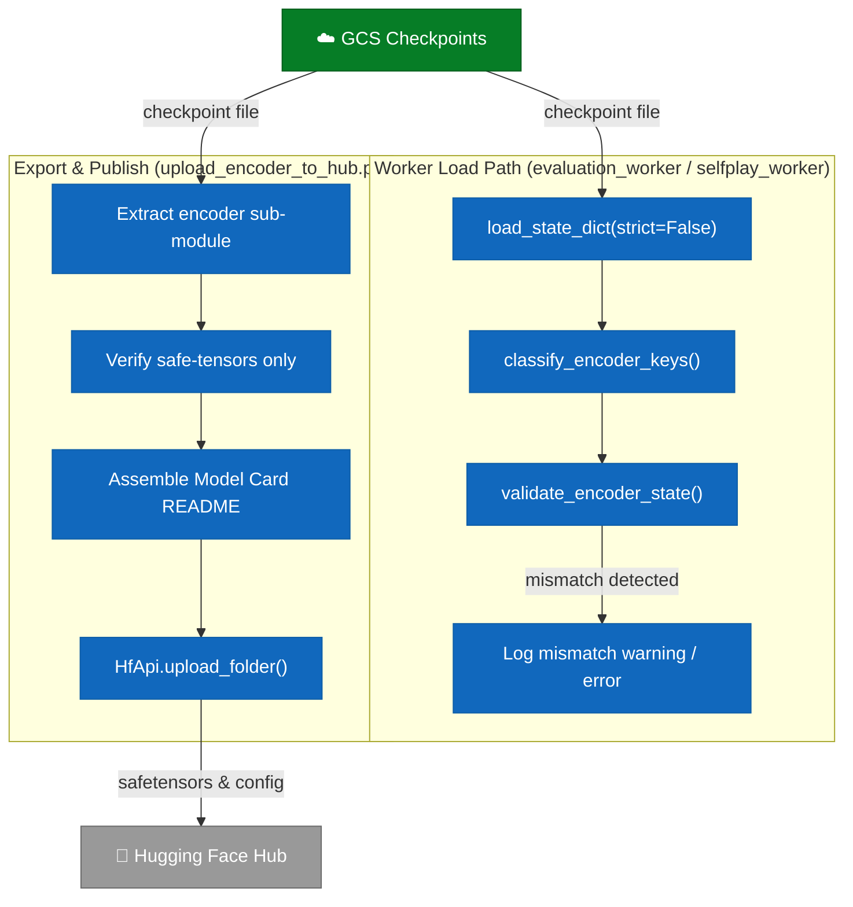

# C4 Architecture Diagrams — Civ6-AlphaZero

> **Standard:** [C4 Model](https://c4model.com/) — four levels of abstraction from system context down to code/data flow.
> Each diagram is a Mermaid flowchart. Render in GitHub, VS Code with the Mermaid extension, or at [mermaid.live](https://mermaid.live).

---

## Level 1 — System Context Diagram

> **Scope:** Civ6-AlphaZero as a black box. Shows the people and external systems that interact with it.

> **Weights & Biases is no longer an external system here.** It was retired on
> 2026-07-13; MLflow is the sole tracker. Only two read-only historical-run
> readers (`scripts/compare_training_runs.py`, `scripts/search_efficiency_report.py`)
> still reach W&B-hosted history, and they are documented as deprecated.

**Legend:**
| Colour | Meaning |
|--------|---------|
| Dark blue | Person (actor) |
| Mid blue | Civ6-AlphaZero system boundary |
| Grey | External system / service |

---

## Level 2 — Container Diagram

> **Scope:** Inside the Civ6-AlphaZero boundary. Shows the major deployable units (containers) and how they communicate.

**There is exactly one training image.** `cloudbuild.yaml` builds only
`dockerfiles/Dockerfile.vertex`, whose `alpha_zero.cloud.gcp.entrypoint` routes
`--mode` to one of four workers in the same image. The four per-role images
(`Dockerfile.base` / `.selfplay` / `.trainer` / `.evaluator`), `docker-compose.yml`
and the LEGACY `alpha_zero/cloud/{selfplay_worker,trainer,evaluator}.py` they
entrypointed were deleted on 2026-09-02 — nothing built or deployed them. The
second image, `dockerfiles/Dockerfile.inference`, is built separately by
`infra/cloudbuild-gameplay.yaml` and serves `alpha_zero/serving/`.

**Container responsibilities:**

| Unit | `--mode` | Technology | Hosts |
|------|----------|-----------|-------|
| Self-Play Worker | `selfplay` | Python / PyTorch / Docker (Vertex) | Gumbel or BatchGumbel MCTS over MicroCiv |
| Training Worker | `training` | Python / PyTorch / Docker (Vertex) | SGD updates, weight promotion |
| Evaluation Worker | `evaluation` | Python (Vertex) | Arena scoring vs the incumbent |
| Tournament Worker | `tournament` | Python (Vertex) | Round-robin, ELO snapshots |
| Vertex Orchestrator | — (local) | Python / google-cloud-aiplatform | Job sequencing, preemption recovery |
| MLflow Monitoring Layer | — (local) | Python / MLflow / SQLite | Experiment tracking (sole tracker) |
| Web UI | — (local) | FastAPI + WebSocket | Human-vs-AI browser interface |
| Civ6 Bridge | — (local) | Python / Lua mod | File IPC or headless FireTuner socket |

---

## Level 3 — Component Diagram (MLflow Monitoring Layer)

> **Scope:** Inside `alpha_zero/monitoring/` and the scripts that drive it. Focuses on the Phase 19 additions.

**14 metrics logged by `log_evaluation_result()`:**

| Category | Metrics |
|----------|---------|
| Counts (4) | `n_games`, `n_wins`, `n_losses`, `n_draws` |
| Normalised rates (3) | `win_rate` (0-1), `loss_rate`, `draw_rate` |
| Game stats (7) | `avg_game_length`, `max_game_length`, `min_game_length`, `avg_score_diff`, `total_turns`, `games_per_second`, `eval_duration_s` |

---

## Level 3 — Component Diagram (MCTS Search Family)

`alpha_zero/core/civ6_mcts.py` held five search variants, four protocols and three
configuration dataclasses in 2,443 lines until 2026-08-30. It is now
`alpha_zero/core/mcts/`, one module per variant, with `civ6_mcts.py` retained as a
re-export shim so every historical import path resolves to the same objects.

The layering below is **enforced, not aspirational**: `tests/unit/test_mcts_split_backcompat.py`
parses module-scope imports and fails if `gumbel` or `muzero` ever import `base`, or if
`muzero` imports the `gumbel` search module. That is why the shared Gumbel-Top-k helpers
live in their own leaf module — `MuZeroMCTS` calls them, and putting them in `gumbel.py`
would have coupled the MuZero variant to the Gumbel variant.

Line counts below were re-measured on 2026-09-02 (`wc -l alpha_zero/core/mcts/*.py`);
they grew with the 2026-08-30 change that gave every search its own RNG.

| Module | Lines | Contents | Depends on |
|---|---:|---|---|
| `mcts_protocols.py` | 161 | `MCTSNetwork`, `MuZeroNetworkProtocol`, `ActionSpace`, `MCTSEnvironment` | — |
| `gumbel_ops.py` | 112 | `gumbel_sample_actions`, `compute_completed_q` | — |
| `base.py` | 223 | `MCTSConfig`, `MCTSNode`, `_env_current_player` | — |
| `puct.py` | 401 | `Civ6MCTS` | `base`, `mcts_protocols` |
| `simple.py` | 199 | `SimpleMCTS` | `base`, `mcts_protocols` |
| `gumbel.py` | 572 | `GumbelMCTS`, `GumbelMCTSNode`, `GumbelMCTSConfig` | `gumbel_ops`, `mcts_protocols` |
| `muzero.py` | 888 | `MuZeroMCTS`, `MuZeroNode`, `MuZeroMCTSConfig` | `gumbel_ops`, `mcts_protocols` |

**Extension seam.** New variants are added through `create_mcts(...)`'s `_MCTS_REGISTRY`
(charter Invariant 1); callers never branch on a concrete MCTS type. The split left that
factory untouched — its lazy import resolves through the shim — so the diff outside the
moved code is the shim and the documentation.

---

## Data Flow Diagram — 50-Iteration Training Run

> **Scope:** End-to-end data flow for a full 50-iteration GCS-backed training run (v042–v091), including how evaluation results reach MLflow.

**Key invariants:**
- `WinRateResult.win_rate` is on a **0–100 scale**; `log_evaluation_result()` normalises to **0–1** before storing in MLflow.
- Each MLflow run corresponds to one model checkpoint (one iteration).
- `resolve_run_id()` auto-detects the latest champion from GCS — no hardcoded UUIDs.

---

## Checkpoint Validation & Hub Publishing

---

*Last revised: 2026-09-02 — Tier A dead-code removal (44 modules / 21,903 lines; the
four per-role Dockerfiles and `docker-compose.yml` with them), W&B removed from the
context diagram, one-image container model made explicit.*
*Architecture version: Phase 21 (Hexcrystal Encoder, SpaceTimeDB, & Spaces Integrations) + MCTS package decomposition*
