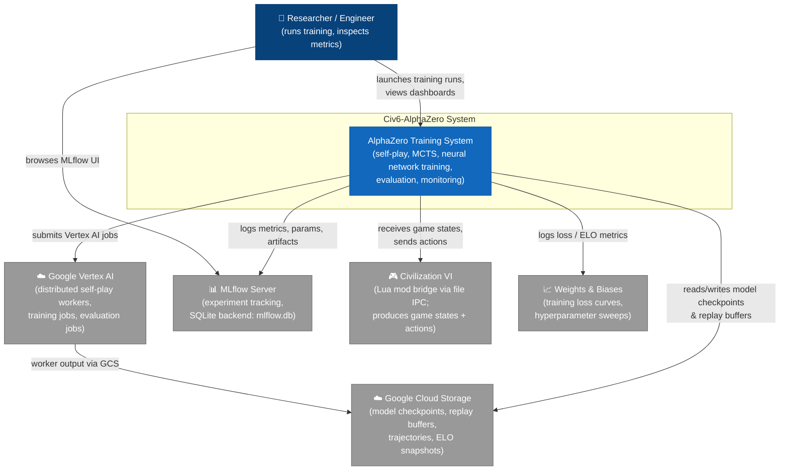
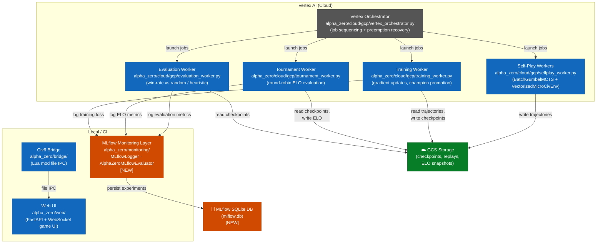
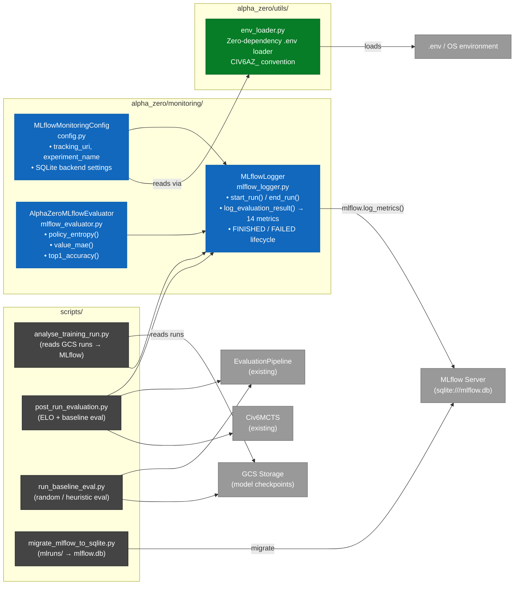
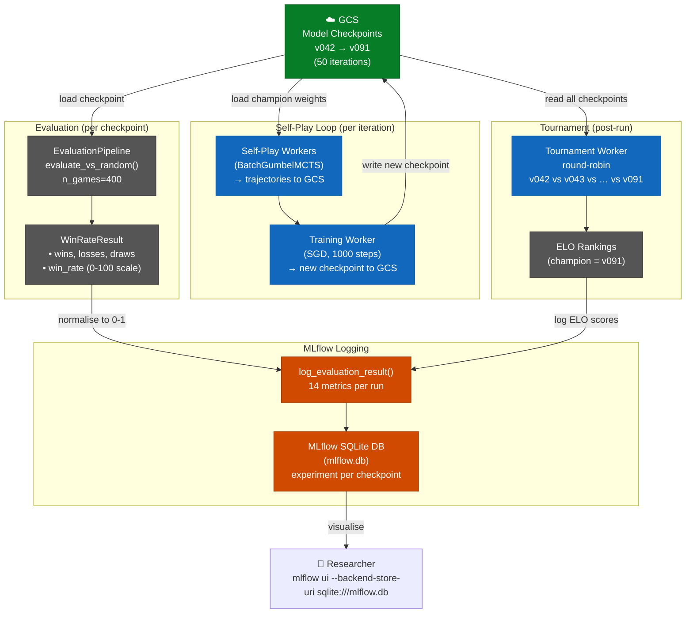
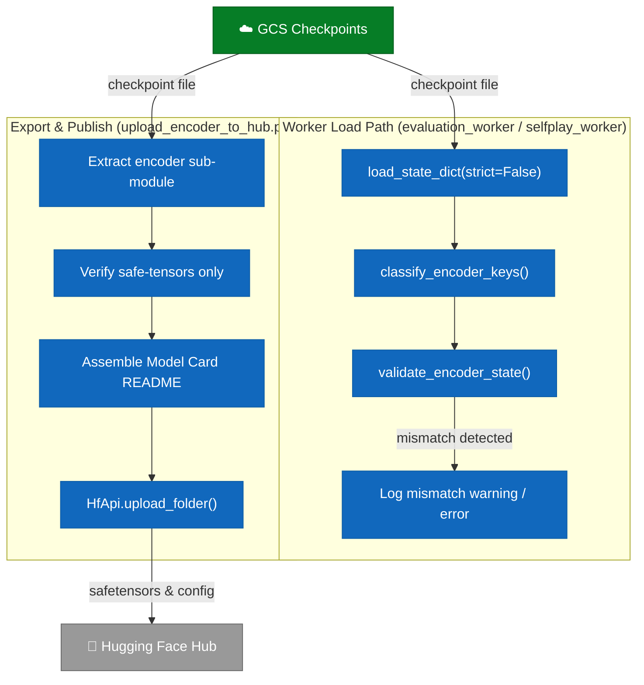

# C4 Architecture Diagrams — Civ6-AlphaZero

> **Standard:** [C4 Model](https://c4model.com/) — four levels of abstraction from system context down to code/data flow.
> Each diagram is a Mermaid flowchart. Render in GitHub, VS Code with the Mermaid extension, or at [mermaid.live](https://mermaid.live).

---

## Level 1 — System Context Diagram

> **Scope:** Civ6-AlphaZero as a black box. Shows the people and external systems that interact with it.

**Legend:**
| Colour | Meaning |
|--------|---------|
| Dark blue | Person (actor) |
| Mid blue | Civ6-AlphaZero system boundary |
| Grey | External system / service |

---

## Level 2 — Container Diagram

> **Scope:** Inside the Civ6-AlphaZero boundary. Shows the major deployable units (containers) and how they communicate.

**Container responsibilities:**

| Container | Technology | Hosts |
|-----------|-----------|-------|
| Self-Play Workers | Python / PyTorch / Docker (Vertex) | BatchGumbelMCTS + VectorizedMicroCivEnv |
| Training Worker | Python / PyTorch / Docker (Vertex) | SGD updates, weight promotion |
| Vertex Orchestrator | Python / google-cloud-aiplatform | Job sequencing, preemption |
| Tournament Worker | Python / ELO library | Round-robin, ELO snapshots |
| Evaluation Worker | Python | Win-rate vs random/heuristic |
| MLflow Monitoring Layer | Python / MLflow / SQLite | Experiment tracking **(NEW)** |
| Web UI | FastAPI + WebSocket | Human-vs-AI browser interface |
| Civ6 Bridge | Python / Lua mod | File-based IPC to real Civ6 |

---

## Level 3 — Component Diagram (MLflow Monitoring Layer)

> **Scope:** Inside `alpha_zero/monitoring/` and the scripts that drive it. Focuses on the Phase 19 additions.

**14 metrics logged by `log_evaluation_result()`:**

| Category | Metrics |
|----------|---------|
| Counts (4) | `n_games`, `n_wins`, `n_losses`, `n_draws` |
| Normalised rates (3) | `win_rate` (0-1), `loss_rate`, `draw_rate` |
| Game stats (7) | `avg_game_length`, `max_game_length`, `min_game_length`, `avg_score_diff`, `total_turns`, `games_per_second`, `eval_duration_s` |

---

## Data Flow Diagram — 50-Iteration Training Run

> **Scope:** End-to-end data flow for a full 50-iteration GCS-backed training run (v042–v091), including how evaluation results reach MLflow.

**Key invariants:**
- `WinRateResult.win_rate` is on a **0–100 scale**; `log_evaluation_result()` normalises to **0–1** before storing in MLflow.
- Each MLflow run corresponds to one model checkpoint (one iteration).
- `resolve_run_id()` auto-detects the latest champion from GCS — no hardcoded UUIDs.

---

## Checkpoint Validation & Hub Publishing

---

*Generated: 2026-08-11*
*Architecture version: Phase 21 (Hexcrystal Encoder, SpaceTimeDB, & Spaces Integrations)*
