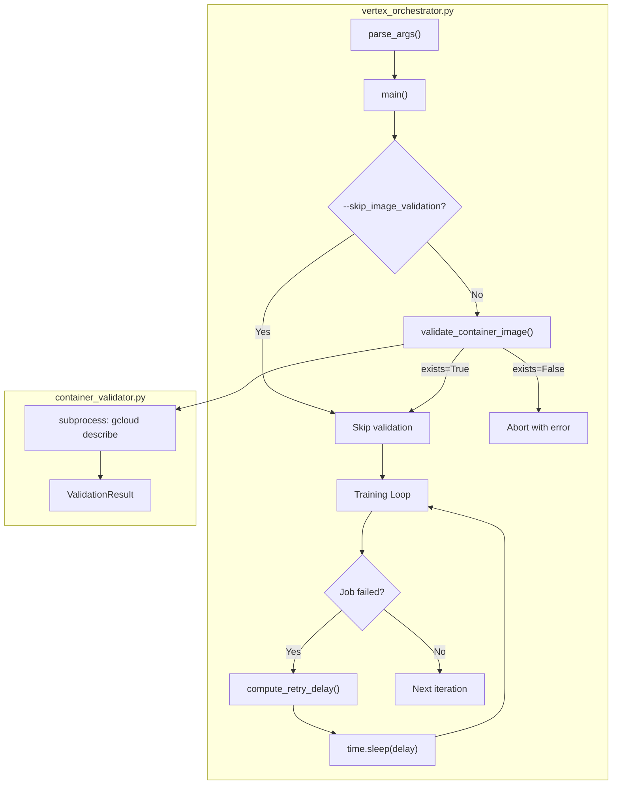

# ADR: Pipeline Hardening — Retry, Validation, and Observability

**Status**: Accepted (shipped; recorded 2026-07-25)  
**Date**: 2026-02-20  
**Epics**: 2 (Backoff), 3 (Validation), 4 (Tests)

---

## Context

The MuZero training pipeline on Vertex AI experienced a 2-hour unattended failure (50+ failed jobs, ~$5 wasted) due to a stale container image. Phase 1 fixed the immediate issue (MCTS type alignment, circuit breaker). Phase 2 addresses structural resilience gaps.

## Decisions

### D1: Exponential Backoff with Jitter

**Decision**: Replace flat `time.sleep(30)` retry delays with `min(base * 2^attempt, max) * (1 ± jitter)`.

**Rationale**:

- Flat delays hammer the API at constant rate during transient failures
- Exponential backoff is industry-standard (AWS, GCP, Azure all recommend it)
- Jitter prevents retry storms from multiple workers hitting the API simultaneously

**Alternatives Considered**:

- **Linear backoff** (30, 60, 90...): Still predictable, no thundering-herd protection
- **Circuit breaker only**: Already implemented (Phase 1), but doesn't address per-retry timing

**Parameters**: `base=30s, max=300s, multiplier=2, jitter=±25%` — configurable via CLI.

### D2: Subprocess-based Container Validation

**Decision**: Use `subprocess.run(["gcloud", "container", "images", "describe", ...])` with 5s timeout.

**Rationale**:

- No additional Python dependencies (vs `google-cloud-artifactregistry` SDK)
- `gcloud` is already required for Vertex AI operations
- 5s timeout prevents hangs from known `gcloud` issues on Windows

**Alternatives Considered**:

- **Docker Python SDK**: Requires `docker` package, adds dependency
- **Artifact Registry Python SDK**: Heavier dependency, overkill for a pre-flight check
- **HTTP API directly**: Requires auth token management, complex

### D3: Graceful Fallback on Validation Failure

**Decision**: If container validation fails (network error, no `gcloud`), log a warning and **continue** (don't block).

**Rationale**:

- Local development without `gcloud` should not be blocked
- CI environments may not have registry access
- The validation is a guard, not a gate

---

## Component Diagram

---

## Non-Functional Requirements

| Requirement | Target |
|---|---|
| Validation overhead | <5 seconds |
| Retry delay range | 30s–300s |
| Test coverage for new code | ≥80% |
| Backwards compatibility | All existing CLI args unchanged |

---

## Risks

| Risk | Impact | Mitigation |
|---|---|---|
| `gcloud` hangs on Windows | Validation blocks startup | 5s subprocess timeout + `--skip_image_validation` |
| Jitter causes very short delays | Insufficient backoff | Floor of `base * 0.75` even at attempt 0 |
| Container registry migration | URI format change | Support both GCR and Artifact Registry URI formats |
