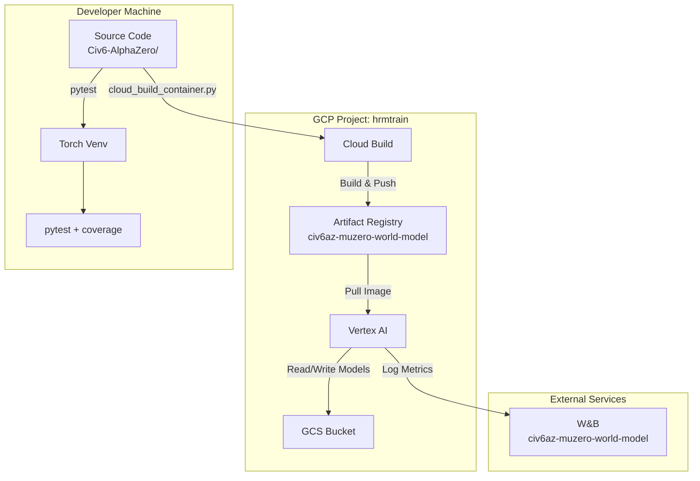
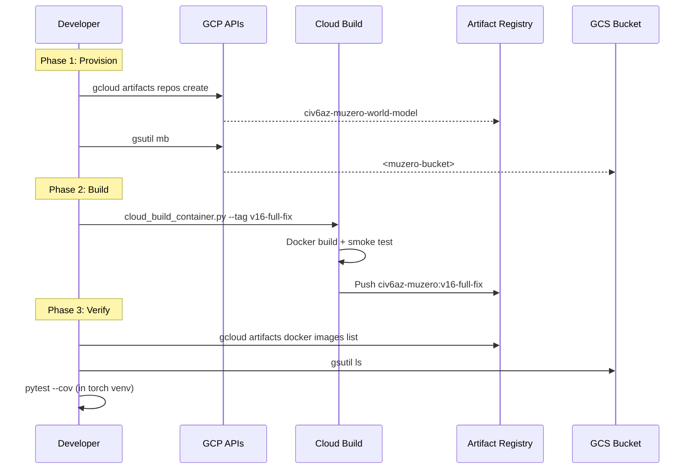

# ADR: GCP Resource Deployment for MuZero-World-Model

> **Status**: Accepted (shipped) | **Date**: 2026-02-20 (recorded 2026-07-25)
> **Deciders**: ianshank (ML Engineer)

---

## Context

The MuZero-World-Model project shares the `hrmtrain` GCP project with other training pipelines. All GCP resource names (AR repo, GCS bucket, container images, job display names, W&B projects) have been renamed in code to isolate this project. This ADR covers the infrastructure provisioning and deployment steps.

---

## System Components



---

## Data Flow



---

## Technology Choices

| Component | Choice | Rationale |
|-----------|--------|-----------|
| Container Registry | Artifact Registry | GCR deprecated; AR supports multi-region, IAM policies |
| Build | Cloud Build | No local Docker needed; reproducible, cached |
| Bucket Location | `us-central1` | Co-located with Vertex AI for low-latency I/O |
| Container Tag | `v16-full-fix` | Matches YAML configs; immutable tag for reproducibility |
| Test Framework | pytest + coverage | Configured in `pyproject.toml`; 80% threshold enforced |

---

## API Contracts

### Provisioning Commands (idempotent)

```bash
# AR repo (409 ALREADY_EXISTS is OK)
gcloud artifacts repositories create civ6az-muzero-world-model \
  --location=us-central1 \
  --repository-format=docker \
  --project=hrmtrain

# GCS bucket (409 ALREADY_EXISTS is OK)
gsutil mb -l us-central1 -p <project> gs://<muzero-bucket>
```

### Container Build

```bash
# Uses cloud_build_container.py which uploads source to GCS
# and triggers Cloud Build with AR as target
python scripts/cloud_build_container.py --tag v16-full-fix
```

### Test Suite

```bash
# From activated torch venv
pytest tests/ -v --cov=alpha_zero --cov-report=html --timeout=300
```

---

## Non-Functional Requirements

| Property | Requirement |
|----------|-------------|
| **Idempotency** | All provisioning commands must be safe to re-run |
| **Isolation** | No shared resources with other `hrmtrain` projects |
| **Rollback** | Old `muzero-world-model` repo kept for 30 days |
| **Security** | IAM roles scoped to the project's default compute service account |
| **Latency** | Container build < 15 min; test suite < 10 min |

---

## Risks & Anti-Patterns

| Risk | Severity | Mitigation |
|------|----------|------------|
| `gcloud` CLI hangs (IPv6) | Medium | Use `gcp_diagnose_and_submit.py` bypass or fix IPv6 |
| Cloud Build quota exceeded | Low | E2_HIGHCPU_8 machine, 1800s timeout |
| torch import slow in tests | Medium | Run tests only in torch-enabled venv, use `-x` for fast-fail |
| AR repo permissions | Low | Service account already has `artifactregistry.writer` |

---

## Decisions Requiring Sign-Off

> [!IMPORTANT]
>
> 1. **Bucket naming**: `<muzero-bucket>` is globally unique. Confirm no collision.
> 2. **Old data**: Existing models in `gs://<training-bucket>/models/civ6az/muzero/` will NOT be migrated. Fresh start confirmed?
> 3. **Venv path**: Tests require torch — need user to confirm which Python environment to use.
