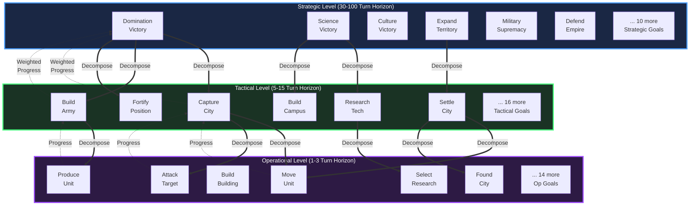
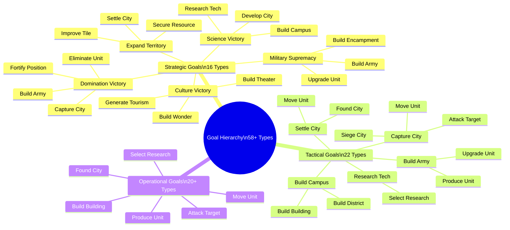
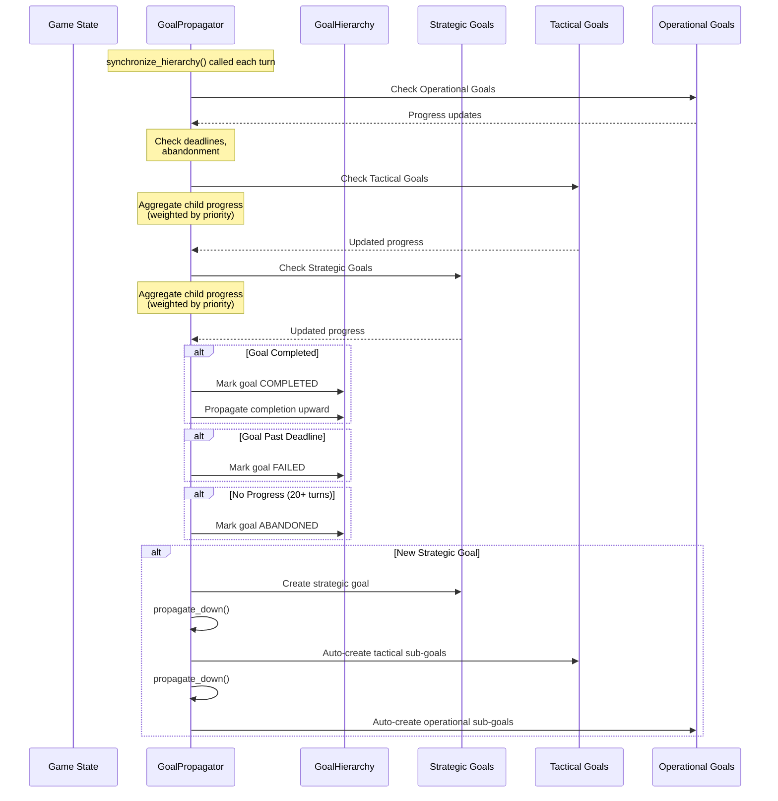
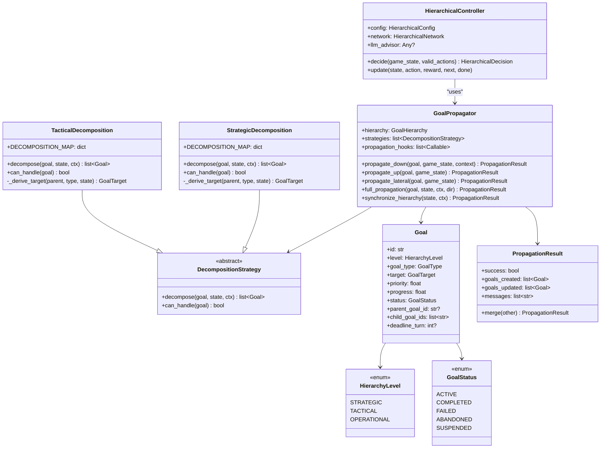
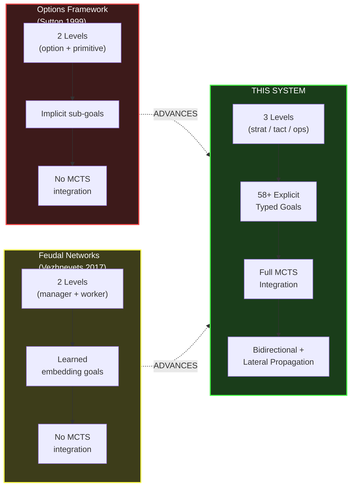

# Patent Case 3: Three-Level Hierarchical MCTS with Goal Propagation

## Architecture Diagram

## Goal Propagation System

```mermaid
flowchart LR
    subgraph PROPAGATION["GoalPropagator - Bidirectional Flow"]
        direction TB

        subgraph DOWN["Downward: Goal Decomposition"]
            direction LR
            D1["Strategic Goal"] --> D2["DecompositionStrategy\n.decompose()"]
            D2 --> D3["Tactical Sub-Goals\n(via DECOMPOSITION_MAP)"]
            D3 --> D4["DecompositionStrategy\n.decompose()"]
            D4 --> D5["Operational Sub-Goals\n(via DECOMPOSITION_MAP)"]
        end

        subgraph UP["Upward: Progress Aggregation"]
            direction RL
            U1["Operational\nProgress"] --> U2["Weighted Sum\n(by priority)"]
            U2 --> U3["Tactical\nProgress"]
            U3 --> U4["Weighted Sum\n(by priority)"]
            U4 --> U5["Strategic\nProgress"]
        end

        subgraph LATERAL["Lateral: Synergy / Conflict Detection"]
            direction LR
            L1["Goal A\n(Build Army)"] <-->|"Synergy\n+10% boost"| L2["Goal B\n(Build Encampment)"]
            L3["Goal C\n(Expand)"] <-->|"Conflict\n-10% priority"| L4["Goal D\n(Defend)"]
        end
    end

    style DOWN fill:#1a2744,stroke:#4aff7f,stroke-width:2px,color:#fff
    style UP fill:#1a2744,stroke:#4a9eff,stroke-width:2px,color:#fff
    style LATERAL fill:#1a2744,stroke:#ffbf4a,stroke-width:2px,color:#fff
```

## Decomposition Maps (Domain Knowledge)

## Synchronize Hierarchy Lifecycle

## Component Class Diagram

## Innovation Comparison

## Data Flow Summary

| Step | Component | Input | Output | Novel? |
|------|-----------|-------|--------|--------|
| 1 | HierarchicalController | Game state | Strategic goal selection | Moderate |
| 2 | StrategicDecomposition | Strategic goal | 2-4 tactical sub-goals | **YES** |
| 3 | TacticalDecomposition | Tactical goal | 1-3 operational sub-goals | **YES** |
| 4 | propagate_up | Child progress | Parent progress (weighted) | **YES** |
| 5 | propagate_lateral | Goal update | Synergy/conflict adjustments | **YES** |
| 6 | synchronize_hierarchy | All active goals | Status/deadline management | **YES** |

> **Key Novelty:** The integration of a 3-level goal hierarchy with explicit domain-specific decomposition maps (58+ goal types), bidirectional propagation (down + up + lateral), and MCTS integration. No prior work combines hierarchical RL with this scale of explicit goal management for complex strategy games.
