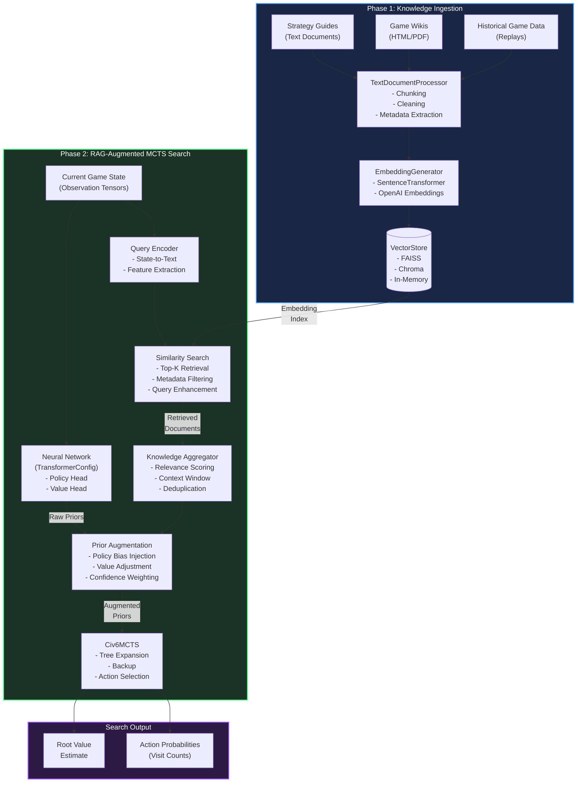
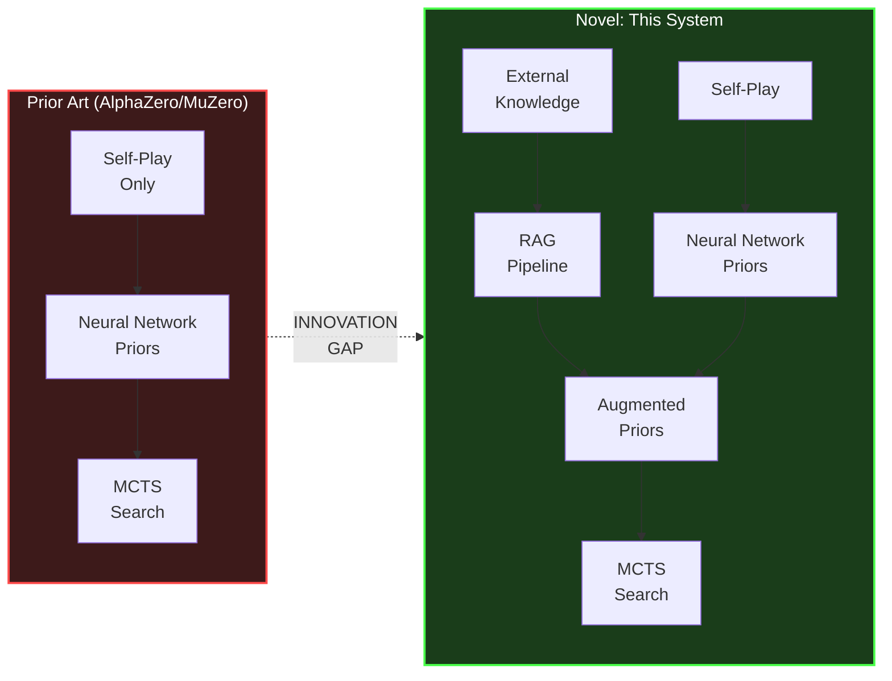
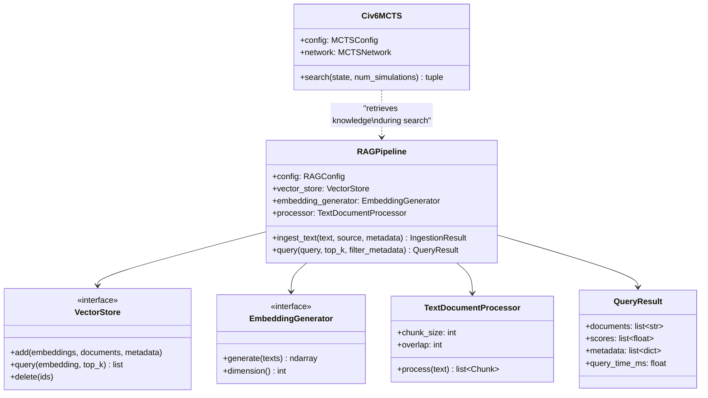

# Patent Case 1: RAG-Enhanced Monte Carlo Tree Search

## Architecture Diagram

## Key Innovation Points

## Component Detail

## Data Flow Summary

| Step | Component | Input | Output | Novel? |
|------|-----------|-------|--------|--------|
| 1 | TextDocumentProcessor | Raw strategy docs | Chunked text segments | No |
| 2 | EmbeddingGenerator | Text chunks | Vector embeddings | No |
| 3 | VectorStore | Embeddings + metadata | Indexed knowledge base | No |
| 4 | Query Encoder | Game state tensor | Text query | **YES** |
| 5 | Similarity Search | Query embedding | Top-K relevant docs | No |
| 6 | Prior Augmentation | NN priors + retrieved docs | Augmented priors | **YES** |
| 7 | Civ6MCTS | Augmented priors | Action selection | **YES** |

> **Key Novelty:** Steps 4, 6, and 7 represent the novel contribution -- converting game state observations into knowledge queries, fusing retrieved knowledge with neural network priors, and using the augmented priors within MCTS search. No prior AlphaZero variant incorporates external retrieval during search.
