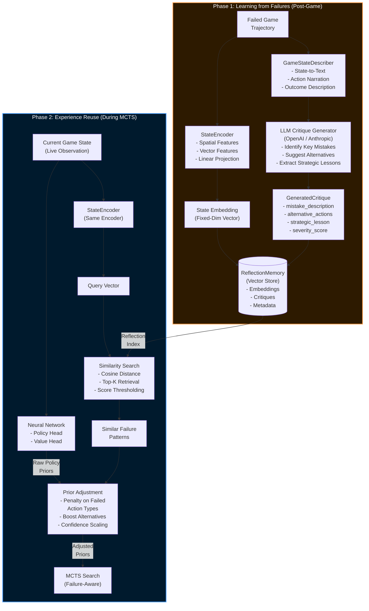
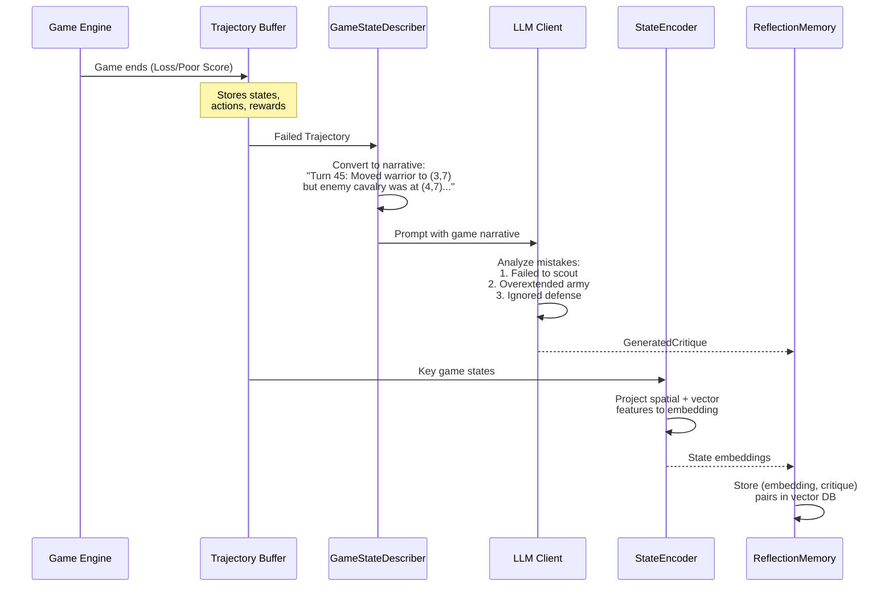
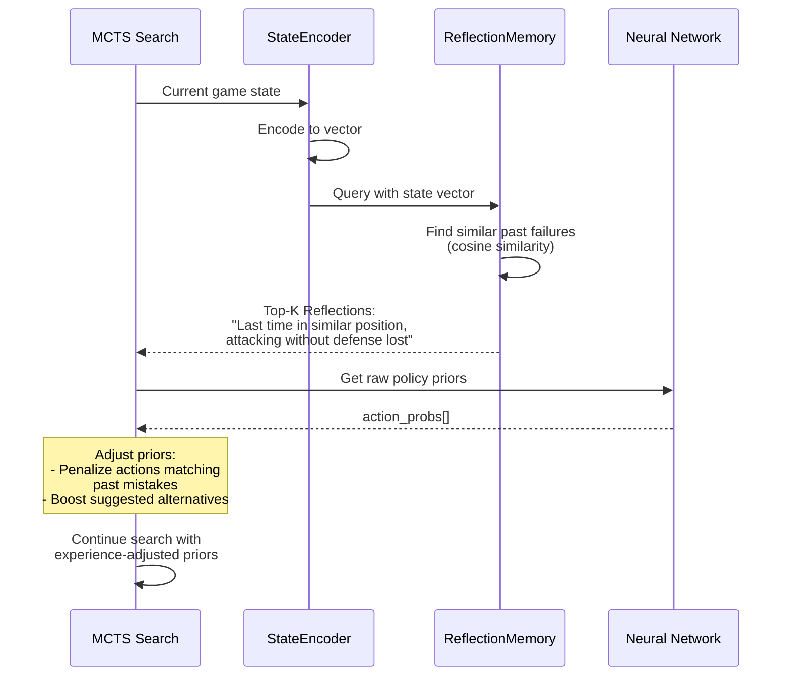
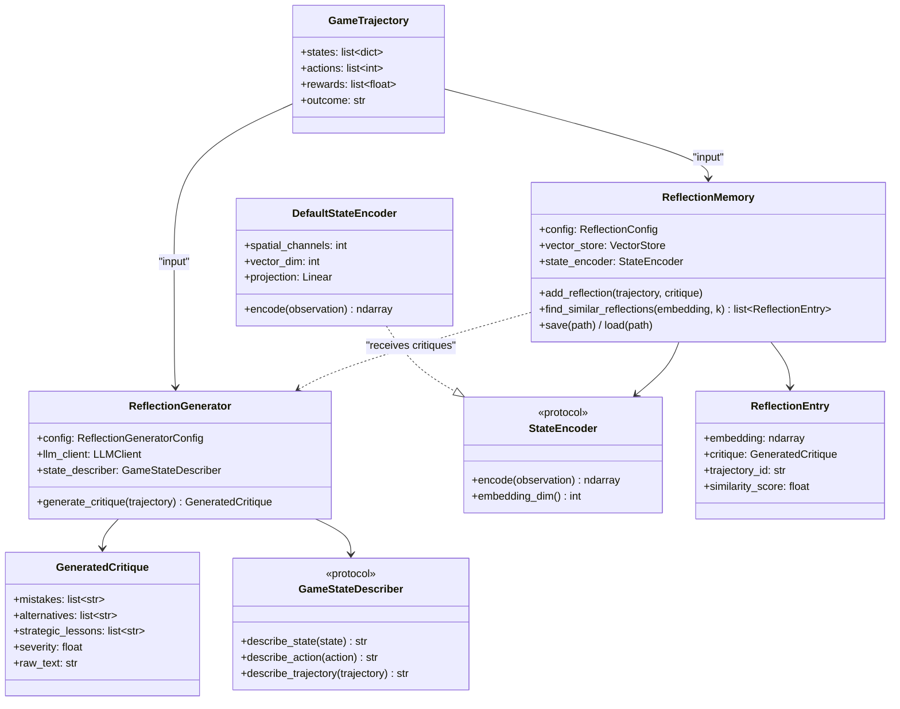
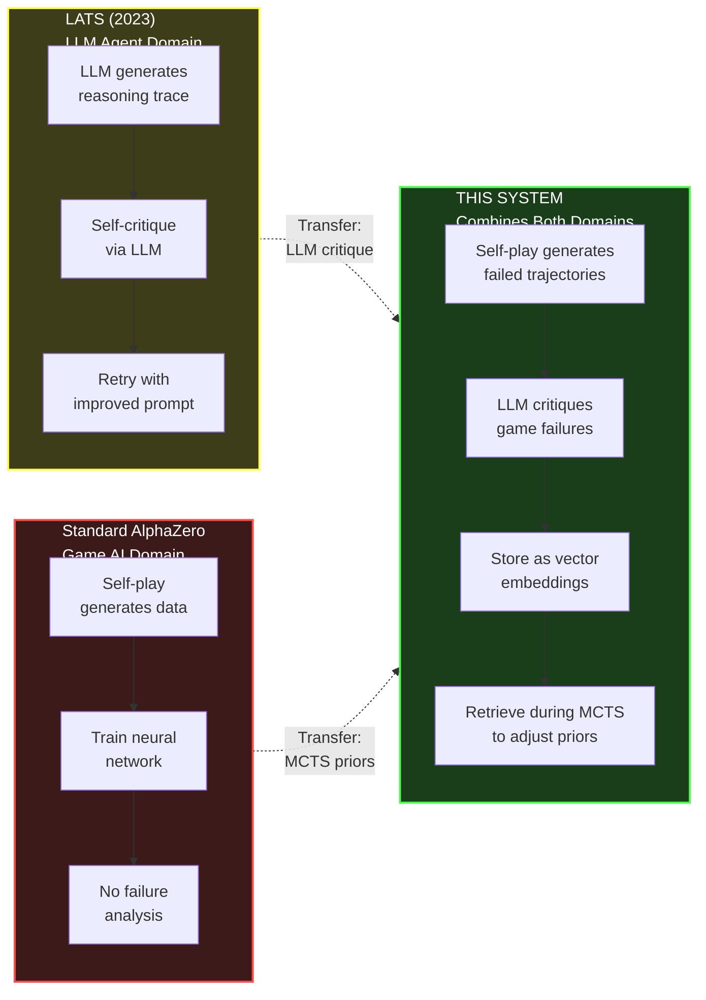

# Patent Case 2: LATS-Style Reflection Memory with Game-State Embedding

## Architecture Diagram

## Critique Generation Flow

## Inference-Time Retrieval Flow

## Component Class Diagram

## Innovation Comparison

## Data Flow Summary

| Step | Component | Input | Output | Novel? |
|------|-----------|-------|--------|--------|
| 1 | GameStateDescriber | Failed trajectory | Text narrative | Moderate |
| 2 | LLM Critique Generator | Game narrative | Structured critique | **YES** |
| 3 | StateEncoder | Game observation | Embedding vector | Moderate |
| 4 | ReflectionMemory.add | Embedding + critique | Stored reflection | **YES** |
| 5 | ReflectionMemory.find | Current state embedding | Similar failures | **YES** |
| 6 | Prior Adjustment | NN priors + failure data | Modified priors | **YES** |

> **Key Novelty:** The transfer of LATS-style verbal self-critique from the LLM domain to neural-network-guided MCTS game agents. The combination of (a) LLM-generated game critiques, (b) game-state embedding similarity search, and (c) MCTS prior adjustment based on retrieved failure patterns is unprecedented.
