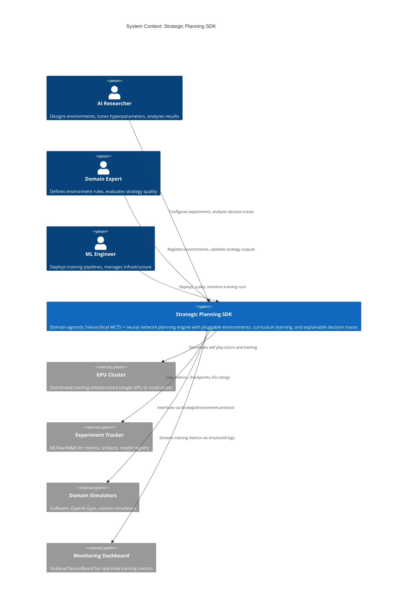
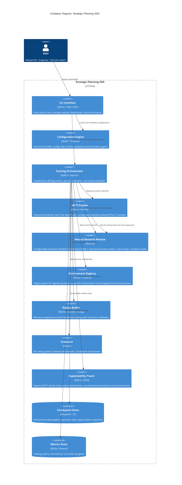
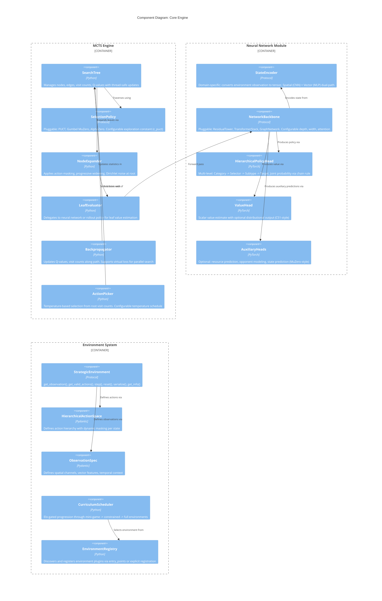

# Agentic Coding System Prompt Template: Strategic Planning SDK

> **Design Principle:** This template treats prompting as constraint programming, not instruction writing. Define the feasible region, objective function, and search parameters—then let the agent solve.
>
> **Origin:** Derived from the [Mango-Metrics-NLM/Civ6-AlphaZero](https://github.com/Mango-Metrics-NLM/Civ6-AlphaZero) project. The architecture generalizes AlphaZero-style hierarchical MCTS + neural network planning into a domain-agnostic strategic planning SDK applicable to logistics, energy management, policy modeling, healthcare, trading, and beyond.

-----

## SECTION 1: OBJECTIVE FUNCTION

### 1.1 System Intent

```
I am building: A domain-agnostic strategic planning SDK that generalizes
AlphaZero-style hierarchical MCTS with neural network policy/value estimation
into pluggable environments for multi-agent, partial-information, multi-horizon
decision-making across domains including (but not limited to) logistics, energy
grid management, climate policy simulation, healthcare decision support,
algorithmic trading, urban planning, and workforce optimization.
```

### 1.2 Success Criteria (Mechanically Verifiable)

```
This succeeds when:
- [ ] All unit tests pass: `pytest tests/unit -v --tb=short` exits 0
- [ ] All integration tests pass: `pytest tests/integration -v` exits 0
- [ ] All property-based tests pass: `pytest tests/property -v` exits 0
- [ ] Type checking passes: `mypy src/ --strict` exits 0
- [ ] Lint passes: `ruff check src/ tests/` exits 0
- [ ] Coverage >= 85% on core logic (mcts/, networks/, training/, environments/):
      `pytest --cov=src/core --cov-report=term-missing`
- [ ] Smoke test: `python -m src.cli health-check` completes in < 30s
- [ ] A mini-game environment trains for 10 iterations without error:
      `python -m src.cli train --env=mini_resource --iterations=10 --smoke`
- [ ] C4 architecture diagrams render correctly in Mermaid-compatible viewers
- [ ] All configuration is externalized (zero hardcoded values in src/)
- [ ] Logging output at DEBUG level produces actionable trace for any failure
- [ ] Plugin interface validated: a new environment can be registered and trained
      with zero modifications to core/
```

### 1.3 Problem Description (The "Three Paragraphs")

```
PARAGRAPH 1 — CORE COORDINATION LOGIC:
The system orchestrates a self-play reinforcement learning loop where an MCTS
engine, guided by a neural network (policy + value heads), generates training
data through simulated gameplay in pluggable environments. A hierarchical action
decomposition (Category -> Selector -> Subtype -> Target) handles combinatorial
action spaces. A curriculum scheduler progresses agents through mini-game
environments of increasing complexity before full environment training. Multiple
sub-agents coordinate: self-play actors generate trajectories, a learner
trains the network, an evaluator benchmarks against baselines, and an
explainability tracer exports decision trees for human review.

PARAGRAPH 2 — DATA FLOWS AND STATE:
Data flows from Environment -> State Encoder (spatial tensor + vector features)
-> Neural Network (residual tower + hierarchical policy heads + value head +
auxiliary heads) -> MCTS (selection -> expansion -> evaluation -> backup -> pick)
-> Action Decoder -> Environment. Training data (state, policy target, value
target) accumulates in a memory-mapped replay buffer. The parameter server
distributes network weights to self-play actors and collects gradient updates.
State includes: environment observations, MCTS tree statistics, replay buffer
contents, Elo ratings for checkpoints, curriculum progress, and training
metrics. All state is serializable for checkpoint/resume.

PARAGRAPH 3 — FAILURE MODES AND INVARIANTS:
Failure modes: actor crash (trajectory loss mitigated by WAL-style logging),
network divergence (monitored via auxiliary loss spikes, auto-rollback to
last stable checkpoint), environment deadlock (timeout + forced termination),
replay buffer corruption (checksum validation on read), curriculum regression
(Elo-gated promotion only). Invariants: (1) no hardcoded values in any module—
all parameters flow from configuration, (2) every public function has type
hints and a docstring, (3) every environment plugin satisfies the
StrategicEnvironment protocol, (4) MCTS tree statistics are numerically
consistent (visit counts sum correctly, Q-values bounded), (5) training
loss is monotonically non-increasing over 100-step windows (alert otherwise).
```

-----

## SECTION 2: FEASIBLE REGION (Constraints)

### 2.1 Hard Constraints (Violations = Failure)

```
LANGUAGE_AND_RUNTIME:
  - Python 3.11+ (required for TaskGroup, ExceptionGroup)
  - PyTorch 2.1+ (required for torch.compile)
  - CUDA 12.x support (with CPU fallback for CI)

REQUIRED_DEPENDENCIES:
  - pydantic >= 2.0 (configuration validation, serialization)
  - numpy >= 1.24 (tensor operations)
  - torch >= 2.1 (neural networks, torch.compile)
  - gymnasium >= 0.29 (environment interface compatibility)
  - structlog >= 23.0 (structured logging)
  - hydra-core >= 1.3 (hierarchical configuration)
  - rich >= 13.0 (terminal UI, progress bars)
  - pytest >= 7.4 (testing framework)
  - hypothesis >= 6.80 (property-based testing)

SECURITY:
  - No hardcoded secrets, API keys, file paths, or magic numbers
  - All user inputs validated via Pydantic before processing
  - Subprocess calls use explicit argument lists (no shell=True)
  - Pickle deserialization restricted to trusted checkpoint sources

COMPATIBILITY:
  - Must run on Linux (Ubuntu 22.04+), macOS (13+)
  - Must run on both x86_64 and ARM64 (Apple Silicon)
  - Must support single-GPU, multi-GPU, and CPU-only configurations
  - All environments must be serializable (for distributed self-play)

NO_HARDCODED_VALUES:
  - Every numeric threshold, path, hyperparameter, timeout, buffer size,
    learning rate, batch size, and architectural dimension MUST be
    sourced from configuration (Hydra YAML or environment variables)
  - Use typing.Final for true constants (e.g., MCTS_INF = float('inf'))
  - Use enums for categorical choices (e.g., ActionType, DeviceType)
```

### 2.2 Soft Constraints (Preferences)

```
CODE_STYLE:
  - Google Python Style Guide
  - Line length: 100 characters
  - Docstrings: Google style (Args, Returns, Raises, Examples)
  - Type hints: Required on all public functions, preferred on private

ARCHITECTURE:
  - Protocol-based interfaces (typing.Protocol) for all plugin points
  - Dataclasses / Pydantic models for configuration and state
  - Functional style for pure computations (MCTS logic, tensor ops)
  - Composition over inheritance everywhere
  - Dependency injection for all cross-cutting concerns (logging, metrics)

PERFORMANCE:
  - torch.compile() for network forward pass
  - Async I/O for checkpoint saving (don't block training)
  - Memory-mapped replay buffer (avoid RAM overflow)
  - Vectorized MCTS when possible (batch simulations)
  - Lazy imports for optional heavy dependencies

TESTING:
  - pytest with pytest-xdist for parallel execution
  - hypothesis for property-based testing of MCTS logic
  - Integration tests with lightweight mini-game environments
  - Smoke tests for training loop (1 iteration, small network)
  - Parameterized tests for all environment plugins
  - Coverage target: >= 85% for core logic

LOGGING:
  - structlog with JSON output for production, pretty-print for dev
  - Contextual logging: every log line includes environment_id, actor_id,
    iteration, step as bound context
  - Log levels: DEBUG=MCTS tree details, INFO=training progress,
    WARNING=performance anomalies, ERROR=recoverable failures,
    CRITICAL=invariant violations
  - Correlation IDs for distributed tracing across actors
```

### 2.3 Anti-Constraints (Explicit Freedoms)

```
You ARE explicitly permitted to:

ALGORITHM_CHOICES:
  - Choose specific MCTS tree traversal strategies (PUCT, Gumbel, etc.)
  - Implement additional auxiliary losses beyond the baseline
  - Add curriculum learning schedules not specified
  - Design custom reward shaping for sparse reward environments
  - Implement exploration bonuses (count-based, curiosity-driven, RND)
  - Choose between MuZero (learned model) and AlphaZero (given model)

ARCHITECTURE_DECISIONS:
  - Choose neural network backbone (ResNet, DenseNet, Transformer, GNN)
  - Add additional network heads (resource prediction, opponent modeling)
  - Implement action masking strategies for invalid moves
  - Design state encoding for domain-specific topologies (hex, graph, grid)
  - Choose LSTM/Transformer dimensions for temporal features
  - Select replay buffer strategy (uniform, prioritized, hindsight)

ENGINEERING_PRACTICES:
  - Refactor existing code for consistency
  - Add dependencies not explicitly listed (document in pyproject.toml)
  - Restructure file organization if it improves clarity
  - Create additional utility modules as needed
  - Choose between threading, multiprocessing, or asyncio for concurrency
  - Add pre-commit hooks, CI configs, Makefiles, or other tooling
```

-----

## SECTION 3: PERMISSION ARCHITECTURE

### 3.1 Scope (What You Can Touch)

```
IN SCOPE:
  - All files in src/
  - All files in tests/
  - Configuration files in configs/
  - Documentation in docs/
  - Project metadata: pyproject.toml, Makefile, .pre-commit-config.yaml
  - CLAUDE.md in project root
  - Architecture diagrams in docs/architecture/

OUT OF SCOPE:
  - .git/ directory
  - Any files marked with # DO NOT MODIFY
  - Production deployment configs (deploy/, k8s/, terraform/)
  - Third-party vendored code in vendor/
  - User data or checkpoint files in data/, checkpoints/
```

### 3.2 Autonomy Level

```
AUTONOMOUS (proceed without asking):
  - File creation/deletion within scope
  - Dependency installation via pip/uv
  - Running tests, linters, type checkers
  - Refactoring for consistency
  - Adding logging, error handling, type hints
  - Creating new test files
  - Updating CLAUDE.md

CONFIRM FIRST (ask before proceeding):
  - Architectural changes affecting > 5 modules
  - Breaking changes to StrategicEnvironment protocol
  - Deletions of > 200 lines of existing code
  - Adding new required (non-optional) dependencies
  - Changes to the training loop invariants
  - Modifications to the checkpoint format (backwards compatibility)

PROHIBITED (do not attempt):
  - Hardcoding any values that should be configurable
  - Writing code without corresponding tests
  - Ignoring type errors or lint warnings (fix them)
  - Using print() instead of structured logging
  - Committing directly to main branch
  - Disabling or skipping existing tests without documented reason
```

### 3.3 Resource Budget

```
- Max iterations before requesting guidance: 5
- Max files to modify in single pass: 25
- Time-boxed exploration: <= 10 min on research before asking
- Max test suite runtime target: < 5 min for unit tests, < 15 min for full suite
```

-----

## SECTION 4: C4 ARCHITECTURE

### 4.1 Level 1 — System Context Diagram



### 4.2 Level 2 — Container Diagram



### 4.3 Level 3 — Component Diagram (Core Engine)



### 4.4 Level 4 — Code Diagram (MCTS Search Step)

```mermaid
C4Code
    title Code Diagram: Single MCTS Search Iteration

    CodeElement(select, "select_leaf()", "Traverse tree from root using SelectionPolicy until reaching unexpanded node or terminal state")
    CodeElement(expand, "expand_node()", "Query StrategicEnvironment.get_valid_actions(), apply action mask, add child nodes with prior probabilities from policy head")
    CodeElement(evaluate, "evaluate_leaf()", "Run StateEncoder + NetworkBackbone + ValueHead forward pass. Returns value estimate v in [-1, 1]")
    CodeElement(backup, "backpropagate()", "Walk path root<-leaf, updating Q(s,a) = (N*Q + v)/(N+1), incrementing visit count N(s,a)")
    CodeElement(pick, "pick_action()", "At root: pi(a) = N(root,a)^(1/tau) / Sum N(root,b)^(1/tau) where tau is temperature from schedule")

    Rel(select, expand, "Returns leaf node")
    Rel(expand, evaluate, "New node created")
    Rel(evaluate, backup, "Value returned")
    Rel(backup, select, "Tree updated, repeat for num_simulations")
    Rel(backup, pick, "After all simulations complete")
```

-----

## SECTION 5: PROJECT STRUCTURE

### 5.1 Directory Layout

```
strategic-planning-sdk/
├── CLAUDE.md                          # Session memory (auto-maintained)
├── pyproject.toml                     # Project metadata, dependencies, tool configs
├── Makefile                           # Common commands (make test, make lint, etc.)
├── configs/                           # Hydra configuration hierarchy
│   ├── config.yaml                    # Root config (composes all groups)
│   ├── environment/                   # Environment-specific configs
│   │   ├── mini_resource.yaml         # Mini-game: resource management
│   │   ├── mini_combat.yaml           # Mini-game: unit combat
│   │   ├── mini_exploration.yaml      # Mini-game: exploration/expansion
│   │   ├── civ6_duel.yaml             # Full Civ6 duel environment
│   │   ├── logistics.yaml             # Supply chain environment
│   │   ├── energy_grid.yaml           # Energy management environment
│   │   ├── climate_policy.yaml        # Climate negotiation environment
│   │   └── _template.yaml             # Template for new environments
│   ├── network/                       # Neural network architecture configs
│   │   ├── resnet_small.yaml          # ResNet: 6 blocks, 64 filters
│   │   ├── resnet_large.yaml          # ResNet: 20 blocks, 256 filters
│   │   ├── transformer.yaml           # Transformer backbone
│   │   └── gnn.yaml                   # Graph neural network backbone
│   ├── mcts/                          # MCTS hyperparameter configs
│   │   ├── alphazero.yaml             # Classic AlphaZero PUCT
│   │   ├── gumbel_muzero.yaml         # Gumbel MuZero (sample efficient)
│   │   └── fast_search.yaml           # Reduced simulations for debugging
│   ├── training/                      # Training loop configs
│   │   ├── default.yaml               # Standard self-play training
│   │   ├── smoke.yaml                 # 1 iteration, tiny network (CI)
│   │   └── distributed.yaml           # Multi-GPU / multi-node
│   └── curriculum/                    # Curriculum progression configs
│       ├── default.yaml               # Mini-games -> constrained -> full
│       └── single_env.yaml            # Skip curriculum (single environment)
│
├── src/                               # Source code (no hardcoded values)
│   ├── __init__.py
│   ├── cli.py                         # Click-based CLI entry point
│   ├── core/                          # Domain-agnostic core engine
│   │   ├── __init__.py
│   │   ├── protocols.py               # All Protocol definitions
│   │   ├── types.py                   # Shared types, enums, TypeAliases
│   │   ├── config.py                  # Pydantic configuration models
│   │   ├── logging.py                 # structlog setup, correlation IDs
│   │   ├── exceptions.py              # Custom exception hierarchy
│   │   ├── mcts/                      # MCTS engine
│   │   │   ├── __init__.py
│   │   │   ├── tree.py                # SearchTree: nodes, edges, statistics
│   │   │   ├── selection.py           # SelectionPolicy implementations
│   │   │   ├── expansion.py           # NodeExpander with action masking
│   │   │   ├── evaluation.py          # LeafEvaluator (network or rollout)
│   │   │   ├── backpropagation.py     # Backpropagator with virtual loss
│   │   │   ├── action_picker.py       # Temperature-based action selection
│   │   │   └── search.py              # Orchestrates full MCTS search
│   │   ├── networks/                  # Neural network components
│   │   │   ├── __init__.py
│   │   │   ├── encoders.py            # StateEncoder implementations
│   │   │   ├── backbones.py           # ResidualTower, TransformerStack, etc.
│   │   │   ├── heads.py               # PolicyHead, ValueHead, AuxHeads
│   │   │   ├── model.py               # Full model assembly from config
│   │   │   └── utils.py               # Weight init, gradient clipping, etc.
│   │   ├── training/                  # Training loop components
│   │   │   ├── __init__.py
│   │   │   ├── self_play.py           # Self-play actor
│   │   │   ├── learner.py             # Network training loop
│   │   │   ├── evaluator.py           # Elo rating, baseline benchmarks
│   │   │   ├── replay_buffer.py       # Memory-mapped prioritized replay
│   │   │   ├── checkpoint.py          # Versioned save/load with migration
│   │   │   ├── curriculum.py          # CurriculumScheduler
│   │   │   └── orchestrator.py        # Coordinates all training components
│   │   └── explain/                   # Explainability and analysis
│   │       ├── __init__.py
│   │       ├── tracer.py              # MCTS decision trace exporter
│   │       ├── visualizer.py          # Tree visualization utilities
│   │       └── analyzer.py            # Strategy pattern analysis
│   │
│   ├── environments/                  # Domain-specific environment plugins
│   │   ├── __init__.py
│   │   ├── registry.py                # Environment discovery and registration
│   │   ├── base.py                    # Shared utilities for environments
│   │   ├── mini_games/                # Curriculum mini-game environments
│   │   │   ├── __init__.py
│   │   │   ├── resource_management.py # Resource allocation mini-game
│   │   │   ├── territory_control.py   # Territory expansion mini-game
│   │   │   └── tactical_combat.py     # Unit combat mini-game
│   │   ├── civ6/                      # Civilization VI environment
│   │   │   ├── __init__.py
│   │   │   ├── environment.py         # CivRealm integration
│   │   │   ├── encoder.py             # 84-channel spatial + 512-dim vector
│   │   │   └── action_decoder.py      # Hierarchical action mapping
│   │   ├── logistics/                 # Supply chain environment
│   │   │   ├── __init__.py
│   │   │   ├── environment.py         # Logistics simulation
│   │   │   ├── encoder.py             # Route/demand/capacity encoding
│   │   │   └── action_decoder.py      # Mode -> Route -> Load -> Destination
│   │   ├── energy/                    # Energy grid environment
│   │   │   ├── __init__.py
│   │   │   ├── environment.py         # Grid management simulation
│   │   │   ├── encoder.py             # Generation/demand/storage encoding
│   │   │   └── action_decoder.py      # Source -> Distribution -> Storage
│   │   └── climate_policy/            # Climate negotiation environment
│   │       ├── __init__.py
│   │       ├── environment.py         # Multi-agent policy simulation
│   │       ├── encoder.py             # Emissions/economy/policy encoding
│   │       └── action_decoder.py      # Policy -> Implementation -> Diplomacy
│   │
│   └── adapters/                      # External system adapters
│       ├── __init__.py
│       ├── mlflow_adapter.py          # Experiment tracking
│       ├── tensorboard_adapter.py     # Real-time metric visualization
│       └── distributed_adapter.py     # Multi-GPU / multi-node coordination
│
├── tests/                             # Full test suite
│   ├── conftest.py                    # Shared fixtures, test configuration
│   ├── factories.py                   # Test data factories (no hardcoded values)
│   ├── unit/                          # Fast, isolated unit tests
│   │   ├── core/
│   │   │   ├── mcts/
│   │   │   │   ├── test_tree.py
│   │   │   │   ├── test_selection.py
│   │   │   │   ├── test_expansion.py
│   │   │   │   ├── test_backpropagation.py
│   │   │   │   ├── test_action_picker.py
│   │   │   │   └── test_search.py
│   │   │   ├── networks/
│   │   │   │   ├── test_encoders.py
│   │   │   │   ├── test_backbones.py
│   │   │   │   ├── test_heads.py
│   │   │   │   └── test_model.py
│   │   │   ├── training/
│   │   │   │   ├── test_self_play.py
│   │   │   │   ├── test_learner.py
│   │   │   │   ├── test_evaluator.py
│   │   │   │   ├── test_replay_buffer.py
│   │   │   │   ├── test_checkpoint.py
│   │   │   │   └── test_curriculum.py
│   │   │   ├── test_config.py
│   │   │   └── test_logging.py
│   │   └── environments/
│   │       ├── test_registry.py
│   │       └── test_mini_games.py
│   ├── property/                      # Property-based tests (Hypothesis)
│   │   ├── test_mcts_invariants.py    # Visit count consistency, Q-value bounds
│   │   ├── test_action_space.py       # Action mask correctness
│   │   └── test_replay_buffer.py      # FIFO ordering, capacity limits
│   ├── integration/                   # Multi-component tests
│   │   ├── test_training_loop.py      # Full iteration: self-play -> train -> eval
│   │   ├── test_curriculum.py         # Mini-game -> promotion -> next stage
│   │   ├── test_checkpoint_cycle.py   # Save -> load -> resume -> verify identical
│   │   └── test_environment_plugins.py # All registered envs pass protocol checks
│   └── smoke/                         # Quick validation tests
│       └── test_health_check.py       # CLI health check, import validation
│
└── docs/                              # Documentation
    ├── architecture/                  # C4 diagrams (Mermaid source)
    │   ├── c4_context.mermaid
    │   ├── c4_container.mermaid
    │   ├── c4_component.mermaid
    │   └── c4_code.mermaid
    ├── environments/                  # Environment plugin guides
    │   ├── creating_environments.md
    │   └── environment_catalog.md
    ├── training/                      # Training guides
    │   ├── quick_start.md
    │   ├── curriculum_design.md
    │   └── distributed_training.md
    └── api/                           # Auto-generated API docs
        └── .gitkeep
```

-----

## SECTION 6: CORE PROTOCOLS AND INTERFACES

### 6.1 StrategicEnvironment Protocol

```python
"""Core protocol that ALL environment plugins must satisfy."""

from typing import Protocol, Any, runtime_checkable
from dataclasses import dataclass
import numpy as np
from numpy.typing import NDArray


@runtime_checkable
class StrategicEnvironment(Protocol):
    """Environment protocol for the Strategic Planning SDK.

    Every method is documented with its contract. Implementations MUST
    satisfy all postconditions. The test suite (test_environment_plugins.py)
    automatically validates protocol compliance for all registered environments.
    """

    @property
    def observation_spec(self) -> "ObservationSpec": ...

    @property
    def action_spec(self) -> "HierarchicalActionSpec": ...

    def reset(self, *, seed: int | None = None) -> NDArray[np.float32]:
        """Reset environment. Postconditions: get_valid_actions() >= 1, not is_terminal()."""
        ...

    def step(
        self, action: "HierarchicalAction"
    ) -> tuple[NDArray[np.float32], float, bool, bool, dict[str, Any]]:
        """Execute action. Returns (obs, reward, terminated, truncated, info). reward in [-1,1]."""
        ...

    def get_valid_actions(self) -> list["HierarchicalAction"]:
        """Non-empty list unless is_terminal(). All accepted by step()."""
        ...

    def get_observation(self) -> NDArray[np.float32]: ...
    def is_terminal(self) -> bool: ...
    def serialize(self) -> bytes: ...

    @classmethod
    def deserialize(cls, data: bytes, config: Any) -> "StrategicEnvironment": ...

    def get_symmetries(
        self, observation: NDArray[np.float32], policy: NDArray[np.float32]
    ) -> list[tuple[NDArray[np.float32], NDArray[np.float32]]]: ...
```

### 6.2 Key Configuration Models

```python
"""Configuration models — the ONLY source of truth for all parameters."""

from pydantic import BaseModel, Field
from enum import Enum


class DeviceType(str, Enum):
    CPU = "cpu"
    CUDA = "cuda"
    MPS = "mps"
    AUTO = "auto"

class SelectionPolicyType(str, Enum):
    PUCT = "puct"
    GUMBEL = "gumbel"
    ALPHAZERO = "alphazero"

class BackboneType(str, Enum):
    RESNET = "resnet"
    TRANSFORMER = "transformer"
    GNN = "gnn"


class MCTSConfig(BaseModel):
    num_simulations: int = Field(ge=1)
    c_puct: float = Field(gt=0)
    dirichlet_alpha: float = Field(gt=0)
    dirichlet_epsilon: float = Field(ge=0, le=1)
    temperature_schedule: dict[int, float]
    virtual_loss: float = Field(ge=0)
    progressive_widening_alpha: float = Field(gt=0)
    selection_policy: SelectionPolicyType = SelectionPolicyType.PUCT

class NetworkConfig(BaseModel):
    backbone_type: BackboneType = BackboneType.RESNET
    num_residual_blocks: int = Field(ge=1)
    num_filters: int = Field(ge=1)
    fc_hidden_dim: int = Field(ge=1)
    value_head_hidden_dim: int = Field(ge=1)
    policy_head_hidden_dim: int = Field(ge=1)
    use_attention: bool
    attention_heads: int = Field(ge=1)
    dropout_rate: float = Field(ge=0, lt=1)
    weight_init: str

class TrainingConfig(BaseModel):
    batch_size: int = Field(ge=1)
    learning_rate: float = Field(gt=0)
    lr_schedule: dict[int, float]
    weight_decay: float = Field(ge=0)
    max_iterations: int = Field(ge=1)
    games_per_iteration: int = Field(ge=1)
    replay_buffer_size: int = Field(ge=1)
    checkpoint_interval: int = Field(ge=1)
    eval_interval: int = Field(ge=1)
    eval_games: int = Field(ge=1)
    max_steps_per_game: int = Field(ge=1)
    num_actors: int = Field(ge=1)
    device: DeviceType = DeviceType.AUTO
    mixed_precision: bool
    compile_model: bool
    gradient_accumulation_steps: int = Field(ge=1)

class CurriculumStage(BaseModel):
    name: str
    environment: str
    min_iterations: int = Field(ge=0)
    max_iterations: int = Field(ge=1)
    baseline_type: str

class CurriculumConfig(BaseModel):
    stages: list[CurriculumStage]
    promotion_elo_threshold: float
    promotion_window: int = Field(ge=1)
    demotion_enabled: bool
    demotion_elo_threshold: float

class LoggingConfig(BaseModel):
    level: str
    format: str
    log_dir: str
    log_mcts_trees: bool
    log_gradient_norms: bool
    metrics_interval: int = Field(ge=1)
    correlation_id_enabled: bool

class SDKConfig(BaseModel):
    mcts: MCTSConfig
    network: NetworkConfig
    training: TrainingConfig
    curriculum: CurriculumConfig
    logging: LoggingConfig
    seed: int
    project_name: str
    output_dir: str
```

-----

## SECTION 7: LOGGING AND DEBUGGING FRAMEWORK

### 7.1 Structured Logging Architecture

```python
"""Every log line includes: timestamp, level, event, correlation_id, component,
plus bound context: environment_id, actor_id, iteration, step.

Usage:
    from src.core.logging import get_logger
    log = get_logger("mcts.search")
    log.info("search_complete", num_simulations=800, best_action="MOVE_UNIT_3")
"""

# Component-level log config in configs/logging.yaml:
#   mcts.tree: DEBUG
#   training.learner: INFO
#   environments: WARNING
#   explain.tracer: DEBUG
```

### 7.2 Debug Utilities (zero-cost in production)

- MCTS Tree Dump: full search tree to JSON
- Network Activation Maps: intermediate layer hooks
- Environment State Snapshots: auto-save before/after each step
- Action Mask Validator: cross-check mask vs get_valid_actions()
- Replay Buffer Inspector: buffer statistics
- Gradient Flow Analyzer: vanishing/exploding gradient detection
- Checkpoint Diff: parameter delta between two checkpoints

### 7.3 Metrics Collected

Training (per iteration): policy_loss, value_loss, auxiliary_loss, total_loss,
learning_rate, gradient_norm, replay_buffer_size.

Self-play (per game): game_length, outcome, total_reward, mean_mcts_depth,
mean_branching_factor.

Evaluation (per round): elo_rating, win_rate_vs_baseline, draw_rate.

Curriculum: current_stage, games_at_stage, promotion_events, demotion_events.

System: gpu_utilization, gpu_memory, throughput (games/hr, steps/sec).

-----

## SECTION 8: TESTING STRATEGY

See implementation plan (docs/strategic-planning-sdk-plan.md) Section 7
for the full testing strategy with test pyramid, property tests, and
protocol compliance framework.

-----

## SECTION 9: FEEDBACK LOOP SPECIFICATION

### 9.1 Verification Commands (in order)

```bash
1. ruff check src/ tests/
2. ruff format --check src/ tests/
3. mypy src/ --strict
4. pytest tests/unit -v --tb=short -x
5. pytest tests/property -v --tb=short
6. pytest tests/integration -v --tb=short
7. pytest tests/smoke -v
8. pytest --cov=src/core --cov-report=term-missing
```

### 9.2 Error Handling Protocol

```
ON LINT FAILURE:     ruff check --fix -> re-run from step 1
ON FORMAT FAILURE:   ruff format -> re-run from step 1
ON TYPE ERROR:       Fix annotations (prefer narrowing over # type: ignore) -> step 3
ON TEST FAILURE:     Read traceback, fix implementation, re-run isolated -> step 4
ON REPEATED FAILURE: Stop, produce diagnostic report, request guidance
ON COVERAGE BELOW:   Identify uncovered lines, add tests, re-run
```

-----

## SECTION 10: CONTEXT PERSISTENCE

### 10.1 SDK CLAUDE.md Template

```markdown
# CLAUDE.md — Strategic Planning SDK

## Build Commands
- `pip install -e ".[dev]"` — Install with dev dependencies
- `make install` — Full install with pre-commit hooks

## Test Commands
- `make test` — Full test suite
- `make test-unit` — Unit tests only (fast)
- `make test-property` — Property-based tests
- `make test-integration` — Integration tests
- `make test-smoke` — Smoke tests (CI)
- `make coverage` — Coverage report

## Lint/Format Commands
- `make lint` — Ruff check + mypy
- `make format` — Ruff format

## Training Commands
- `python -m src.cli train --config-name=config` — Default training
- `python -m src.cli train --env=mini_resource --iterations=10`
- `python -m src.cli train training=smoke` — Smoke test
- `python -m src.cli evaluate --checkpoint=path/to/ckpt`

## Environment Plugin Checklist
1. Create directory: src/environments/{name}/
2. Implement StrategicEnvironment protocol in environment.py
3. Implement StateEncoder in encoder.py
4. Implement action decoder in action_decoder.py
5. Add config: configs/environment/{name}.yaml
6. Register in src/environments/registry.py
7. Add tests: tests/unit/environments/test_{name}.py
8. Verify: pytest tests/integration/test_environment_plugins.py -k {name}
```

-----

## SECTION 11: EXECUTION PROTOCOL

### 11.1 Initial Actions

```
1. Read CLAUDE.md
2. Scan project structure
3. Read configs/config.yaml
4. Identify entry points: src/cli.py, src/core/training/orchestrator.py
5. Run smoke tests: make test-smoke
6. Check TODOs: grep -rn "TODO\|FIXME" src/
```

### 11.2 Implementation Order

```
UNDERSTAND -> CONFIGURE -> PROTOCOL -> IMPLEMENT -> LOG -> HANDLE -> TEST -> VERIFY -> REFACTOR -> DOCUMENT
```

### 11.3 Completion Checklist

```
[ ] All success criteria from Section 1.2 met
[ ] All verification commands from Section 9.1 pass
[ ] Zero hardcoded values in any src/ file
[ ] Every public function has type hints and Google-style docstring
[ ] Structured logging present in all components
[ ] Every new component has corresponding test file
[ ] CLAUDE.md updated
[ ] C4 diagrams updated if structure changed
[ ] Summary of changes with files changed, tests added, coverage delta
```

-----

## SECTION 12: DOMAIN EXPANSION REFERENCE

### 12.1 Environment Plugin Mapping (7 Domains)

| Research Domain | Environment Module | Civ6 Analogy | Action Hierarchy | Key Observation Channels |
|---|---|---|---|---|
| AI Strategy (Logistics) | `environments/logistics/` | Territory -> route optimization | Mode -> Route -> Load -> Destination | Network graph, demand, capacity, in-transit |
| Decision Models (Trading) | `environments/trading/` | Tech tree -> portfolio | Asset -> Instrument -> Order -> Size | Price series, positions, risk, order book |
| Human-AI (Education) | `environments/education/` | Strategy advisor -> tutor | Topic -> Scenario -> Decision -> Rationale | Student state, mastery, curriculum |
| Resource Mgmt (Energy) | `environments/energy/` | City resources -> grid | Source -> Distribution -> Storage -> Pricing | Generation, demand curve, storage, weather |
| Simulations (Military) | `environments/wargame/` | Unit combat -> tactics | Unit -> Movement -> Engagement -> Support | Terrain, force disposition, fog of war |
| Climate Policy | `environments/climate_policy/` | Diplomacy -> negotiation | Policy -> Implementation -> Diplomacy -> Trade | Emissions, GDP, temperature, commitments |
| AI Research (Benchmark) | `environments/mini_games/` | Curriculum mini-games | Varies | Varies |

### 12.2 Extension Points (What Domain Experts Implement)

```
1. StrategicEnvironment    — Game rules, state transitions, rewards
2. StateEncoder            — Domain observation -> tensor encoding
3. ActionDecoder           — Hierarchical action -> domain-specific command
4. RewardShaper (optional) — Domain-specific intermediate rewards
5. Symmetries (optional)   — Data augmentation via domain symmetries
6. Config YAML             — Domain-specific hyperparameters
```

-----

## APPENDIX A: MAKEFILE

```makefile
.PHONY: install test lint format clean
SRC_DIR := src
TEST_DIR := tests
COVERAGE_THRESHOLD := 85

install:
	pip install -e ".[dev]"
	pre-commit install
test: test-unit test-property test-integration
test-unit:
	pytest $(TEST_DIR)/unit -v --tb=short -x
test-property:
	pytest $(TEST_DIR)/property -v --tb=short
test-integration:
	pytest $(TEST_DIR)/integration -v --tb=short
test-smoke:
	pytest $(TEST_DIR)/smoke -v
coverage:
	pytest --cov=$(SRC_DIR)/core --cov-report=term-missing --cov-fail-under=$(COVERAGE_THRESHOLD)
lint:
	ruff check $(SRC_DIR) $(TEST_DIR)
	mypy $(SRC_DIR) --strict
format:
	ruff format $(SRC_DIR) $(TEST_DIR)
format-check:
	ruff format --check $(SRC_DIR) $(TEST_DIR)
verify: lint format-check test coverage
clean:
	find . -type d -name __pycache__ -exec rm -rf {} +
	rm -rf .pytest_cache .mypy_cache .ruff_cache htmlcov .coverage
health-check:
	python -m $(SRC_DIR).cli health-check
train-smoke:
	python -m $(SRC_DIR).cli train --config-name=config training=smoke
```

-----

## APPENDIX B: pyproject.toml TEMPLATE

```toml
[build-system]
requires = ["hatchling"]
build-backend = "hatchling.build"

[project]
name = "strategic-planning-sdk"
version = "0.1.0"
description = "Domain-agnostic strategic planning SDK: hierarchical MCTS + neural networks"
requires-python = ">=3.11"
dependencies = [
    "torch>=2.1",
    "numpy>=1.24",
    "pydantic>=2.0",
    "hydra-core>=1.3",
    "omegaconf>=2.3",
    "structlog>=23.0",
    "rich>=13.0",
    "click>=8.1",
    "gymnasium>=0.29",
]

[project.optional-dependencies]
dev = [
    "pytest>=7.4",
    "pytest-cov>=4.1",
    "pytest-xdist>=3.3",
    "hypothesis>=6.80",
    "mypy>=1.5",
    "ruff>=0.1",
    "pre-commit>=3.4",
]
adapters = ["mlflow>=2.7", "tensorboard>=2.14"]
environments = []

[project.scripts]
spsdk = "src.cli:main"

[tool.ruff]
line-length = 100
target-version = "py311"

[tool.ruff.lint]
select = ["E", "F", "I", "N", "W", "UP", "B", "SIM", "TCH"]

[tool.mypy]
python_version = "3.11"
strict = true

[tool.pytest.ini_options]
testpaths = ["tests"]
markers = ["slow", "gpu", "integration"]
addopts = "-ra --strict-markers"

[tool.coverage.run]
source = ["src"]
omit = ["src/adapters/*", "tests/*"]

[tool.coverage.report]
fail_under = 85
show_missing = true
```
